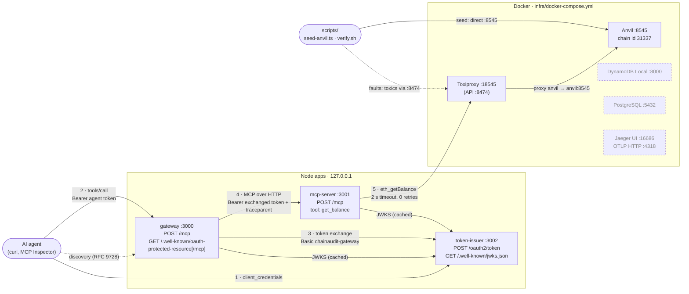
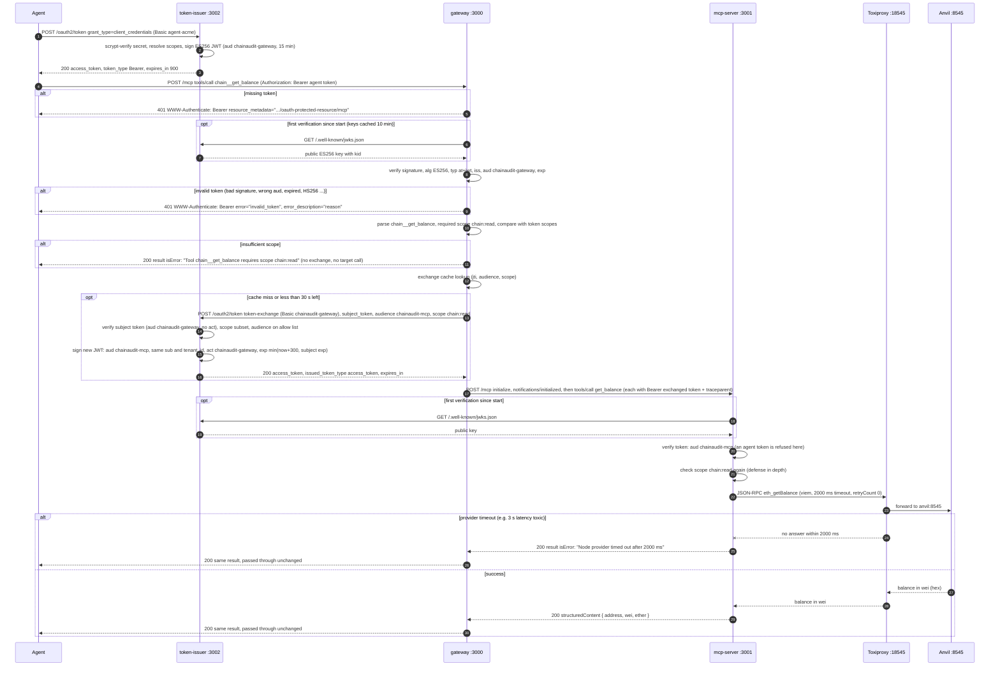
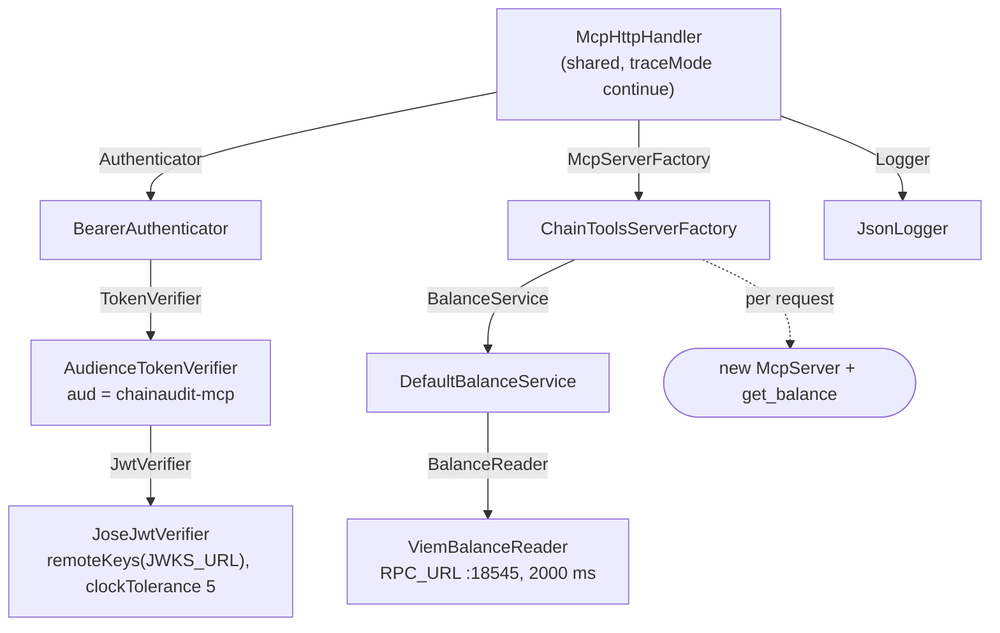
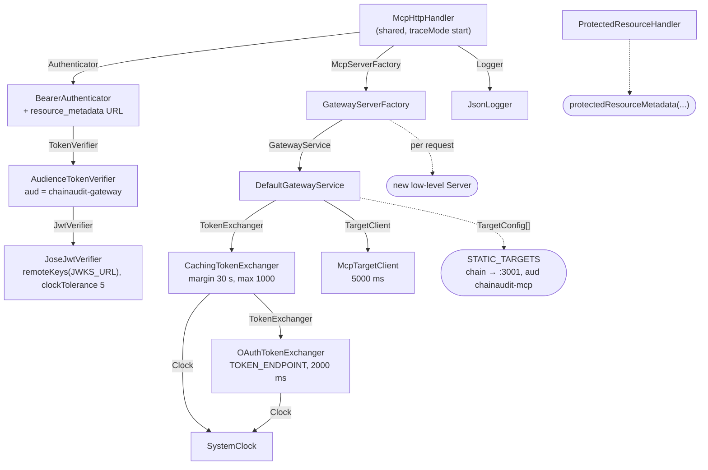
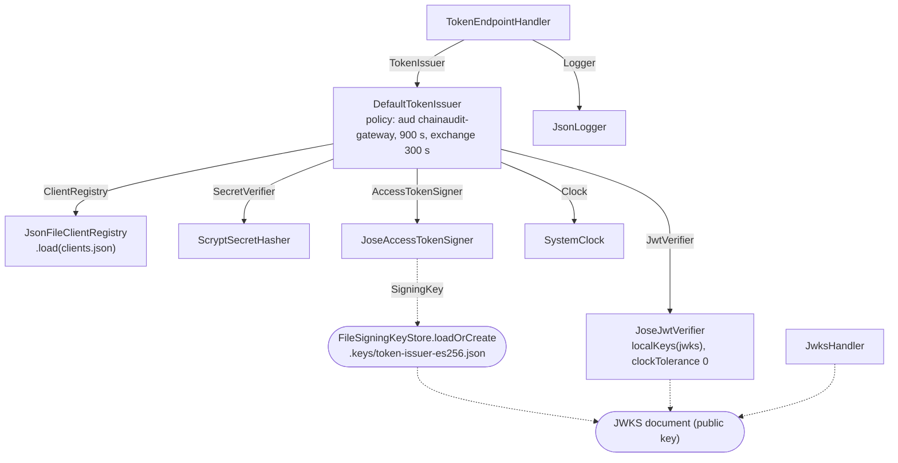

# 01 · Identity chain: from agent token to balance

What the code does today, as of commit `1cc958a` (after the constructor-injection refactor). Every diagram here was drawn from the source, not from `docs/rfc-001.md`. Where the two disagree, the code wins in the diagrams, and the differences are listed at the end (section 6).

## 1. Components

Three Node apps on `127.0.0.1` and five Docker services (`infra/docker-compose.yml`). Ports are the defaults in each app's `config.ts`.

Dashed boxes are running but **not called by any app yet**. Nothing reads DynamoDB or PostgreSQL, and nothing exports spans to Jaeger.

## 2. One `tools/call` for `get_balance`

Agent `agent-acme`, tool `chain__get_balance`, address of Anvil account #1.

**Which code performs each step** (numbers match the diagram):

1. Agent request → `src/apps/token-issuer/main.ts` route `POST /oauth2/token` → `TokenEndpointHandler.handle` (`src/apps/token-issuer/token-endpoint-handler.ts`), which runs `parseBasicAuth`.
2. Secret check, scopes, signing → `DefaultTokenIssuer.issue` → `clientCredentials` (`src/core/issuer/token-issuer.ts`), using `ScryptSecretHasher.verify` (`src/adapters/local/scrypt-secret-hasher.ts`), `resolveScopes`, and `JoseAccessTokenSigner.sign` (`src/adapters/local/jose-access-token-signer.ts`).
3. Token response → `toHttp` in `token-endpoint-handler.ts` (adds `Cache-Control: no-store`).
4. MCP request in → `src/apps/gateway/main.ts` route `POST /mcp` → `McpHttpHandler.handle` (`src/apps/shared/mcp-http-handler.ts`, `traceMode: 'start'` creates a new `trace_id`).
5. Missing token → `BearerAuthenticator.authenticate` returns `unauthorized(...)` with `resource_metadata` (`src/apps/shared/bearer-auth.ts`).
6. JWKS fetch → `JoseJwtVerifier.remoteKeys` / jose `createRemoteJWKSet` (`src/adapters/local/jose-jwt-verifier.ts`) → issuer `JwksHandler.handle` (`src/apps/token-issuer/jwks-handler.ts`).
7. Public key returned → `JwksHandler.handle` (`Cache-Control: public, max-age=300`).
8. Token verification → `AudienceTokenVerifier.verify` (`src/core/auth/audience-token-verifier.ts`) → `JoseJwtVerifier.verify` (jose `jwtVerify`, `algorithms: ['ES256']`, `typ: 'at+jwt'`).
9. Invalid token → `toDomainError` in `jose-jwt-verifier.ts` maps it to `InvalidTokenError(reason)`, and `BearerAuthenticator.authenticate` builds the 401.
10. Scope check → `GatewayServerFactory.create` (`src/apps/gateway/gateway-server-factory.ts`) → `DefaultGatewayService.callTool` (`src/core/gateway/gateway-service.ts`), using `parseNamespacedName`, `requiredScope` and `missingScope` (`src/core/gateway/catalog.ts`).
11. Insufficient scope → `toolError(...)` in `gateway-service.ts`.
12. Cache lookup → `DefaultGatewayService.tokenFor` → `CachingTokenExchanger.exchange` / `isFresh` (`src/core/auth/caching-token-exchanger.ts`).
13. Exchange request → `OAuthTokenExchanger.exchange` (`src/adapters/local/oauth-token-exchanger.ts`, `fetch` with a 2000 ms `AbortSignal.timeout`).
14. Subject verification and checks → `DefaultTokenIssuer.issue` → `tokenExchange` → `verifySubject` (`src/core/issuer/token-issuer.ts`), using `JoseJwtVerifier.verify` with `localKeys` and `clockTolerance: 0`.
15. New token signed → `tokenExchange`, using `JoseAccessTokenSigner.sign` (`expiresAt = Math.min(...)`).
16. Exchanged token returned → `toHttp` in `token-endpoint-handler.ts`, then `OAuthTokenExchanger.exchange` parses it with zod.
17. Calls to the MCP server → `McpTargetClient.callTool` / `withClient` (`src/adapters/local/mcp-target-client.ts`, SDK `Client.connect` + `callTool`, 5000 ms at the request and fetch level).
18. JWKS fetch from the MCP server → same as step 6, built in `src/apps/mcp-server/main.ts`.
19. Public key returned → same as step 7.
20. MCP server verification → `McpHttpHandler.handle` (`traceMode: 'continue'`) → `BearerAuthenticator.authenticate` → `AudienceTokenVerifier.verify` (aud `chainaudit-mcp`).
21. Second scope check → the `get_balance` callback in `ChainToolsServerFactory.create` (`src/apps/mcp-server/chain-tools-server-factory.ts`), using `missingScope` and `TOOL_SCOPES`.
22. RPC call → `DefaultBalanceService.getBalance` (`src/core/balance/balance-service.ts`) → `ViemBalanceReader.getBalance` (`src/adapters/local/viem-balance-reader.ts`).
23. Proxying → Toxiproxy proxy `anvil` from `infra/toxiproxy/toxiproxy.json` (`0.0.0.0:18545` → `anvil:8545`).
24. Timeout → viem `TimeoutError` → `ViemBalanceReader.toDomainError` → `ProviderTimeoutError` (`src/core/errors.ts`).
25. Timeout as a tool result → `toToolError` in `chain-tools-server-factory.ts`.
26. Timeout result passed through → `DefaultGatewayService.callTool` returns the target's result unchanged.
27. Success: Anvil answers → Anvil.
28. Success: through the proxy → Toxiproxy.
29. Success: tool result → `DefaultBalanceService.getBalance` (`formatEther` from `src/core/units.ts`), then the `get_balance` callback returns `structuredContent`.
30. Success result passed through → `DefaultGatewayService.callTool` → `GatewayServerFactory` → SDK transport (`enableJsonResponse: true`).

## 3. Dependency trees (as wired in each `main.ts`)

Each arrow means *class → the port it depends on (edge label) → the concrete adapter `main.ts` passes in*. Dotted arrows are plain data or config values, not ports.

### mcp-server · `src/apps/mcp-server/main.ts`

### gateway · `src/apps/gateway/main.ts`

### token-issuer · `src/apps/token-issuer/main.ts`

## 4. Agent token vs. exchanged token

Values for `agent-acme` from `src/apps/token-issuer/clients.json` and the config defaults. Both tokens have the header `{ alg: ES256, kid: <RFC 7638 thumbprint>, typ: at+jwt }` and a fresh `jti`.

| Claim | Agent token (client credentials) | Exchanged token (RFC 8693) | Set in |
| --- | --- | --- | --- |
| `iss` | `http://localhost:3002` | `http://localhost:3002` (same issuer) | `JoseAccessTokenSigner.sign` (`ISSUER_URL`) |
| `aud` | `chainaudit-gateway` (`TOKEN_AUDIENCE`) | `chainaudit-mcp`: the requested audience, which must be on the gateway client's `allowed_audiences` | `clientCredentials` / `tokenExchange` |
| `sub` | `agent-acme` (the client id) | `agent-acme`, copied from the subject token, **not** the gateway | same |
| `tenant_id` | `acme`, from `clients.json` | `acme`, copied from the subject token | same |
| `scope` | The requested scopes if all are allowed; all allowed scopes if none are requested (e.g. `chain:read recon:read recon:write`) | Exactly what the gateway asked for: the one scope the tool needs (`chain:read`). It must be a subset of the subject's scopes, otherwise `invalid_scope` | `resolveScopes` / `requested.every(...)` |
| `act` | absent | `{ sub: "chainaudit-gateway" }`: who is acting for the agent | `tokenExchange` (`actor: client.client_id`) |
| `exp` | `iat + 900` (15 min, `TOKEN_TTL_SECONDS`) | `min(iat + 300, subject exp)` (5 min, never longer than the agent token) | `clientCredentials` / `tokenExchange` |

Who accepts which token:
- **The gateway** accepts only `aud = chainaudit-gateway`.
- **The MCP server** accepts only `aud = chainaudit-mcp`.
- **The issuer** exchanges a subject token only if its `aud` equals the exchanging client's `subject_audience` and it has no `act`. So an exchanged token can't be exchanged again.

## 5. Questions this diagram answers

**Why doesn't the gateway just forward the agent's token to the MCP server?**
That token's `aud` is `chainaudit-gateway`, and the MCP server only accepts `chainaudit-mcp`. To accept it, the MCP server would have to trust tokens addressed to someone else. Then any service that ever saw an agent token could replay it (token passthrough, confused deputy). The gateway exchanges it instead for a 5-minute token addressed to that one target, carrying the agent's `sub` and `tenant_id` and recording itself in `act`.

**The gateway already checks the scope, so why does the MCP server check it again?**
Each hop owns its policy. A gateway bug, a new route, or a token obtained by another path would otherwise reach the tool unchecked. The exchanged token carries only the scope the gateway asked for, and the MCP server checks that scope again in the `get_balance` callback before touching the provider.

**How does the MCP server know the tenant, and why can't an agent fake it?**
`tenant_id` comes only from verified token claims: the issuer copies it from the agent's verified token into the exchanged token, and `JoseJwtVerifier` turns it into `Principal.tenantId`. Tool arguments carry only the address. Changing `tenant_id` in a token would break its ES256 signature, and only the issuer holds the private key.

**What happens when the node provider hangs, and why are the timeouts 2 s and 5 s?**
viem gives up after 2000 ms with no retries, the adapter maps that to `ProviderTimeoutError`, and the tool returns `isError: "Node provider timed out after 2000 ms"`. The gateway passes that through. The gateway's own timeout to the target is 5000 ms, deliberately longer, so the target can report a clear provider timeout before the gateway would have to fall back to a generic "Target chain is unavailable".

**Why cache exchanged tokens, and what keeps the cache safe?**
Without the cache, every tool call would cost an extra round trip to the issuer. The key is the agent token's `jti` plus the audience plus the scope set, so a token is never shared between callers or reused for a wider scope. Entries stop being used 30 s before expiry, to allow for clock skew and time in flight. The cache is capped at 1000 entries with expired entries swept, so it can't grow without bound.

## 6. Code vs. `rfc-001.md`: differences

What the code does today versus what the RFC describes. Some are planned for later tasks; none are hidden in the diagrams above.

1. **Runtime.** The RFC puts the MCP server on Lambda behind AgentCore Gateway, with Cognito issuing tokens. The code runs three local Express apps, and the gateway and issuer are this repo's own stand-ins (planned; Sunday's AWS step).
2. **Tools.** The RFC lists five tools. The code exposes only `get_balance`, and the gateway's scope map (`STATIC_TARGETS`) knows only that one.
3. **`get_balance` degradation.** The RFC says it "falls back to last known value" with `stale_as_of`. The code returns `isError: "Node provider unavailable"` or the timeout message, and stores nothing.
4. **Resilience.** The RFC specifies:
   - retries (max 2, with jitter),
   - a circuit breaker per `tenant_id + target_id`,
   - a bulkhead,
   - a timeout "capped by the caller's remaining deadline".

   The code has a fixed 2 s timeout with `retryCount: 0`, no breaker, no bulkhead and no deadline propagation (planned: Saturday item 5).
5. **Registry and isolation.** The RFC says targets come from a DynamoDB tenant registry, with HTTPS-only URL validation, DNS rebinding checks, per-tenant quotas and Secrets Manager credentials. The code uses a static list with `http://127.0.0.1:3001/mcp`, which the RFC's own registration rules would reject. Targets are the same for every tenant, and DynamoDB is running but unused (planned: task 5).
6. **Target to node provider.** The RFC says each call uses "the tenant's own API key from Secrets Manager". The code uses one shared `RPC_URL` with no credential.
7. **Tracing.** The RFC says OpenTelemetry context goes through Lambda, SQS and relay messages to Jaeger. The code only propagates a W3C `traceparent` header (gateway → MCP server) and logs `trace_id`. There is no OTel SDK and no spans; Jaeger receives nothing.
8. **Log fields.** The RFC requires `trace_id`, `tenant_id`, `target_id` and `correlation_id`. `correlation_id` doesn't exist, and `target_id` appears only on the gateway's target lines.
9. **Rate limiting.** The RFC's token bucket per tenant and agent client isn't implemented anywhere.
10. **Audience format.** The RFC says audience = gateway. The code uses the logical string `chainaudit-gateway`, while the MCP authorization spec (RFC 8707) expects the server's canonical URI (`http://localhost:3000/mcp`). Proposed in task 4a; not yet in the RFC's "What changed" section.
11. **Token exchange details beyond the RFC.** The code adds:
    - an `act` claim;
    - exchange restricted to the subject token's audience;
    - an allow list of audiences per actor;
    - no re-exchange of delegated tokens;
    - exchanged `exp` capped at the subject's `exp`.

    Proposed in task 4b; not yet in the RFC's "What changed" section, which also lacks the entry "Cognito lacks RFC 8693 token exchange".
12. **Verification beyond the RFC.** The RFC's inbound authorizer checks issuer, audience and expiry. The code also pins `alg: ES256` and requires `typ: at+jwt` (RFC 9068) and the claims `sub`, `iat`, `jti`, `tenant_id` and `scope`.
13. **Cost of one call.** Not in the RFC: each gateway → target call opens a new MCP client, so one `tools/call` costs about four HTTP requests to the MCP server. Those are `initialize`, `notifications/initialized`, a `GET` answered with 405, and `tools/call`. Each one is authenticated.
14. **Domain database.** The RFC has the MCP server reading PostgreSQL (engagements, transactions). PostgreSQL is running but no code connects to it yet (planned: Sunday morning).
