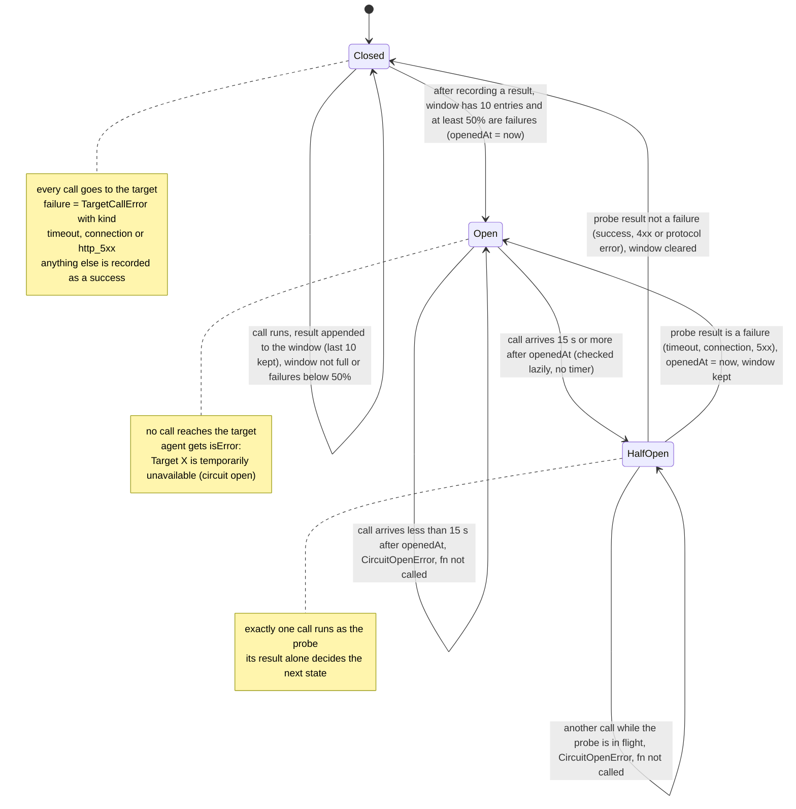
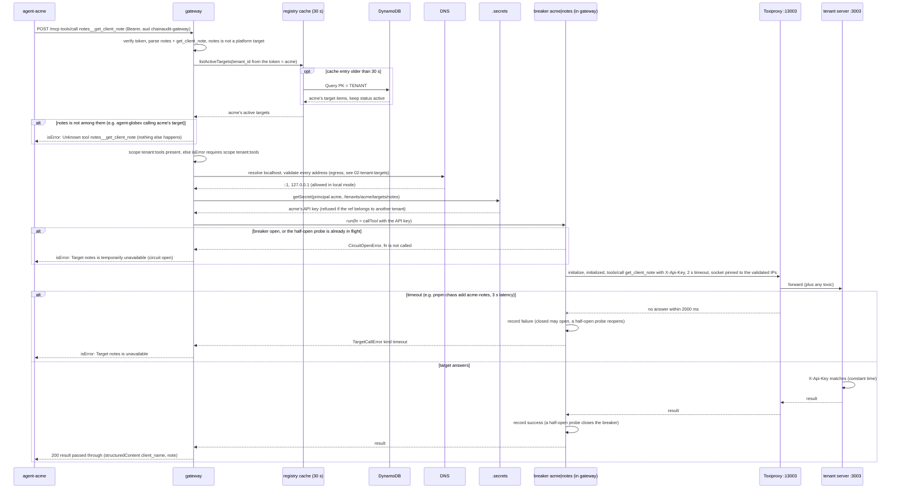
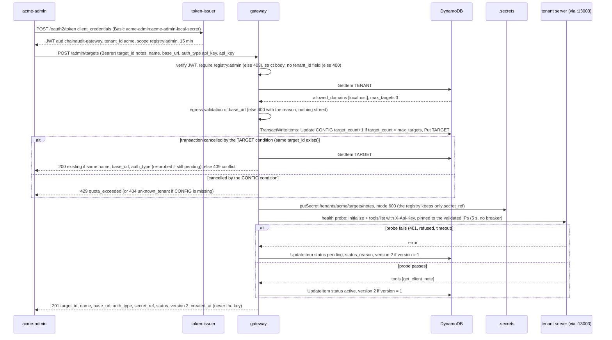

# 02 · Registry and resilience

Drawn from the code at commit `0ae1470` (task 6), not from `docs/rfc-001.md`. Where they disagree, the differences are listed at the end (section 4). Companion to `02-tenant-targets.md`, which covers egress validation and the DynamoDB key design in more depth.

Defaults come from `src/apps/gateway/config.ts`: `BREAKER_WINDOW=10`, `BREAKER_FAILURE_RATE=0.5`, `BREAKER_OPEN_SECONDS=15`, `TENANT_TARGET_TIMEOUT_MS=2000`, `TARGET_TIMEOUT_MS=5000` (platform targets).

## 1. Circuit breaker state machine

`CircuitBreaker` in `src/core/resilience/circuit-breaker.ts`. There is one instance per `tenant_id|target_id`, created on first use by `CircuitBreakers.run` (`src/core/resilience/circuit-breakers.ts`) and kept in memory in the gateway process.

What a call does in each state (`CircuitBreaker.run`):

| State | On entry to `run` | `fn` (the target call) | Afterwards (`record`) |
| --- | --- | --- | --- |
| Closed | nothing | runs | pushes `failed = isTargetFailure(err)` (or `false` on success) into the window, trims it to 10, and opens if the window is full and failures ≥ 50% |
| Open | if 15 s have passed, moves to HalfOpen and continues as below; otherwise throws `CircuitOpenError` | not called | — |
| HalfOpen | if a probe is already running (`probing`), throws `CircuitOpenError`; otherwise this call becomes the probe | runs once | a failure goes to Open with a new `openedAt`; anything else goes to Closed with an empty window |

- **Every transition is logged**, through the request's logger: `{"level":"warn","msg":"circuit breaker transition","trace_id":…,"tenant_id":"acme","target_id":"notes","from":"closed","to":"open","failures":…,"calls":…}`.
- **Failure classification** is `isTargetFailure` in `src/core/errors.ts`, over the `kind` that `toTargetCallError` sets in `src/adapters/local/mcp-target-client.ts`:
  - `timeout`: the SDK request timeout, or `AbortSignal.timeout`;
  - `connection`: `ECONNREFUSED`, `ENOTFOUND`, a fetch `TypeError` with a cause;
  - `http_5xx`.
- **Not failures:** `http_4xx` (including 401/403), `protocol`, and a tool's own `isError` result, because the call itself succeeded.

## 2. `tools/call` to a tenant-owned target

`agent-acme` calls `notes__get_client_note`. acme's `notes` target is registered at `http://localhost:13003/mcp`, which is the Toxiproxy proxy `acme-notes` in front of the sample server on :3003.

Where each part lives:
- **Entry:** `McpHttpHandler.handle` (`src/apps/shared/mcp-http-handler.ts`) → `GatewayServerFactory.create` → `DefaultGatewayService.callTool` (`src/core/gateway/gateway-service.ts`).
- **Registry lookup:**
  - `tenantTargetsOf` → `CachingTenantTargetReader.listActiveTargets` (`src/core/registry/caching-target-reader.ts`);
  - on a miss, `DynamoDbTenantRegistry.listActiveTargets` (`src/adapters/aws/dynamodb-tenant-registry.ts`).
- **Tenant check:** there's no separate comparison. The list is fetched with the caller's `tenantId`, so another tenant's targets are never in it.
- **Scope check:** `missingScope(principal, TENANT_TOOLS_SCOPE)` (`src/core/gateway/catalog.ts`).
- **Egress:** `egressFor` → `DefaultEgressValidator.validate` → `NodeDnsResolver.resolve`.
- **Credential:** `tenantCredential` → `FileCredentialProvider.getSecret` → `pathFor` (`src/adapters/local/file-credential-provider.ts`).
- **Breaker:** `this.breakers.run(tenantId, targetId, logger, fn)` → `CircuitBreakers.run` → `CircuitBreaker.run`.
- **Call:** `McpTargetClient.callTool` → `withClient`:
  - `X-Api-Key` comes from `credentialHeader`;
  - the timeout is `context.timeoutMs`, 2000 ms;
  - `pinnedAgent` builds the connection pinned to the validated IPs.
- **Error mapping:** `toTargetCallError`; then `callTool`'s `catch` returns `circuitOpen(...)` or `Target notes is unavailable`.

`tools/list` takes the same route: `listTenantTools` also runs inside `breakers.run`. When the breaker is open, that target's tools drop out of the catalog (the rejected promise is logged as `target list failed`).

## 3. Registering a target

A tenant admin registers `notes`. The body is `{ target_id, name, base_url: http://localhost:13003/mcp, auth_type: api_key, api_key }`.

Where each part lives:
- **Token:** `DefaultTokenIssuer.clientCredentials` (`src/core/issuer/token-issuer.ts`), with client `acme-admin` in `src/apps/token-issuer/clients.json`.
- **Admin route:** `POST /admin/targets` in `src/apps/gateway/main.ts` → `RegisterTargetHandler.handle` (`src/apps/gateway/register-target-handler.ts`: `missingScope(..., 'registry:admin')`, `bodySchema.strict()`, `toHttp`, `view`).
- **Logic:** `DefaultTargetRegistrar.register` and `probe` (`src/core/registry/target-registrar.ts`).
- **Conditional write:** `DynamoDbTenantRegistry.createTarget` (`TransactWriteCommand`, outcome decided from `CancellationReasons`).
- **Pending → active:** `DynamoDbTenantRegistry.updateTargetStatus` (`ConditionExpression: 'version = :expected'`, `version + 1`). On a version conflict the registrar re-reads and returns the stored item.
- **Probe:** `McpTargetClient.listTools`, called directly by the registrar. It does **not** pass through the circuit breaker, and it uses the client's default 5 s timeout, not the 2 s tenant timeout.

## 4. Code vs. `rfc-001.md`

1. **Breaker parameters.** RFC: last 20 calls, 30 s cooldown, 3 probes in half-open. Code: last 10, 15 s, 1 probe (task 6 minimal). The "What changed" line for this is proposed but not yet approved.
2. **Where breaker state lives.** RFC: in memory per instance, plus a DynamoDB write on each transition so new instances start informed. Code: in memory only; a new or restarted gateway starts every breaker closed.
3. **"Open: calls fail immediately without touching the target."** That holds for the target, but before the breaker check the gateway still does the cached registry read, the scope check, a DNS resolution and a secret file read. An open breaker saves the target call and its timeout, not that local work.
4. **Timeout.** RFC: 2 s, capped by the caller's remaining deadline. Code: a fixed 2 s for tenant targets and 5 s for platform targets, with no deadline propagation. The registration probe uses 5 s.
5. **Not built** (out of scope for task 6):
   - retries with jitter;
   - the bulkhead per tenant;
   - degradation (`stale_as_of`);
   - measuring target failures separately for SLOs;
   - quotas beyond max targets (already recorded in the RFC).
6. **What counts as a failure.** The RFC doesn't define it. The code counts timeouts, connection errors and 5xx, and records 4xx, protocol errors and tool `isError` results as successes. A half-open probe that gets a 401 therefore closes the breaker.
7. **Breaker scope.** The RFC keys breakers by `tenant_id + target_id`, and the code does the same for tenant targets. It also does it for **platform** targets (`acme|chain`, `globex|chain`), so one tenant's traffic can't open the platform breaker for another tenant.
8. **Credentials.** RFC: Secrets Manager with the ARN in DynamoDB, isolated by IAM ABAC. Code: one local file per secret with `secret_ref` as a path, isolated by a code-level tenant check (the intended local stand-in).
9. **Registration API.** The RFC describes the steps but not the interface. The code has `POST /admin/targets`, scope `registry:admin`, `.strict()` body validation, idempotency on `target_id` (200 or 409), and 429 on quota. A failed probe leaves the target `pending` with a `status_reason`; nothing re-probes it automatically, and there's no API to set `disabled`.
10. **Egress in local mode.** RFC: HTTPS only. Code: plain `http` to loopback or private addresses when `APP_ENV=local` and `EGRESS_ALLOW_PRIVATE_NETWORKS=true` (see `02-tenant-targets.md`).

## 5. Questions this diagram answers

**Why one breaker per tenant and target instead of one per target?**
The failure might be caused by one tenant: their key was revoked, their traffic hit a rate limit, or their own server is down. A shared breaker would let acme's failures block globex. Keyed by `tenant_id|target_id`, acme's open breaker for `notes` changes nothing for globex's `ledger`, nor for acme's own platform tool `chain__get_balance`.

**Why doesn't a 401 count as a failure?**
A 401 or 403 means the target is up and answered; the request was wrong (a bad key, missing permission). Opening the breaker wouldn't give an unhealthy target time to recover. It would only hide a configuration problem behind "circuit open". Timeouts, connection errors and 5xx are the signals that the target itself is unhealthy.

**What happens to traffic right after the 15 seconds, and why only one probe?**
The first call after the cooldown moves the breaker to half-open and becomes the probe; every other call is still rejected until the probe finishes. If the target is still broken, only that one call waits for the 2 s timeout. If it has recovered, one success closes the breaker and clears the window. Letting all waiting traffic through at once could knock a recovering target over again.

**Two admins register the same target at the same moment. What happens?**
Both send a `TransactWriteItems` whose `Put` has `attribute_not_exists(SK)`. DynamoDB applies exactly one; the other is cancelled with the TARGET condition and gets the existing item (200, or 409 if the definitions differ). The same transaction increments `target_count` only while it's below `max_targets`, so the quota can't be overshot by the race either.

**The gateway runs on many Lambda instances. Is the breaker still useful?**
Each instance has its own breaker and its own window, so a failing target is detected separately on each instance, and a fresh instance starts closed. It still caps the damage: each instance stops calling the target after at most 10 calls. The RFC's fix is to share state only on transitions (a DynamoDB write when a breaker opens), which reacts faster across instances without adding a write per request. That isn't built yet.
