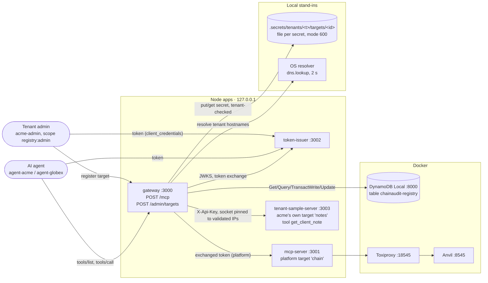
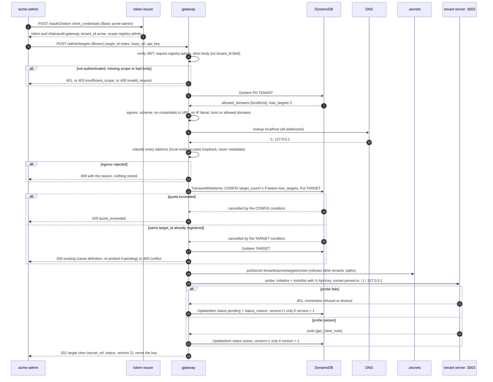
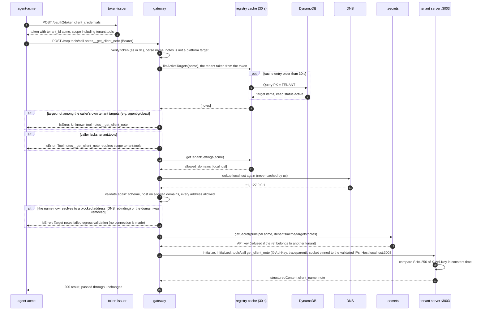
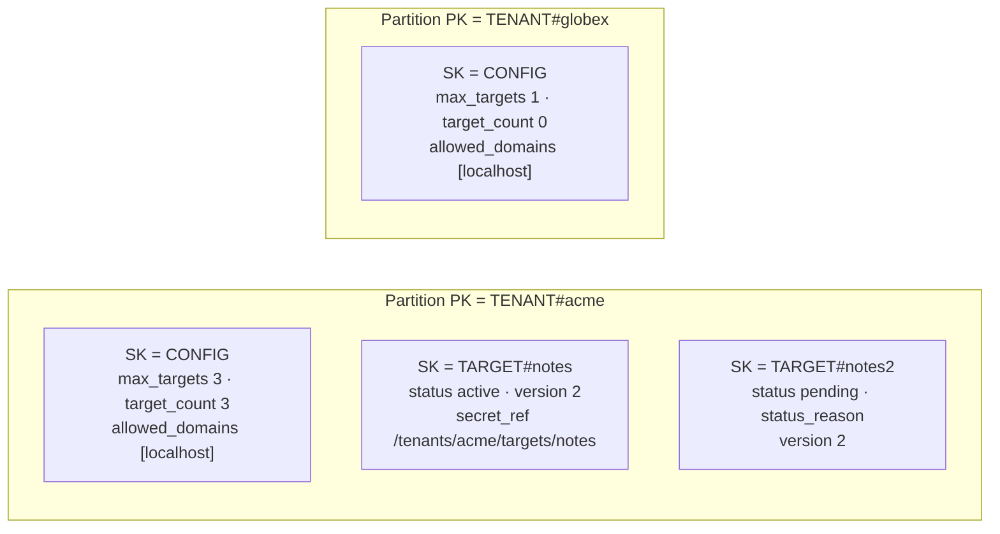
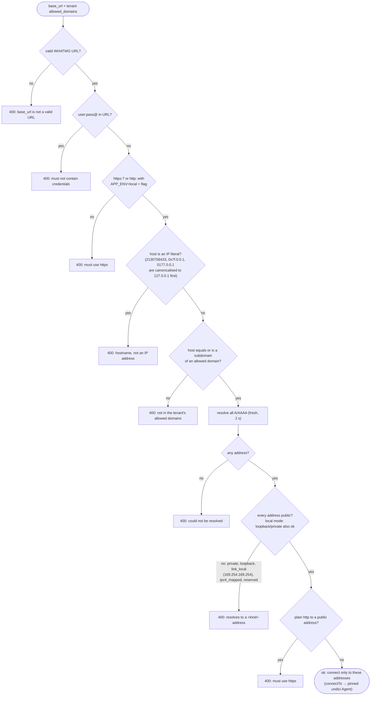
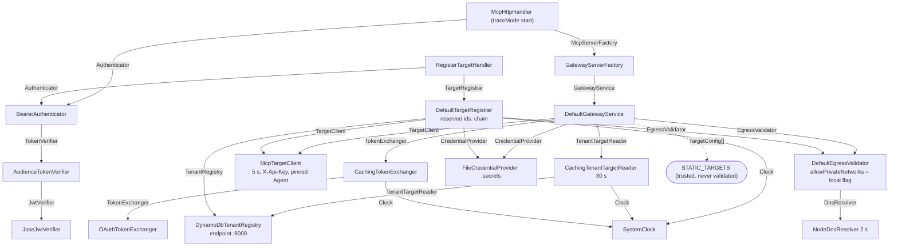

# 02 · Tenant targets: registry, credentials and egress

What the code does after tasks 5a and 5b, drawn from the source, not from `docs/rfc-001.md`. This picks up where `01-identity-chain.md` stops; 01 is a snapshot and is not updated. Where the code and the RFC disagree, the differences are listed at the end (section 8).

A **tenant target** is an MCP server that a tenant (an audit firm) runs itself and registers with the gateway. It is a third party: the gateway validates where it lives, keeps its credential apart, and only routes that tenant's agents to it.

## 1. Components

Ports are the defaults from each app's `config.ts`. `gateway:dev` runs with `APP_ENV=local EGRESS_ALLOW_PRIVATE_NETWORKS=true`.

## 2. A tenant admin registers a target

`POST /admin/targets` with `{ target_id: notes, name, base_url: http://localhost:3003/mcp, auth_type: api_key, api_key }`.

**Which code performs each step:**

1. Token request → issuer `TokenEndpointHandler.handle` → `DefaultTokenIssuer.issue` (see diagram 01).
2. Token returned → `DefaultTokenIssuer.clientCredentials` (`acme-admin` in `src/apps/token-issuer/clients.json`).
3. Admin request in → `src/apps/gateway/main.ts` route `POST /admin/targets` → `RegisterTargetHandler.handle` (`src/apps/gateway/register-target-handler.ts`).
4. Authentication, scope and body → `BearerAuthenticator.authenticate`, `missingScope(caller, 'registry:admin')`, and `bodySchema` (zod `.strict()`) in `register-target-handler.ts`.
5. Rejected → `RegisterTargetHandler.handle` / `badRequest`.
6. Settings read → `DefaultTargetRegistrar.register` (`src/core/registry/target-registrar.ts`) → `DynamoDbTenantRegistry.getTenantSettings` (`src/adapters/aws/dynamodb-tenant-registry.ts`).
7. Settings returned → `getTenantSettings`.
8. URL checks → `DefaultEgressValidator.validate` (`src/core/egress/egress-validator.ts`), using `isIpLiteralHost` (`src/core/egress/ip-ranges.ts`) and `isAllowedDomain`.
9. DNS → `NodeDnsResolver.resolve` (`src/adapters/local/node-dns-resolver.ts`: `dns.lookup`, `all: true`, 2 s race).
10. Addresses returned → `NodeDnsResolver.resolve`.
11. Address check → `classifyIp` in `ip-ranges.ts`; `allowPrivateNetworks` comes from `parseConfig` (`src/apps/gateway/config.ts`).
12. Egress rejected → `register` returns `{ kind: 'invalid', reason }`, and `toHttp` maps it to 400.
13. Atomic create → `DynamoDbTenantRegistry.createTarget` (`TransactWriteCommand` with two conditions).
14. Quota condition failed → `createTarget` reads `CancellationReasons`.
15. 429 → `toHttp` (`quota_exceeded`).
16. Duplicate condition failed → `createTarget` returns `'duplicate'`.
17. Existing item → `DynamoDbTenantRegistry.getTarget`, compared with `sameDefinition` in `target-registrar.ts`.
18. 200 or 409 → `toHttp` (`existing` / `conflict`).
19. Secret stored → `FileCredentialProvider.putSecret` → `pathFor` (`src/adapters/local/file-credential-provider.ts`, using `tenantOfSecretRef` in `src/core/registry/secret-ref.ts`).
20. Probe → `DefaultTargetRegistrar.probe` → `McpTargetClient.listTools` / `withClient` / `pinnedAgent` (`src/adapters/local/mcp-target-client.ts`). The key goes in `X-Api-Key`.
21. Probe failure → `toTargetCallError` in `mcp-target-client.ts` (safe reasons only).
22. Pending recorded → `DynamoDbTenantRegistry.updateTargetStatus` (`ConditionExpression: version = :expected`).
23. Probe success → `ApiKeyGuard.allows` + `ClientNotesServerFactory.create` on the tenant server (`src/apps/tenant-sample-server/`).
24. Active recorded → `updateTargetStatus`.
25. Response → `view()` in `register-target-handler.ts`, which has no field for the key.

## 3. An agent calls a tenant tool

`agent-acme` (scopes `chain:read recon:read recon:write tenant:tools`) calls `notes__get_client_note`.

**Which code performs each step:**

1. Token request → `DefaultTokenIssuer.clientCredentials` (`tenant:tools` added to agents in `clients.json`).
2. Token returned → same.
3. MCP request → `McpHttpHandler.handle` (`src/apps/shared/mcp-http-handler.ts`) → `GatewayServerFactory.create` → `DefaultGatewayService.callTool` (`src/core/gateway/gateway-service.ts`).
4. Platform or tenant → `parseNamespacedName`, then `this.platformTargets.find(...)` misses, so the tenant path is taken.
5. Tenant targets → `DefaultGatewayService.tenantTargetsOf` → `CachingTenantTargetReader.listActiveTargets` (`src/core/registry/caching-target-reader.ts`).
6. Cache miss → `TtlCache.get` → `DynamoDbTenantRegistry.listActiveTargets` (`QueryCommand`, paginated).
7. Items → `listActiveTargets` filters on `status === 'active'`.
8. List returned → `CachingTenantTargetReader`.
9. Not found → `callTool` returns `Unknown tool`. A target id that isn't in the caller's own list can't be told apart from one that doesn't exist.
10. Scope → `missingScope(principal, TENANT_TOOLS_SCOPE)` (`src/core/gateway/catalog.ts`).
11. Settings → `DefaultGatewayService.egressFor` → `CachingTenantTargetReader.getTenantSettings`.
12. Settings returned → same, cached 30 s.
13. Fresh DNS → `DefaultEgressValidator.validate` → `NodeDnsResolver.resolve`.
14. Addresses → same.
15. Re-validation → `validate` / `classifyIp`. On success it logs `egress validated` with `connect_to`.
16. Rebinding stopped → `egressFor` returns `undefined`, and `callTool` returns the error before any connection.
17. Credential → `DefaultGatewayService.tenantCredential` → `FileCredentialProvider.getSecret` → `pathFor`.
18. Key returned → same, or `CredentialAccessDeniedError` (`src/core/errors.ts`).
19. Pinned call → `McpTargetClient.callTool` → `withClient`. `connectTo` builds `pinnedAgent` (undici `Agent` with `connect.lookup`), and `undici.fetch` uses it as `dispatcher`. `credentialHeader` sets `X-Api-Key`.
20. Key check → `NotesHttpHandler.handle` → `ApiKeyGuard.allows` (`src/apps/tenant-sample-server/`).
21. Result → `ClientNotesServerFactory.create`, the `get_client_note` callback.
22. Passed through → `DefaultGatewayService.callTool` → `GatewayServerFactory` → SDK transport.

## 4. DynamoDB key design

One table, `chainaudit-registry`, with `PK` (hash) and `SK` (range), on-demand billing and no indexes (`scripts/setup-dynamodb.ts`). Every item of a tenant lives in that tenant's partition.

| Need | Operation (all use the key, never Scan) | Code |
| --- | --- | --- |
| Tenant settings | `GetItem(PK=TENANT#t, SK=CONFIG)` | `getTenantSettings` |
| One target | `GetItem(PK=TENANT#t, SK=TARGET#id)` | `getTarget` |
| The tenant's targets | `Query(PK=TENANT#t AND begins_with(SK,'TARGET#'))`, then `status = active` | `listActiveTargets` |
| Register (quota + idempotency) | `TransactWriteItems`: `Update CONFIG` if `target_count < max_targets`, plus `Put TARGET#id` if `attribute_not_exists(SK)` | `createTarget` |
| Change status | `Update TARGET#id`, `version = version + 1` if `version = :expected` | `updateTargetStatus` |
| Onboard or refresh a tenant | `Update CONFIG SET max_targets, allowed_domains, target_count = if_not_exists(...)` | `scripts/setup-dynamodb.ts` |

The item holds `secret_ref`, which is a pointer. The key itself only exists in `.secrets/`.

## 5. Egress validation, step by step

`DefaultEgressValidator.validate(url, allowedDomains)`. It runs at registration (and on every re-probe) and **again before every tenant call**. Platform targets from `STATIC_TARGETS` never pass through it.

Blocked ranges (`src/core/egress/ip-ranges.ts`):
- **IPv4:** `0/8`, `10/8`, `100.64/10`, `127/8`, `169.254/16`, `172.16/12`, `192.0.0/24`, `192.0.2/24`, `192.168/16`, `198.18/15`, `198.51.100/24`, `203.0.113/24`, `224/4`, `240/4`.
- **IPv6:** `::`, `::1`, `::ffff:0:0/96`, `::/96`, `64:ff9b::/96`, `100::/64`, `2001::/32`, `2001:db8::/32`, `2002::/16`, `fc00::/7`, `fe80::/10`, `fec0::/10`, `ff00::/8`.

Anything unparseable counts as reserved (fail closed).

## 6. Gateway dependency tree (`src/apps/gateway/main.ts`)

The parts that are new since diagram 01 are the registry, credentials, egress and admin handler.

## 7. Questions this diagram answers

**Why validate the URL again on every call, and why connect to the IP you validated instead of just the URL?**
DNS answers can change between registration and use, or even between our check and the HTTP client's own lookup: an attacker's DNS answers a public IP first and `10.0.0.5` a second later (DNS rebinding). The gateway resolves once, checks every address, and gives the HTTP client a lookup that can only return those addresses. The URL keeps the hostname, so `Host` and TLS still use the registered name.

**`http://2130706433/` looks harmless. Why is it blocked, and how?**
It's `127.0.0.1` written as one decimal number. `0x7f.0.0.1` and `0177.0.0.1` are the same address too, and naive string filters such as "starts with 127." miss all of them. The WHATWG URL parser canonicalises them to `127.0.0.1`, the validator then refuses any IP literal as host, and the resolved addresses of a real name are classified as numbers, not strings.

**Why does the quota use a transaction instead of counting targets and then writing?**
Count-then-write races: two registrations at 2 of 3 both see room, and both write. `TransactWriteItems` puts the counter increment (conditioned on `target_count < max_targets`) and the target put (conditioned on `attribute_not_exists(SK)`) in one atomic step. The cancellation reasons then say whether it failed on the quota or because the target already exists.

**Why does a tenant target get an API key, and what stops one tenant from using another's?**
The target is a third party. A token from our issuer, exchanged or not, would let it call our platform as the agent. Routing only ever reads the caller's own partition (`TENANT#<tenant from the token>`), so another tenant's target id is simply "Unknown tool". The credential store also refuses any `secret_ref` whose tenant segment differs from the caller's. In AWS that check moves to IAM (session tags, ABAC), which code can't bypass.

**What does the 30-second registry cache cost, and why aren't DNS and credentials cached as well?**
A target disabled in DynamoDB can stay callable for up to 30 s on each gateway instance, and a new one appears up to 30 s late. That's the price of removing a DynamoDB read from almost every request. DNS is resolved fresh because the rebinding defence depends on it, and credentials are read fresh so that a rotated key applies on the next call.

## 8. Code vs. `rfc-001.md`: differences

1. **Credential store.** The RFC uses Secrets Manager, tagged with `tenant_id`, with DynamoDB storing the ARN, and isolation by IAM ABAC with STS session tags. The code uses one local file per secret, with `secret_ref` as a path. Isolation is a code-level check in `FileCredentialProvider`, which is weaker (see the `// LEARN:` there). The local stand-in is intended.
2. **HTTPS only.** The RFC says HTTPS only. The code also accepts `http:`, but only when `APP_ENV=local` and `EGRESS_ALLOW_PRIVATE_NETWORKS=true`, and only for loopback or private addresses. Production never reads the flag.
3. **Blocked ranges.** The RFC lists private, loopback, link-local and 169.254.169.254. The code also blocks carrier-grade NAT, documentation and benchmark ranges, multicast, reserved, NAT64, 6to4, Teredo, IPv4-mapped and IPv4-compatible IPv6, and any IP literal as host.
4. **"Connect to the checked IP."** The RFC states the goal, not how to reach it. Node's global `fetch` can't choose the IP, so the code uses `undici`'s `Agent` with `connect.lookup` and `undici.fetch` as the MCP transport's custom `fetch`. That's the new dependency `undici@7.30.0`.
5. **Auth types.** The RFC: "auth type and credential". The code supports only `api_key`, sent as `X-Api-Key`.
6. **Health probe.** The RFC: "becomes active after a health probe succeeds". The code adds that a failed probe stays `pending` with `status_reason`, that re-registering the same definition re-probes, that there is no periodic re-probe, and that there is no API to disable a target, although the `disabled` status exists.
7. **Allowed domains** are managed only by `scripts/setup-dynamodb.ts`. There's no admin API for them, and the RFC doesn't say who manages them.
8. **Registry caching** (30 s, no cross-instance invalidation) isn't in the RFC.
9. **Idempotency records** (RFC domain model: `tenant_id + idempotency_key` in DynamoDB) aren't implemented. Registration is idempotent by `target_id` instead.
10. **Quotas.** Only max targets exists, which is already recorded in the RFC's "What changed" section. Requests per minute and concurrent calls aren't implemented.
11. **Gateway to tenant target** uses the tenant's API key, not token exchange. This is already recorded in the RFC's "What changed" section.
