# 03 · End-to-end flows, with names

A snapshot drawn from the code after task 6 (commit `0ae1470`, plus the guide). Every name, port, log line and response text is taken from the source. Design-only parts are dashed and labelled. Earlier snapshots (01, 02) stay as they were.

**Cast**

| Name | Role | Where it lives |
| --- | --- | --- |
| **Caseware** | Platform operator ("we"). Runs everything in `src/apps` except the tenant sample servers | gateway :3000, token-issuer :3002, mcp-server :3001, DynamoDB :8000, `.secrets/`, `.keys/` |
| **acme** | Audit firm, Caseware customer, tenant `acme` | `TENANT#acme` partition, clients `agent-acme` and `acme-admin`, its own server `notes` (:3003 via Toxiproxy :13003) |
| **globex** | Another audit firm, tenant `globex` | `TENANT#globex`, clients `agent-globex` and `globex-admin`, its own server `ledger` (:3004) |
| **Northwind Ltd** | acme's audit client (data, not a user) | A wallet on Anvil (illustrated by account #1, `0x7099…79C8`), a note in acme's `notes` server |
| **agent-acme** | acme's AI agent | `clients.json`: scopes `chain:read recon:read recon:write tenant:tools` |
| **acme-admin** | acme's administrator | `clients.json`: scope `registry:admin` |
| **chainaudit-gateway** | The gateway's own OAuth client | Token exchange only, audiences `[chainaudit-mcp]` |

Contents:

1. Who's who and where everything runs
2. Startup and wiring
3. Caseware onboards a tenant
4. Token issuance, every branch
5. Token exchange inside the issuer
6. Inside the gateway, one request
7. agent-acme lists its tools
8. agent-acme reads Northwind's wallet balance
9. agent-acme reads acme's note about Northwind
10. acme-admin registers `notes`
11. The life of a registry item
12. Isolation scenarios
13. A DNS rebinding attack
14. The breaker during the chaos demo
15. Error map
16. Northwind's reconciliation (design only)

---

## 1. Who's who and where everything runs

**What you're looking at:** three organisational layers and every running process, with its port, and who owns it. The right-hand column shows the AWS services each piece stands in for (design only, dashed).

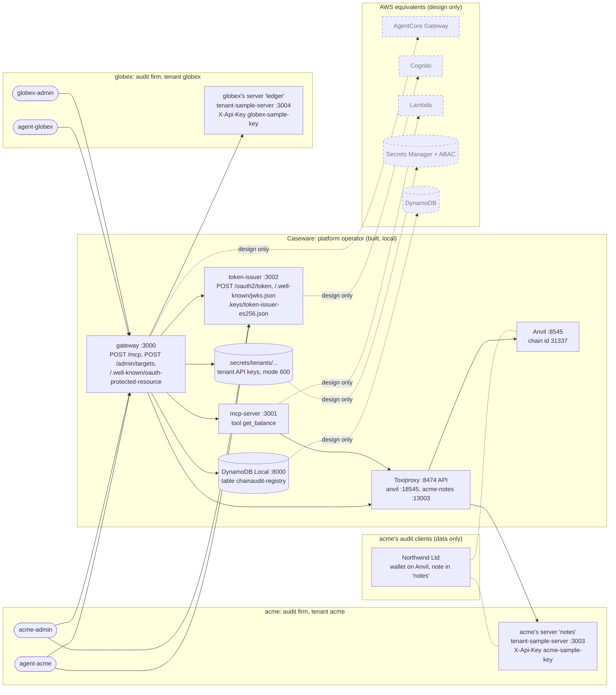

- **Caseware's** box holds everything the operator runs. acme and globex never touch DynamoDB, `.secrets/` or the issuer's keys directly.
- **acme's** and **globex's** boxes hold their identities (OAuth clients defined in `src/apps/token-issuer/clients.json`) and the servers they run themselves.
- **Northwind** has no identity in the system. It shows up only as data: a wallet address and a note.

---

## 2. Startup and wiring

**What you're looking at:** the commands in order (all from `package.json`), what each composition root (`main.ts`) does when it starts, and the line it prints.

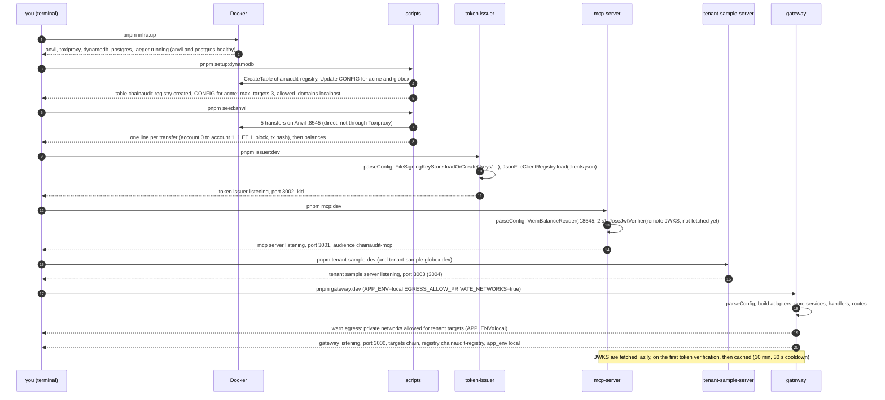

1. `pnpm infra:up` runs `docker compose -f infra/docker-compose.yml up -d`.
2. Five containers start. Healthchecks: `pg_isready` and `cast block-number`. `pnpm infra:ps` shows the status.
3. `pnpm setup:dynamodb` runs `scripts/setup-dynamodb.ts`.
4. `CreateTableCommand` (PK/SK, on demand), then `UpdateCommand` per tenant `CONFIG` (`target_count` initialised, never reset).
5. Its console output. DynamoDB Local is in memory, so this is rerun after every `infra:up`.
6. `pnpm seed:anvil` runs `scripts/seed-anvil.ts`, using Anvil's public dev mnemonic.
7. Five `sendTransaction` calls, waiting for each receipt.
8. Tx hashes and final balances. Anvil is in memory too.
9. `pnpm issuer:dev` runs `src/apps/token-issuer/main.ts`.
10. If the key file is missing it generates ES256 and writes it with mode 0600. `clients.json` is validated with zod, and a bad file stops startup.
11. Log line `token issuer listening` (with `kid`).
12. `pnpm mcp:dev` runs `src/apps/mcp-server/main.ts`.
13. Adapters, `DefaultBalanceService`, `AudienceTokenVerifier(aud chainaudit-mcp)`, `ChainToolsServerFactory`, `McpHttpHandler(traceMode continue)`.
14. Log line `mcp server listening`.
15. `pnpm tenant-sample:dev` / `tenant-sample-globex:dev` run `src/apps/tenant-sample-server/main.ts` with `SAMPLE_PORT` and `SAMPLE_API_KEY`.
16. Log line `tenant sample server listening`.
17. `pnpm gateway:dev` runs `src/apps/gateway/main.ts`. The env flags come from the script.
18. The wiring order is in the file's numbered comments: config → adapters → core → driving side → routes.
19. Printed only when local mode is on. In production the flag is never read.
20. Log line `gateway listening`.

---

## 3. Caseware onboards a tenant

**What you're looking at:** what Caseware (the operator) does so a new audit firm can use the platform. Today it's all manual. Dashed steps are what a production onboarding API would do (design only).

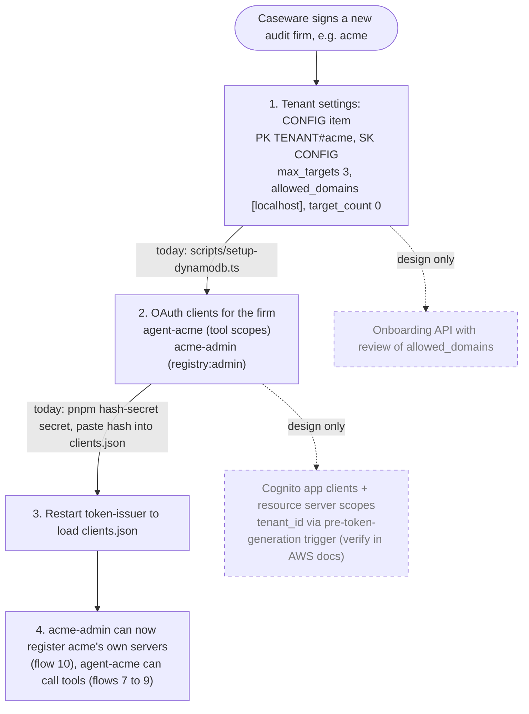

- `scripts/setup-dynamodb.ts` holds the tenant list in code: acme with `max_targets 3` and globex with `max_targets 1`, both with `allowed_domains [localhost]`.
- `scripts/hash-secret.ts` prints `scrypt$17$8$1$<salt>$<hash>` via `ScryptSecretHasher.hash`.
- `clients.json` is loaded once at startup (`JsonFileClientRegistry.load`).

---

## 4. Token issuance, every branch

**What you're looking at:** agent-acme asking for a token, and every answer the issuer can give.

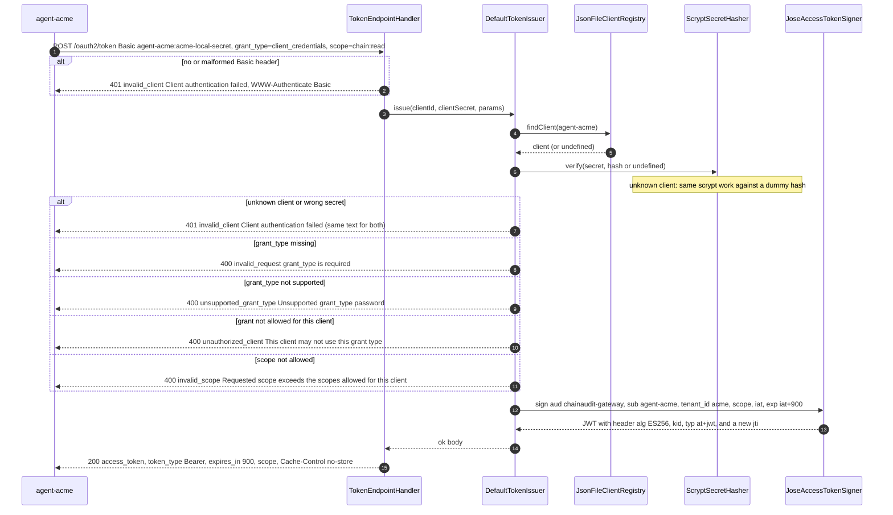

1. The `src/apps/token-issuer/main.ts` route (`express.urlencoded`) → `TokenEndpointHandler.handle`.
2. `parseBasicAuth` (form-decoding per RFC 6749 §2.3.1) fails → `oauthError(401, 'invalid_client', …, BASIC_CHALLENGE)`.
3. `DefaultTokenIssuer.issue` (`src/core/issuer/token-issuer.ts`).
4. `JsonFileClientRegistry.findClient`.
5. Returns the client or `undefined`.
6. `ScryptSecretHasher.verify` (`timingSafeEqual`; `DUMMY_HASH` when the client is unknown).
7. `INVALID_CLIENT` → `toHttp` → 401 + `WWW-Authenticate Basic`. Logged as `token denied`, `reason invalid_client`.
8. `fail('invalid_request', 'grant_type is required')`.
9. `fail('unsupported_grant_type', …)`.
10. `fail('unauthorized_client', …)`, logged as `token denied`.
11. `clientCredentials` → `resolveScopes` returns undefined → `fail('invalid_scope', …)`. No scope requested means all allowed scopes.
12. `JoseAccessTokenSigner.sign`, with `exp = issuedAt + TOKEN_TTL_SECONDS (900)`.
13. The JWT, signed with the key from `.keys/`, with a `jti` from `randomUUID`.
14. Log line `token issued` with `jti`, `scope`, `expires_in`, `client_id`, `tenant_id`.
15. `toHttp` → 200 with `Cache-Control no-store` and `Pragma no-cache`.

---

## 5. Token exchange inside the issuer

**What you're looking at:** the gateway trading agent-acme's token for one addressed to the MCP server, with every check in order. Each refusal is a 400 with the `error` shown.

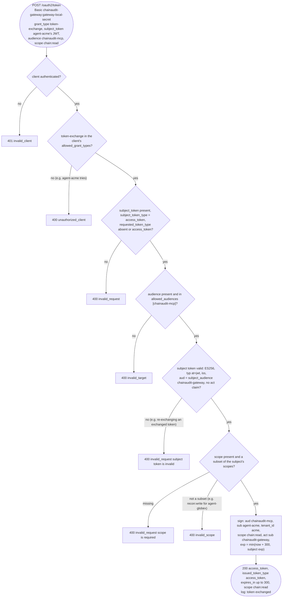

- `DefaultTokenIssuer.issue` handles the grant checks; `tokenExchange` and `verifySubject` (`src/core/issuer/token-issuer.ts`) do the rest.
- Subject tokens are verified with the issuer's own keys: `JoseJwtVerifier.localKeys`, `clockTolerance 0`.
- Refusals are logged as `token exchange denied` with `reason invalid_target | invalid_subject_token | invalid_scope`.
- The caller is `OAuthTokenExchanger.exchange` (`src/adapters/local/oauth-token-exchanger.ts`, 2 s timeout), behind `CachingTokenExchanger` (key `jti|audience|scopes`, reused until 30 s before expiry).

---

## 6. Inside the gateway, one request

**What you're looking at:** the classes one `POST /mcp` passes through in `src/apps/gateway`, and every point where a response leaves.

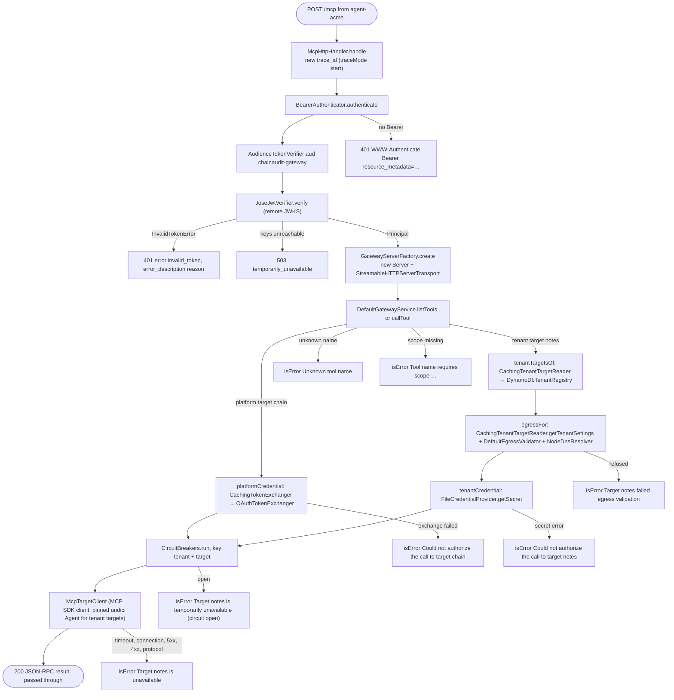

All `isError` results come back as HTTP **200** with a JSON-RPC `result`: the protocol worked and the tool failed. Every request logs one `mcp request` line with `trace_id`, `tenant_id`, `sub`, `rpc_method`, `tool`, `status` and `duration_ms` (`McpHttpHandler`, on `res close`).

---

## 7. agent-acme lists its tools

**What you're looking at:** `tools/list` merging what agent-acme may use from Caseware's platform target and from acme's own target, both in parallel (`Promise.allSettled`).

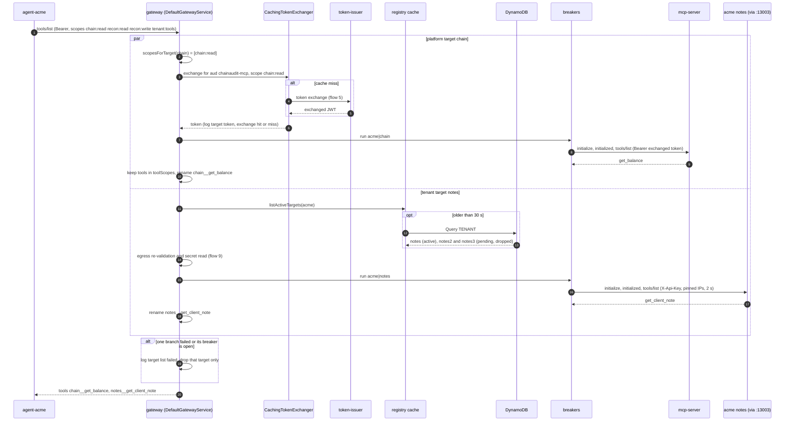

1. `McpHttpHandler` → `GatewayServerFactory` (`ListToolsRequestSchema`) → `DefaultGatewayService.listTools`.
2. `scopesForTarget` (`src/core/gateway/catalog.ts`). No scope in common means the target isn't called at all.
3. `platformCredential` → `CachingTokenExchanger.exchange`.
4. `OAuthTokenExchanger.exchange` → flow 5.
5. The exchanged token.
6. Log line `target token` with `target_id chain`, `exchange hit|miss`, `scope chain:read`.
7. `CircuitBreakers.run('acme', 'chain', …)`.
8. `McpTargetClient.listTools` (5 s timeout).
9. The MCP server's tools.
10. `isToolVisible` + `namespacedName`. Default deny: a tool missing from `toolScopes` is dropped.
11. `ownTenantTargets`, only if the caller has `tenant:tools`.
12. `CachingTenantTargetReader` → `DynamoDbTenantRegistry.listActiveTargets`.
13. Only `status active` is kept.
14. `listTenantTools` → `egressFor` + `tenantCredential`.
15. `CircuitBreakers.run('acme', 'notes', …)`.
16. `McpTargetClient.listTools` with `connectTo`, `timeoutMs 2000`.
17. The tenant's tools.
18. Every tenant tool is namespaced; there's no per-tool scope map for tenant targets.
19. One failing target never hides the others.
20. A JSON-RPC result with both tools. agent-globex would see only `chain__get_balance` (plus `ledger__…` if globex registered `ledger`).

---

## 8. agent-acme reads Northwind's wallet balance

**What you're looking at:** a complete `chain__get_balance` for Northwind's wallet (illustrated by Anvil account #1). The MCP SDK client opens a session per call, so the gateway sends **four HTTP requests** to the MCP server.

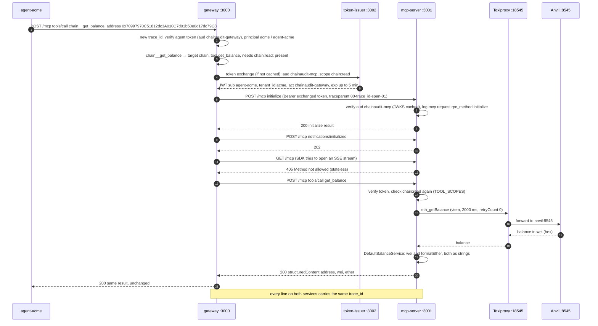

1. `McpHttpHandler.handle` (gateway).
2. `traceMode start` ignores any incoming `traceparent`. `BearerAuthenticator` → `JoseJwtVerifier`. The logger gains `tenant_id acme`, `sub agent-acme`.
3. `DefaultGatewayService.callTool` → `parseNamespacedName` → `callPlatformTool` → `requiredScope` / `missingScope`.
4. `platformCredential` → `CachingTokenExchanger`. The gateway logs `target token`.
5. `DefaultTokenIssuer.tokenExchange`. The issuer logs `token exchanged`.
6. `McpTargetClient.withClient` → `client.connect`. Headers come from `credentialHeader` (`Authorization Bearer`) plus `traceparent` (`traceparentFor`).
7. MCP server `McpHttpHandler` (`traceMode continue`, same `trace_id`). The log line includes `act chainaudit-gateway`.
8. SDK `initialize`.
9. The notification part of the SDK handshake.
10. The transport answers 202 Accepted for notifications.
11. The SDK client's standalone SSE attempt.
12. `McpHttpHandler.methodNotAllowed`. The SDK handles the 405 quietly. This request isn't logged.
13. `client.callTool`.
14. `ChainToolsServerFactory` callback: `missingScope(principal, 'chain:read')`.
15. `ViemBalanceReader.getBalance`.
16. The `anvil` proxy from `infra/toxiproxy/toxiproxy.json`.
17. Anvil answers.
18. Through Toxiproxy.
19. `DefaultBalanceService.getBalance` + `formatEther` (`src/core/units.ts`). Decimal strings, so JSON never rounds wei.
20. `structuredContent` is validated by the SDK against the output schema.
21. Passed through unchanged.

The note at the end: search the three terminals for the gateway's `trace_id` (`docs/verify.md`, step 7a).

If Anvil is slow (`pnpm chaos add anvil`), step 15 fails after 2000 ms. The MCP server returns `isError: Node provider timed out after 2000 ms`, which reaches agent-acme unchanged. If Anvil is down, the text is `Node provider unavailable`.

---

## 9. agent-acme reads acme's note about Northwind

**What you're looking at:** a call to acme's **own** server, `notes__get_client_note("Northwind Ltd")`. Caseware's gateway treats acme's server as a third party.

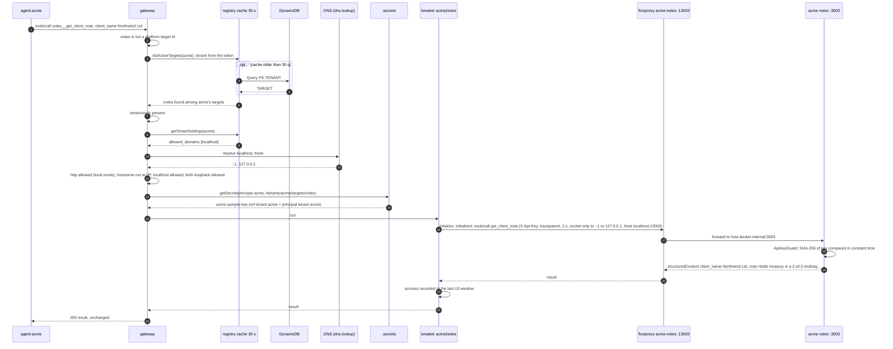

1. `McpHttpHandler` → `DefaultGatewayService.callTool`.
2. `this.platformTargets.find(...)` misses.
3. `tenantTargetsOf` → `CachingTenantTargetReader.listActiveTargets` (`src/core/registry/caching-target-reader.ts`).
4. `DynamoDbTenantRegistry.listActiveTargets` (`QueryCommand`, paginated, never Scan).
5. `toTarget` maps the item.
6. If `notes` weren't in **acme's** list, the result would be `isError Unknown tool notes__get_client_note`, as agent-globex gets.
7. `missingScope(principal, TENANT_TOOLS_SCOPE)`. Missing: `Tool notes__get_client_note requires scope tenant:tools`.
8. `egressFor` → `getTenantSettings`.
9. Cached 30 s, like the targets.
10. `DefaultEgressValidator.validate` → `NodeDnsResolver.resolve` (2 s race). DNS is never cached by us.
11. `dns.lookup` with `all: true`.
12. `classifyIp` per address. The gateway logs `egress validated` with `target_id notes`, `connect_to ["::1","127.0.0.1"]`.
13. `tenantCredential` → `FileCredentialProvider.getSecret` → `pathFor` (tenant check).
14. The file `.secrets/tenants/acme/targets/notes`.
15. `CircuitBreakers.run('acme', 'notes', …)`.
16. `McpTargetClient.callTool`: `credentialHeader` (`X-Api-Key`), and `pinnedAgent` (an undici `Agent` whose `connect.lookup` returns only the validated IPs).
17. Toxiproxy proxy `acme-notes`.
18. `NotesHttpHandler.handle` → `ApiKeyGuard.allows`.
19. `ClientNotesServerFactory` → `get_client_note`.
20. Back through the proxy.
21. `CircuitBreaker.record`.
22. Result.
23. Passed through.

---

## 10. acme-admin registers `notes`

**What you're looking at:** acme's administrator registering acme's own MCP server, and every possible outcome.

Request body:

```
{"target_id":"notes","name":"Client notes","base_url":"http://localhost:13003/mcp","auth_type":"api_key","api_key":"acme-sample-key"}
```

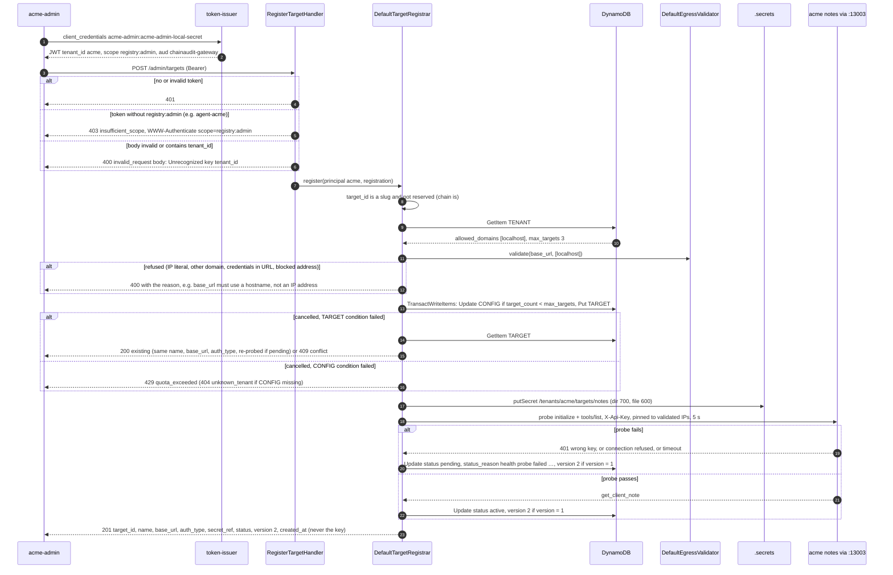

1. `DefaultTokenIssuer.clientCredentials`.
2. The `registry:admin` scope is only on the `*-admin` clients.
3. The gateway route `POST /admin/targets` → `RegisterTargetHandler.handle`.
4. `BearerAuthenticator` failed; logged as `admin request rejected`.
5. `missingScope(caller, 'registry:admin')`; logged as `admin request denied`.
6. `bodySchema.strict()` (zod) → `badRequest`.
7. `DefaultTargetRegistrar.register(principal, …)`. The tenant comes only from the token.
8. `ID_PATTERN` + `reservedTargetIds` (from `STATIC_TARGETS`) → `invalid`.
9. `registry.getTenantSettings`.
10. The CONFIG item (`unknown_tenant` → 404 if missing).
11. `DefaultEgressValidator.validate` (flow 13).
12. Logged as `target registration refused` with the reason. Nothing is stored or called.
13. `DynamoDbTenantRegistry.createTarget` (`TransactWriteCommand` with both `ConditionExpression`s).
14. `CancellationReasons[1]` is `ConditionalCheckFailed` → `duplicate` → `getTarget`.
15. `sameDefinition`. Same → 200 `existing`; if the target is still pending, the new key is stored and the probe runs again. Different → 409 `conflict`.
16. `CancellationReasons[0]` → `quota_exceeded` (429), or `unknown_tenant` (404) when `tenantExists` is false.
17. `FileCredentialProvider.putSecret`. The registry gets only `secret_ref`. Logged as `target registered`.
18. `DefaultTargetRegistrar.probe` → `McpTargetClient.listTools` with `connectTo`. **No breaker, default 5 s timeout.**
19. `toTargetCallError` reasons: `rejected the credentials (HTTP 401)`, `connection refused`, `timed out`. Logged as `target probe failed`.
20. `updateTargetStatus('pending', 'health probe failed: …')` with `ConditionExpression version = :expected`. A version conflict re-reads the item (`target status changed concurrently`).
21. Logged as `target probe passed` with the tool count.
22. `updateTargetStatus('active')`.
23. `view()` + `toHttp`: 201 for created, 200 for existing.

---

## 11. The life of a registry item

**What you're looking at:** the `status` and `version` of one `TARGET#` item over time.

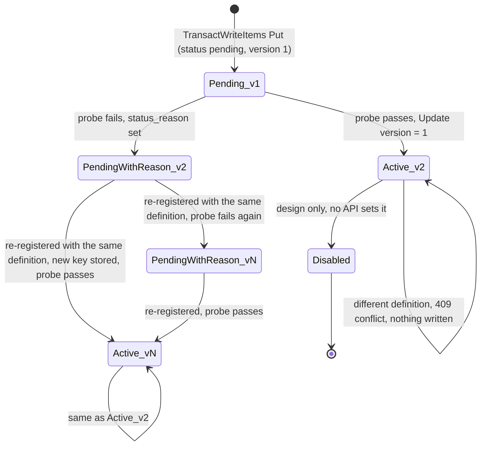

- Routing only uses `active` items (`listActiveTargets`). Pending ones never reach agents.
- Every status update bumps `version` by 1, under a condition on the version just read (optimistic concurrency).
- Items are only removed by restarting DynamoDB Local. There's no delete API.

---

## 12. Isolation scenarios

**What you're looking at:** each way one party might try to reach another party's things, and the check that stops it.

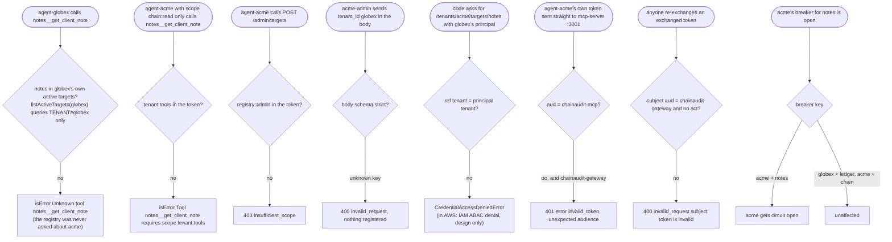

Tests that prove these in `src/core`:

- `gateway-service.test.ts`: s1, s2, s8;
- `target-registrar.test.ts`;
- `token-issuer.test.ts`.

`pnpm verify` covers s1 to s4, s6 and s7 end to end.

---

## 13. A DNS rebinding attack

**What you're looking at:** an attacker who controls the DNS for a hostname on a tenant's allowed list (say `api.evil-tenant.example`, with the attacker's DNS server). It answers a public IP when checked and an internal IP when used. The left side is what the code does. The dashed part is what a validator **without** pinning would let happen.

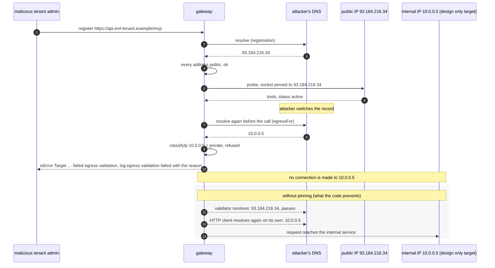

1. `RegisterTargetHandler` → `DefaultTargetRegistrar.register`.
2. `DefaultEgressValidator.validate` → `NodeDnsResolver.resolve`.
3. The attacker's first answer.
4. `classifyIp` → `public`. The name is on the tenant's `allowed_domains`.
5. `probe` with `connectTo [93.184.216.34]` (`pinnedAgent`).
6. Status `active`. Then (the note) the attacker switches the record. DNS is never cached by the gateway.
7. `DefaultGatewayService.egressFor` runs before **every** tenant call.
8. The second answer.
9. `classifyIp` → `private`. A name with even one blocked address fails as a whole.
10. `callTool` returns `Target <id> failed egress validation`. For `tools/list` the target drops out. Logged as `egress validation failed`.
11. In the grey lane, a validator without pinning resolves and passes.
12. The HTTP client then resolves the name again on its own and gets the internal IP.
13. The request reaches the internal service. This lane is **not** possible here: for tenant targets, `McpTargetClient` connects through a lookup that can only return the addresses validated for that call.

The same refusal covers names that resolve to `169.254.169.254` (`link_local`), `::ffff:10.0.0.5` (`ipv4_mapped`) or `127.0.0.1` (`loopback`, accepted only in local mode). Test: `gateway-service.test.ts`, "stops a DNS rebinding".

---

## 14. The breaker during the chaos demo

**What you're looking at:** a timeline of `pnpm chaos` breaking acme's `notes` while globex and acme's platform tool keep working (`docs/verify.md`, step 7k).

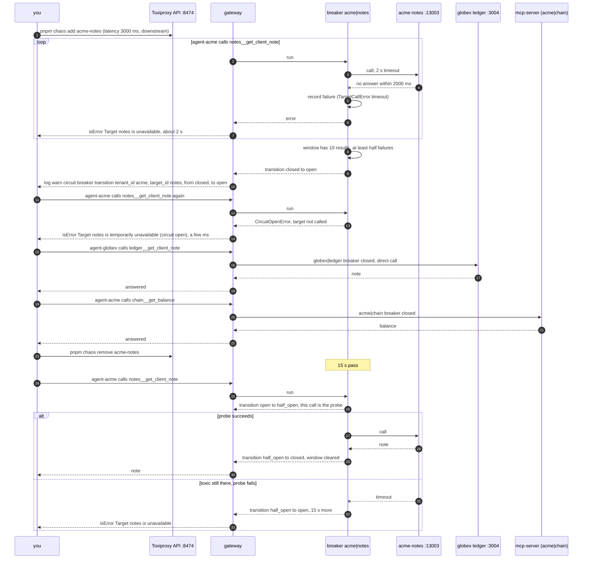

1. `scripts/chaos.ts add` → Toxiproxy `POST /proxies/acme-notes/toxics`, toxic `chaos_latency`.
2. `CircuitBreakers.run('acme', 'notes', …)` (one breaker per `tenant|target`).
3. `McpTargetClient`, with `timeoutMs` from `TENANT_TARGET_TIMEOUT_MS=2000`.
4. The latency toxic delays the response beyond 2 s.
5. `isTargetFailure` is true for `timeout`, `connection` and `http_5xx`. 4xx and protocol errors count as successes.
6. Thrown on to the gateway service.
7. `callTool` catch → `Target notes is unavailable`.
8. `CircuitBreaker.record`. It happens after 5 to 10 failures, depending on how many earlier successes are still in the window.
9. `move('open')`, `openedAt = now`.
10. `logger.warn('circuit breaker transition', …)` with the request's `trace_id`, plus `failures` and `calls`.
11. The next call.
12. `CircuitBreaker.run`.
13. Open and less than 15 s → `CircuitOpenError`, and `fn` isn't called.
14. `circuitOpen(targetId)`.
15. agent-globex.
16. A different key (`globex|ledger`), and no proxy.
17. Answer.
18. Answered.
19. acme's platform tool.
20. A different key (`acme|chain`).
21. Answer.
22. Answered.
23. `scripts/chaos.ts remove` → `DELETE /proxies/acme-notes/toxics/chaos_latency`. Then (the note) 15 s pass. There's no timer; the check happens on the next call.
24. The next call.
25. `CircuitBreaker.run`.
26. `move('half_open')`. This call is the probe, and concurrent calls get `CircuitOpenError`.
27. The probe.
28. Answer.
29. `record(…, probe)` → `move('closed')`, `window = []`.
30. The note.
31. Probe failure (toxic still in place).
32. `move('open')`, a new `openedAt`.
33. The error result.

---

## 15. Error map

**What you're looking at:** every failure, grouped by where it's produced, and exactly what the caller receives.

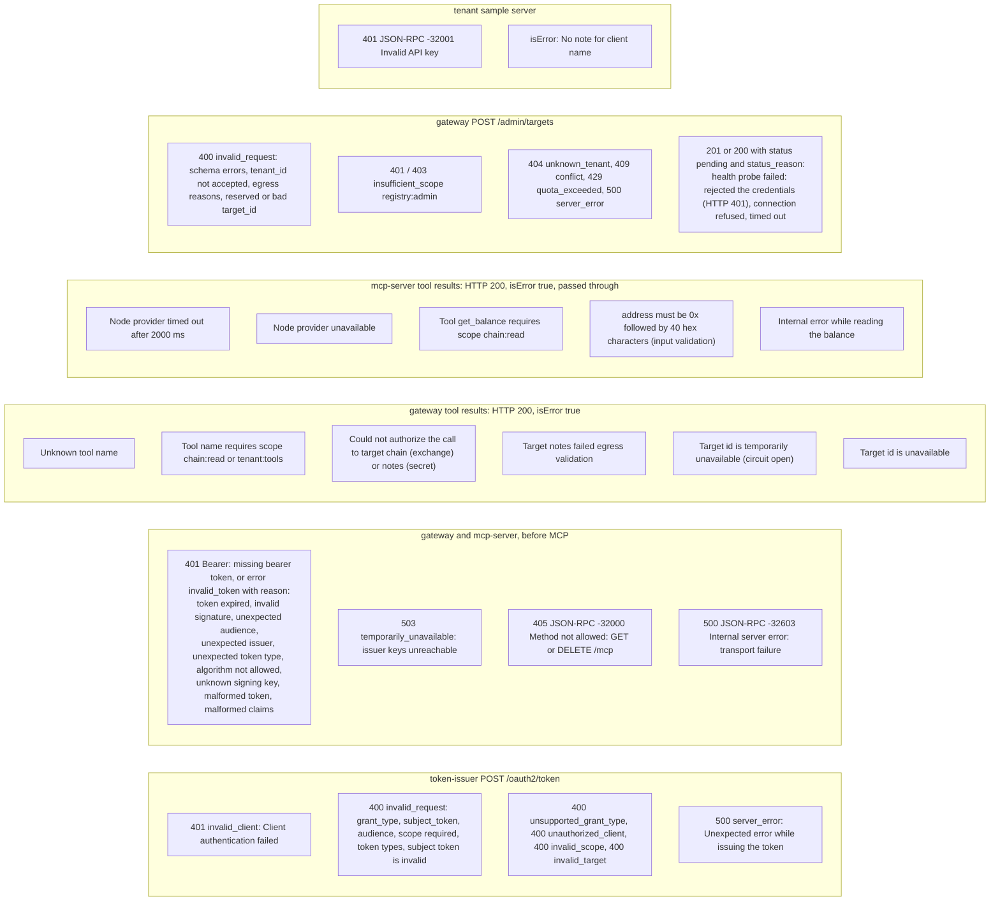

Sources:

- **token-issuer:** `fail(...)` / `oauthError(...)` in `token-issuer.ts` and `token-endpoint-handler.ts`.
- **gateway and mcp-server auth:** `BearerAuthenticator` and `toDomainError` in `jose-jwt-verifier.ts`.
- **gateway tool results:** `toolError(...)` / `circuitOpen(...)` in `gateway-service.ts`.
- **mcp-server tool results:** `toToolError` and `TOOL_SCOPES` in `chain-tools-server-factory.ts`.
- **admin API:** `toHttp` in `register-target-handler.ts`.
- **tenant sample server:** `NotesHttpHandler` and `ClientNotesServerFactory`.

**Rule of thumb:** HTTP errors mean "you can't be served at all" (authentication, protocol, admin input). `isError` means "the tool ran into a problem the model can reason about". Raw errors never reach agents; causes are logged with `trace_id`.

---

## 16. Northwind's reconciliation, end to end (design only)

**What you're looking at:** none of this is built. It's the RFC's design ("Sync and async flows", "On premise relay", "Data layer"), told with the cast. agent-acme asks whether Northwind's on-chain transactions match Northwind's ledger. The ledger lives on a desktop app at the firm or at Northwind.

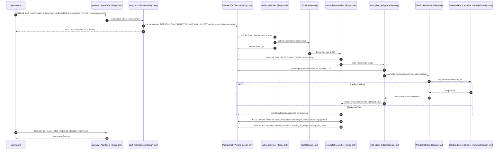

1. The RFC tool table: `start_reconciliation`, scope `recon:write`, async, requires an idempotency key.
2. The identity chain would match flows 5 and 8 (in AWS: Cognito and AgentCore Identity, verify in AWS docs).
3. RFC "Data layer". It's exercised by hand in `docs/sql-lab.sql`, exercises 2 and 3.
4. Idempotent: a retried key returns the original job.
5. RFC "Why an outbox": it avoids the dual-write gap.
6. SQS (Simple Queue Service). A DLQ after 3 attempts, in the ingestion design.
7. `published_at`.
8. At-least-once delivery, so every consumer is idempotent.
9. SQL lab exercise 4 (`SKIP LOCKED`).
10. The relay tool from the RFC table: `fetch_client_ledger`, scope `ledger:read`.
11. RFC "On premise relay": the pending record in DynamoDB.
12. API Gateway WebSocket `postToConnection` (verify in AWS docs).
13. The desktop dials out, so nothing on premise accepts inbound traffic.
14. Its reply arrives via the `$default` route, possibly at another Lambda.
15. The waiting Lambda reads the pending record.
16. `ledger_entries` has `UNIQUE (engagement_id, entry_ref)`.
17. RFC degradation: `blocked` instead of failing.
18. SQL lab exercise 5c, with the filters inside the subqueries (5d shows the WHERE bug).
19. The four outcomes.
20. `get_reconciliation_status`, scope `recon:read`, polled.
21. Status and findings.

The same flow on AWS (design only): AgentCore Gateway with Cognito inbound → Lambda tools → Aurora Serverless v2 (Data API) → an outbox publisher Lambda → SQS with a DLQ → a worker Lambda → API Gateway WebSocket for the relay, with a DynamoDB pending table and connections table.
