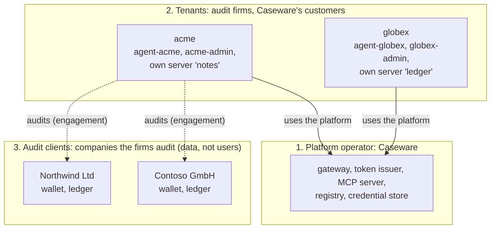
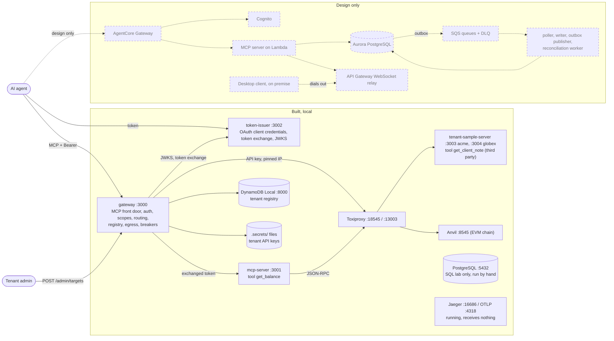

# 01 · The big picture

> **Status**
>
> - **BUILT** (runs locally): token issuer, gateway, MCP server, tenant sample server(s), tenant registry on DynamoDB Local, tenant credentials in files, egress validation, circuit breaker, chaos script, verify script.
> - **DESIGN ONLY** (in `docs/rfc-001.md`, no code): AWS deployment (AgentCore Gateway, Cognito, Lambda), SQS ingestion, outbox publisher, reconciliation worker, on-premise relay, OpenTelemetry tracing, rate limiting, retries, bulkhead, degradation.
> - **NOT DONE BY CODE**: the SQL lab (`docs/sql-lab.sql`) was run by hand against the local PostgreSQL. No application code uses PostgreSQL.

## Who's who

This project was built as practice for a job interview at **Caseware**. The business scenario is invented, so read it as "a scenario designed to practise the role", not as a description of how Caseware's products work today. Throughout this guide, **"we", "us", "our platform" and "the operator" mean Caseware**.

There are three layers of organisations, plus the people and programs acting for them:

| Layer | Who | Plain words | What they own or do in this repo |
| --- | --- | --- | --- |
| **1. Platform operator** | **Caseware** | The company that runs the platform and sells the software | Runs the gateway, the token issuer, the MCP server (`chain__get_balance`), the tenant registry, the credential store and the breakers. Defines the **platform targets** (`STATIC_TARGETS`) and registers the OAuth clients (`clients.json`). |
| **2. Tenants** | **Audit and accounting firms that are Caseware's customers** | Caseware's clients. Each one is walled off from the others | `acme` and `globex`. Each has its own `tenant_id`, its own partition in DynamoDB (`TENANT#acme`), its own secrets (`.secrets/tenants/acme/…`), its own breakers, and optionally its own MCP servers (**tenant targets**). |
| **3. Audit clients** | **Companies that an audit firm audits** | The firm's clients: the people whose books and wallets are being checked | Not users of the system. They appear as **data**: an *engagement* in the SQL schema (`engagements.client_name`), the wallet address passed to `get_balance`, the client name in `get_client_note("Northwind Ltd")`, and the ledger on their on-premise desktop app (design only). |

Acting on behalf of those organisations:

| Actor | Belongs to | In the repo |
| --- | --- | --- |
| **AI agent** | A tenant (an audit firm) | `agent-acme`, `agent-globex`: OAuth clients with `chain:read`, `tenant:tools` and others. It calls tools through the gateway. |
| **Tenant admin** | A tenant (the firm's IT or admin person) | `acme-admin`, `globex-admin`: scope `registry:admin`. It registers the firm's own MCP servers with `POST /admin/targets`. |
| **Gateway client** | Caseware (the platform itself) | `chainaudit-gateway`: may only do token exchange, never act on its own. |
| **Tenant's own MCP server** | A tenant | The tenant sample server: acme's on :3003 (`notes`), globex's on :3004 (`ledger`). A third party from Caseware's point of view. |
| **Desktop client** (design only) | Installed at a tenant or its audit client | Holds the ledger on premise and dials out to the relay (chapter 07). |

**Why the layers matter for the design:**

- **Tenant isolation is between audit firms** (layer 2). acme must never see globex's targets, secrets or data. That's why `tenant_id` comes only from the token and keys every DynamoDB read.
- **Engagements are inside a tenant** (layer 3). The RFC stores each chain transaction once *per engagement*, never shared across tenants, even if two firms happen to audit the same wallet.
- **"Third party" means a tenant's server**, from Caseware's point of view. It gets the firm's own API key, never a Caseware-issued token.
- **The on-premise relay** (design only) exists because the ledger lives on a desktop machine at the firm or its client, behind their firewall.

## The story

An audit firm, **acme** (a Caseware customer, i.e. a tenant), audits a company, **Northwind Ltd** (acme's audit client), that holds crypto on an EVM (Ethereum Virtual Machine) chain. acme's AI agent needs the wallet's balance, and it asks for it through Caseware's platform.

1. **The agent gets a badge.** It authenticates with its own client id and secret at the **token issuer** and receives a short-lived signed token (a JWT, JSON Web Token). The token says: you are `agent-acme`, tenant `acme`, allowed `chain:read` and `tenant:tools`, valid for 15 minutes, meant for the **gateway**.
2. **The agent asks the gateway.** It speaks MCP (Model Context Protocol) to the gateway: "list your tools", then "call `chain__get_balance` for this address". The gateway is the one front door for all agents.
3. **The gateway checks the badge.** It verifies the signature with the issuer's public keys, checks that the token is meant for the gateway, and checks the scope for this specific tool.
4. **The gateway never hands the badge on.** It trades the agent's token at the issuer for a new 5-minute token meant only for the MCP server, carrying the same agent and tenant, only the one scope the tool needs, and an `act` note saying "the gateway is acting for this agent".
5. **The MCP server checks again.** It accepts only tokens meant for itself, checks the scope again, and asks the blockchain node (**Anvil**, through **Toxiproxy**) for the balance, with a 2-second timeout.
6. **The answer travels back.** The balance comes back as exact decimal strings, and the gateway passes the result through unchanged.

acme can also **plug in its own MCP server** (a *tenant target*, here the **tenant sample server** with a `get_client_note` tool). A tenant admin registers it through the gateway. Before every call, the gateway:

- stores it in the **registry** (DynamoDB);
- keeps its API key in a **credential store**;
- checks that its address is safe (egress validation);
- watches its health with a **circuit breaker**.

Only acme's agents ever see acme's targets.

What the RFC designs **beyond** this (not built): the reconciliation job that compares on-chain transactions with the client's ledger in PostgreSQL, the ingestion pipeline on SQS (Simple Queue Service), and a relay to the client's on-premise desktop app.

## Architecture

Solid lines and boxes are built and running locally. Dashed ones are **design only**.

Toxiproxy has two proxies: `anvil` (:18545 → Anvil) and `acme-notes` (:13003 → acme's sample server on :3003). globex's sample server on :3004 is reached directly.

## Each component in one paragraph

**token-issuer** (`src/apps/token-issuer`). The badge office. It checks a client's id and secret (stored as scrypt hashes) and issues signed JWTs with ES256, an asymmetric signature, so verifiers only need the public key it publishes at `/.well-known/jwks.json`. It also performs token exchange for the gateway. **In AWS this is** Amazon Cognito (verify in AWS docs which of these flows Cognito supports; see chapter 06).

**gateway** (`src/apps/gateway`). The front door and switchboard. It verifies agent tokens and merges the tools of every target the caller may use into one catalog. It routes each call to the right target with the right credential. It also hosts the admin API for tenant targets, the egress checks and the circuit breakers. **In AWS this is** Amazon Bedrock AgentCore Gateway, together with AgentCore Identity for outbound credentials.

**mcp-server** (`src/apps/mcp-server`). The platform's own tool server, a *platform target* the operator configures. It exposes `get_balance`, verifies that tokens were minted for it, and reads the chain through Toxiproxy. **In AWS this is** a Lambda function behind AgentCore Gateway.

**tenant-sample-server** (`src/apps/tenant-sample-server`). It plays an audit firm's own MCP server (the firm is a Caseware customer), a third party from Caseware's point of view. It accepts only its API key, never platform tokens. Two instances run: acme's (:3003, behind Toxiproxy) and globex's (:3004).

**Registry and credentials.** DynamoDB holds each tenant's settings and registered targets, partitioned by tenant. Secrets live in files under `.secrets/`, one per target, and the registry stores only the path. **In AWS this is** DynamoDB, plus Secrets Manager with IAM tag-based isolation.

**Anvil + Toxiproxy.** Anvil is a local blockchain. Toxiproxy sits in front of it (and of acme's sample server) so latency and outages can be injected on purpose (`pnpm chaos`).

**DynamoDB Local, PostgreSQL, Jaeger.** These are the local stand-ins for AWS data and tracing services. DynamoDB is used by the gateway. PostgreSQL is used only by the SQL lab. Jaeger runs but nothing sends it traces yet.

## Why it's shaped like this

- **One front door.** Agents only ever talk to the gateway, so authentication, tenant isolation and failure containment live in one place.
- **Every hop gets its own token.** No token is forwarded, which prevents the confused deputy problem (chapter 03).
- **Tenants are walled off by key design,** not by remembering to filter: every registry read names the tenant from the token (chapter 04).
- **A broken target costs only its own tenant** a fast, clear error (chapter 05).
- **Local first.** Every piece runs on a laptop, so the concepts are learned before a managed service hides them. AWS comes last (chapter 06).
