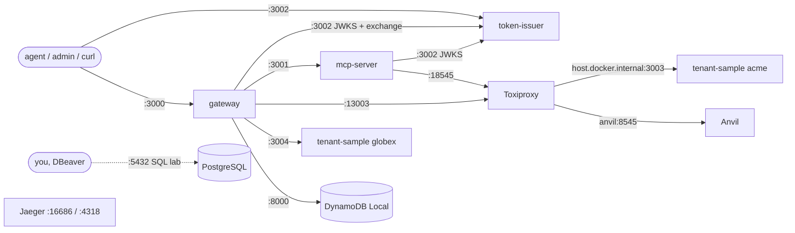

# 02 · The running services

> **Status:** BUILT. Everything here runs locally. PostgreSQL and Jaeger run but no application code uses them. Each section ends with the **real-world replacement**.

## How to start everything

All commands below exist in `package.json` or `infra/docker-compose.yml`. Full runbook: `docs/verify.md`.

| Order | Command | What starts |
| --- | --- | --- |
| 1 | `pnpm install` | dependencies |
| 2 | `pnpm infra:up` | Anvil, Toxiproxy, DynamoDB Local, PostgreSQL, Jaeger (Docker) |
| 3 | `pnpm setup:dynamodb` | registry table + tenant `CONFIG` items (DynamoDB Local is in memory: rerun after every `infra:up`) |
| 4 | `pnpm seed:anvil` | 5 ETH transfers between Anvil's dev accounts (in memory too: rerun after every Anvil restart) |
| 5 | `pnpm issuer:dev` | token-issuer :3002 (start it first: the others fetch its keys) |
| 6 | `pnpm mcp:dev` | mcp-server :3001 |
| 7 | `pnpm tenant-sample:dev` | acme's tenant sample server :3003 |
| 8 | `pnpm tenant-sample-globex:dev` | globex's tenant sample server :3004 (only for the breaker demo) |
| 9 | `pnpm gateway:dev` | gateway :3000 (`APP_ENV=local EGRESS_ALLOW_PRIVATE_NETWORKS=true`) |
| 10 | `pnpm verify` | the automated checks (`scripts/verify.sh`) |

Other commands: `pnpm test`, `pnpm typecheck`, `pnpm build`, `pnpm format`, `pnpm infra:ps`, `pnpm infra:down`, `pnpm hash-secret <secret>`, and `pnpm chaos add|remove|status <proxy>`.

---

## token-issuer (:3002)

**Analogy.** The badge office at a building entrance: it checks your ID and gives you a dated visitor badge.

**Job.** It issues OAuth 2.0 access tokens, as JWTs signed with ES256:

- **client credentials**, for agents and tenant admins;
- **token exchange** (RFC 8693), only for the gateway client.

It also publishes its public key.

| Endpoint | In | Out |
| --- | --- | --- |
| `POST /oauth2/token` | Basic auth (client id + secret), form body `grant_type`, `scope`, and for exchange `subject_token`, `subject_token_type`, `audience` | `{access_token, token_type, expires_in, scope}` (+ `issued_token_type` for exchange), or RFC 6749 errors (`invalid_client` 401, `invalid_scope`, `invalid_target`, `unauthorized_client`, `unsupported_grant_type`, `invalid_request` 400) |
| `GET /.well-known/jwks.json` | — | `{keys: [{kty: EC, crv: P-256, x, y, kid, alg: ES256, use: sig}]}` |

**Key files.**

- `main.ts`: composition root.
- `token-endpoint-handler.ts`: Basic parsing, status mapping.
- `src/core/issuer/token-issuer.ts`: the grants.
- `clients.json`: the clients `agent-acme`, `agent-globex`, `acme-admin`, `globex-admin`, `chainaudit-gateway`.
- `src/adapters/local/file-signing-key-store.ts`: key in `.keys/`, mode 0600.

**When it fails.**

- New tokens can't be issued, and token exchange fails, so calls to platform targets return "Could not authorize the call to target chain".
- If the gateway or MCP server haven't cached the keys yet, they return **503** `temporarily_unavailable`; already cached keys keep working.

**Real-world replacement.** Amazon Cognito (user pool, app clients, resource server for machine-to-machine), or Auth0 / Okta / Keycloak. Cognito's lack of RFC 8693 exchange and of `aud` in M2M tokens comes from the RFC's notes: verify in AWS docs.

---

## gateway (:3000)

**Analogy.** A hotel concierge: it checks your room key, knows which services you're entitled to, calls them for you with the hotel's own arrangements, and stops calling a broken one.

**Job.**

- MCP server towards agents and MCP client towards targets;
- inbound JWT auth and scope checks;
- merged, filtered tool catalog;
- routing;
- token exchange for platform targets;
- API keys for tenant targets;
- tenant registry, egress validation, circuit breakers;
- admin registration API.

| Endpoint | In | Out |
| --- | --- | --- |
| `POST /mcp` | MCP JSON-RPC (`tools/list`, `tools/call`), `Authorization: Bearer <agent token>` | JSON-RPC result; 401 with `WWW-Authenticate: Bearer … resource_metadata=…`; 503 if keys unavailable |
| `GET/DELETE /mcp` | — | 405 (stateless: no SSE stream, no session) |
| `GET /.well-known/oauth-protected-resource[/mcp]` | — | RFC 9728 metadata: `resource`, `authorization_servers`, `scopes_supported` |
| `POST /admin/targets` | Bearer token with `registry:admin`, JSON `{target_id, name, base_url, auth_type: api_key, api_key}` | 201/200 target view, 400, 403, 404, 409, 429 |

**Key files.**

- `main.ts`, `config.ts`, `targets.ts` (`STATIC_TARGETS`), `gateway-server-factory.ts`, `register-target-handler.ts`, `resource-metadata.ts`.
- Core: `gateway/gateway-service.ts`, `registry/*`, `egress/*`, `resilience/*`.

**When it fails.** Agents have no way in: the gateway is the single entry point. In the RFC's design, AgentCore Gateway is managed and scaled by AWS.

**Real-world replacement.** Amazon Bedrock AgentCore Gateway (inbound authorizer, targets, merged catalog), plus AgentCore Identity for outbound credentials. Exact features: verify in AWS docs (chapter 06).

---

## mcp-server (:3001)

**Analogy.** A specialist clerk behind the counter: it only serves requests stamped for its own desk, and it double-checks the stamp.

**Job.** A platform MCP server with one tool, `get_balance(address)`, which returns `{address, wei, ether}` as decimal strings. It accepts only tokens with `aud = chainaudit-mcp`, checks `chain:read` itself, and calls the chain with a 2 s timeout and no retries.

| Endpoint | In | Out |
| --- | --- | --- |
| `POST /mcp` | Bearer **exchanged** token, MCP JSON-RPC, `traceparent` | tool result or `isError` (`Node provider timed out after 2000 ms`, `Node provider unavailable`, scope, address format) |

**Key files.** `main.ts`, `chain-tools-server-factory.ts`, `src/core/balance/balance-service.ts`, `src/adapters/local/viem-balance-reader.ts`.

**When it fails.** The gateway's call fails, and the agent gets `Target chain is unavailable`. The failure counts against the `tenant|chain` breaker of the calling tenant.

**Real-world replacement.** An AWS Lambda function exposed as an MCP target behind AgentCore Gateway (the RFC's choice), or a container on ECS (Elastic Container Service).

---

## tenant-sample-server (:3003 acme, :3004 globex)

**Analogy.** A supplier's own shop down the street: the concierge can send you there, but the shop only knows the supplier's account number, not your hotel key.

**Job.** It plays an MCP server that an **audit firm (a tenant, i.e. a Caseware customer)** runs itself, a third party from Caseware's point of view. The notes it returns are about the firm's own **audit clients** (`Northwind Ltd`, `Contoso GmbH`). It has one tool, `get_client_note(client_name)`, returning a note from an in-memory map, and it requires an `X-Api-Key` header, compared in constant time.

| Instance | Command | Key |
| --- | --- | --- |
| acme | `pnpm tenant-sample:dev` (:3003, reached through Toxiproxy :13003) | `acme-sample-key` |
| globex | `pnpm tenant-sample-globex:dev` (:3004, direct) | `globex-sample-key` |

**Key files.** `main.ts`, `notes-http-handler.ts`, `api-key-guard.ts`, `client-notes-server-factory.ts`.

**When it fails.**

- Registration leaves the target `pending` with a reason.
- Calls return `Target notes is unavailable`.
- Repeated failures open the `acme|notes` breaker, after which calls return `…(circuit open)` immediately.
- Nothing changes for other tenants.

**Real-world replacement.** The tenant's own server on the internet, reachable over HTTPS.

---

## Anvil (:8545)

**Analogy.** A practice blockchain on your desk: fake money, instant blocks, reset whenever you like.

**Job.** A local EVM chain (Foundry image `ghcr.io/foundry-rs/foundry:v1.8.5`, chain id 31337). It keeps its state in memory, so `pnpm seed:anvil` creates balances to read.

**When it fails.** `get_balance` returns `Node provider unavailable` or a timeout.

**Real-world replacement.** A node provider (e.g. Alchemy, Infura, QuickNode) or a self-run node. The RFC calls it a "public RPC provider", with the tenant's own API key from Secrets Manager (design only).

---

## Toxiproxy (:8474 API, :18545, :13003)

**Analogy.** A plumber's valve you can partly close to simulate a clogged pipe.

**Job.** A TCP proxy with injectable faults ("toxics"), configured by `infra/toxiproxy/toxiproxy.json`:

- `anvil`: `0.0.0.0:18545` → `anvil:8545`;
- `acme-notes`: `0.0.0.0:13003` → `host.docker.internal:3003`.

`pnpm chaos add <proxy> [ms]` adds a latency toxic (default 3000 ms), `remove` deletes it, and `status` lists everything.

**When it fails.** Everything behind it looks down. That's often the point.

**Real-world replacement.** In production, nothing: the failures are real. For deliberate experiments in AWS, AWS Fault Injection Service (FIS).

---

## DynamoDB Local (:8000)

**Analogy.** A filing cabinet with one locked drawer per customer.

**Job.**

- It holds the tenant registry: table `chainaudit-registry`, `PK=TENANT#<id>`, `SK=CONFIG | TARGET#<id>`.
- It runs with `-sharedDb -inMemory`, so data disappears on restart.
- `pnpm setup:dynamodb` creates the table and the acme and globex `CONFIG` items.

**When it fails.**

- Registration fails, with a 500 from the admin API.
- For tenants with no cached registry entry, tenant tools disappear from `tools/list`, calls to them answer `Unknown tool …`, and the gateway logs `tenant targets unavailable`. Entries already cached keep working for up to 30 s.
- Platform targets are unaffected.

**Real-world replacement.** Amazon DynamoDB. The same adapter class (`src/adapters/aws/dynamodb-tenant-registry.ts`) works there without the local endpoint.

---

## PostgreSQL (:5432)

**Analogy.** The firm's accounting ledger, where everything must add up and every entry links to another.

**Job.** Only the hand-run SQL lab (`docs/sql-lab.sql`) uses it, in its own `lab` schema. The domain tables (engagements, chain transactions, ledger entries, jobs, outbox) come from the RFC. **No application code connects to PostgreSQL** (design only).

**When it fails.** Nothing in the apps notices.

**Real-world replacement.** Amazon Aurora Serverless v2 PostgreSQL with the Data API (the RFC's choice). Pricing and minimum capacity: verify in AWS docs.

---

## Jaeger (:16686 UI, :4318 OTLP)

**Analogy.** A parcel-tracking website waiting for its first parcel scan.

**Job.** Jaeger v2 (`jaegertracing/jaeger:2.22.0`) accepts OTLP (OpenTelemetry Protocol) over HTTP and shows traces. **Nothing sends traces yet**: the apps only propagate `traceparent` headers and log `trace_id` (chapter 09).

**When it fails.** Nothing in the apps notices.

**Real-world replacement.** AWS X-Ray and CloudWatch, fed by the AWS Distro for OpenTelemetry. Logs go to CloudWatch Logs.

**Detailed flows with names:** [`docs/diagrams/03-end-to-end-flows.md`](../diagrams/03-end-to-end-flows.md): flow 2 (startup and wiring), flow 3 (Caseware onboards a tenant).
