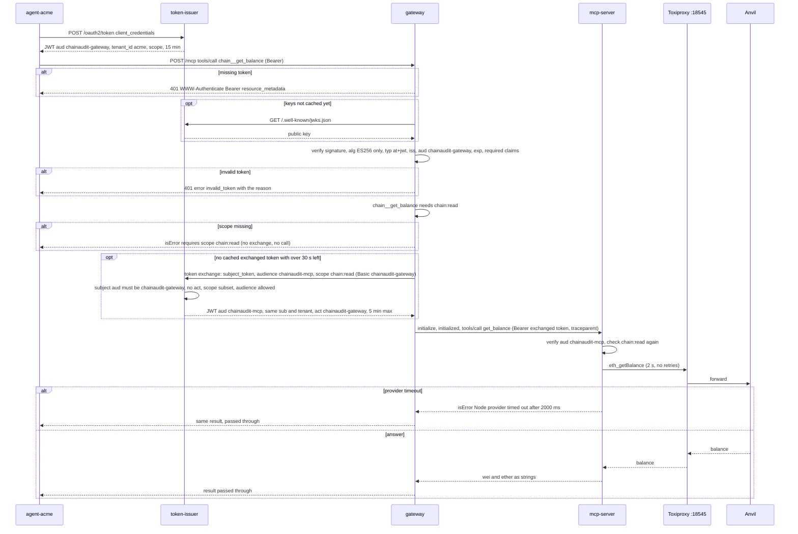

# 03 · The identity chain

> **Status**
>
> - **BUILT** locally: client credentials, JWT verification (JWKS), scope checks at the gateway and at the MCP server, RFC 8693 token exchange with an `act` claim, exchanged-token cache.
> - **DESIGN ONLY**: Cognito as the issuer, AgentCore Gateway's inbound authorizer, AgentCore Identity outbound auth, SigV4/STS for AWS backends.

Acronyms used here:

- **JWT**: JSON Web Token.
- **JWKS**: JSON Web Key Set.
- **MCP**: Model Context Protocol.
- **RFC**: Request for Comments (an internet standard).
- **M2M**: machine to machine.

## 1. A token is born

**Analogy.** A visitor badge printed at reception, with your name, your company, the rooms you may enter, the building it's valid in, and an expiry time. The badge is stamped with a seal that only reception owns.

**Technical.**

- The agent POSTs `grant_type=client_credentials` to `/oauth2/token` with HTTP Basic auth.
- `DefaultTokenIssuer` looks up the client in `clients.json` and verifies the secret with scrypt. For an unknown client id it does the same amount of work, so timing reveals nothing.
- It resolves the scopes: the requested ones must be allowed, and if none are requested it grants all the allowed ones.
- `JoseAccessTokenSigner` signs a JWT with ES256 (the private key lives in `.keys/`), with header `{alg: ES256, kid, typ: at+jwt}`.

The `kid` is the key's RFC 7638 thumbprint. Verifiers find the matching public key at `/.well-known/jwks.json`. Only the issuer can sign, and anyone can verify. That's the point of an asymmetric key.

**In AWS this is** Cognito's token endpoint with an app client and a resource server. Differences noted in the RFC (verify in AWS docs):

- Cognito M2M access tokens carry `client_id` instead of `aud`;
- Cognito scopes are prefixed by the resource server id;
- a custom `tenant_id` claim needs a pre-token-generation trigger.

## 2. The full `tools/call`

Where it happens:

- **Agent token:** `src/core/issuer/token-issuer.ts` (`clientCredentials`).
- **Gateway verification:** `src/apps/shared/bearer-auth.ts`, `src/core/auth/audience-token-verifier.ts`, `src/adapters/local/jose-jwt-verifier.ts`.
- **Scope check:** `src/core/gateway/gateway-service.ts` (`callPlatformTool`) and `catalog.ts`.
- **Exchange:** `src/adapters/local/oauth-token-exchanger.ts` → `token-issuer.ts` (`tokenExchange`), cached by `src/core/auth/caching-token-exchanger.ts`.
- **MCP server checks:** `src/apps/mcp-server/chain-tools-server-factory.ts`.

## 3. Agent token vs. exchanged token

| Claim | Agent token | Exchanged token |
| --- | --- | --- |
| `iss` | `http://localhost:3002` | `http://localhost:3002` |
| `aud` | `chainaudit-gateway` | `chainaudit-mcp` (must be on the gateway client's `allowed_audiences`) |
| `sub` | `agent-acme` | `agent-acme`, copied, **not** the gateway |
| `tenant_id` | `acme` (from `clients.json`) | `acme`, copied |
| `scope` | e.g. `chain:read recon:read recon:write tenant:tools` | exactly what the gateway asked for: `chain:read` |
| `act` | absent | `{ sub: chainaudit-gateway }` |
| `exp` | `iat + 900` (15 min) | `min(iat + 300, subject exp)` |
| `jti` | new UUID | new UUID |

## 4. Why tokens are never forwarded

**Analogy.** If a concierge handed your room key to every shop it called for you, any shop could walk into your room. Instead it hands each shop a one-time voucher valid only at that shop.

**Technical.** The agent token says `aud = chainaudit-gateway`. For the MCP server to accept it, it would have to trust tokens addressed to someone else, and then any service that ever saw an agent token could replay it there. That's **token passthrough**, which the MCP authorization spec forbids, and it turns the gateway into a **confused deputy**. Instead:

- Every hop accepts only its own audience.
- Only the token's audience may exchange it (`subject_audience`).
- An exchanged token can't be exchanged again: it has `act` and the wrong `aud`.
- Scope only shrinks.
- The exchanged token never outlives the original.

**In AWS this is…** the open RFC question of how AgentCore Identity handles outbound auth. The RFC's "What changed" notes that Cognito lacks RFC 8693 exchange, so the caller's identity would have to travel as separate signed context. Verify in AWS docs.

## 5. Why the scope is checked twice

**Analogy.** The building checks your badge at the entrance, and the lab checks it again at its own door. A mistake at the entrance shouldn't open the lab.

**Technical.**

- **At the gateway**, `tools/list` is filtered (you only see what you may use), and `tools/call` checks the scope again. Nothing ties a call to an earlier list: clients can call any name, and a token can be narrower than the one used to list.
- **At the MCP server**, `get_balance` checks `chain:read` itself. If a gateway bug lets a call through, or someone reaches the server by another path with a valid token for it, the tool still refuses.
- **Default deny:** a tool missing from the scope map is neither listed nor callable.

## 6. Details that interviewers like

| Detail | Why |
| --- | --- |
| `algorithms: ['ES256']` | Blocks `alg: none` and HS256 key confusion (the public key misused as an HMAC secret) |
| `typ: at+jwt` | An ID token or other JWT from the same issuer can't pass as an access token |
| JWKS cached, refetch at most once per 30 s cooldown | A flood of made-up `kid`s can't turn the gateway into an amplifier against the issuer |
| 401 vs. 403 vs. 503 | 401: no valid token. 403: valid token but missing `registry:admin` on the admin API. 503: keys unreachable (our fault, not the caller's) |
| 15 min agent token, 5 min hop token | JWTs can't be revoked once issued, so expiry is the only kill switch |
| `trace_id` | The gateway starts a new trace, the MCP server continues it via `traceparent`, and every log line carries it |

## Code vs. RFC

- **Audience format.** The RFC says audience = gateway. The code uses logical names (`chainaudit-gateway`), while the MCP authorization spec expects the server's canonical URI (RFC 8707). This was proposed in task 4a but isn't in the RFC.
- **Token exchange rules.** The RFC's identity table doesn't say who may exchange. The code restricts exchange to the subject token's audience and adds `act`. This was proposed in task 4b but isn't in the RFC.
- **Additional verification checks.** The RFC lists signature, issuer, audience, expiry and scopes. The code also pins the algorithm and requires `typ` and a set of claims.

**Detailed flows with names:** [`docs/diagrams/03-end-to-end-flows.md`](../diagrams/03-end-to-end-flows.md): flow 4 (token issuance, every branch), flow 5 (token exchange inside the issuer), flow 8 (Northwind's wallet balance).
