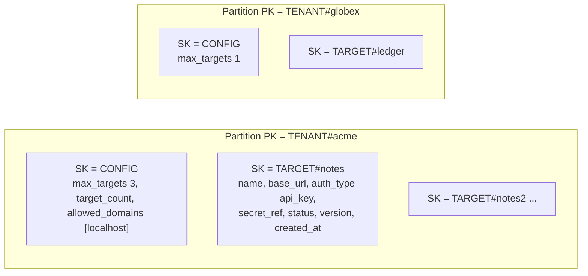
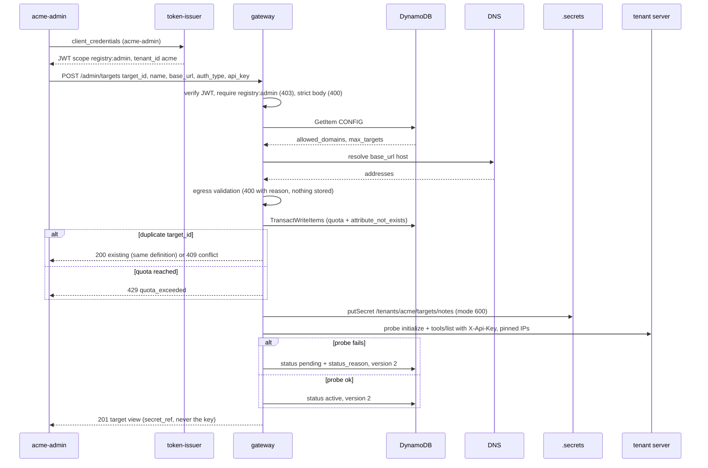
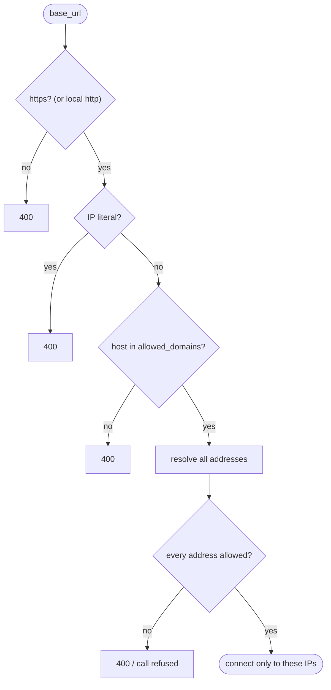

# 04 · Tenants and the target registry

> **Status**
>
> - **BUILT**: tenant from token, DynamoDB single-table registry (Local), admin registration API, health probe, credential store (local files), egress validation with DNS pinning, tenant-scoped routing, 30 s registry cache.
> - **DESIGN ONLY**: Secrets Manager with IAM ABAC, `dynamodb:LeadingKeys` IAM condition, per-tenant request quotas.

Acronyms used here:

- **MCP**: Model Context Protocol.
- **ABAC**: Attribute Based Access Control.
- **IAM**: Identity and Access Management.
- **STS**: Security Token Service.
- **SSRF**: Server-Side Request Forgery.
- **DNS**: Domain Name System.

**Who is the tenant here?** A tenant is an **audit firm that is a Caseware customer** (`acme`, `globex`), not the companies those firms audit. Isolation in this chapter is between audit firms. Caseware is the operator that runs the registry. A firm's audit clients (e.g. `Northwind Ltd`) are data inside a tenant, never tenants themselves. See "Who's who" in chapter 01.

## 1. Where `tenant_id` comes from

**Analogy.** In an office building, your floor is printed on your badge by reception. You can't just tell the elevator which floor you work on.

**Technical.** The only source of `tenant_id` is the verified token: `Principal.tenantId`, set in `JoseJwtVerifier`.

- Tool arguments never carry it.
- The admin API rejects a body containing `tenant_id` (zod `.strict()`).
- Every registry read, credential read and breaker key uses `principal.tenantId`.

**In AWS this is…** the same rule. With Cognito, `tenant_id` would need a custom claim (pre-token-generation trigger, per the RFC's notes; verify in AWS docs).

## 2. DynamoDB key design

**Analogy.** A filing cabinet with one drawer per customer. Inside the drawer, a settings folder and one folder per registered server. You can only open a drawer by saying whose it is.

**Technical.** One table, `chainaudit-registry` (`scripts/setup-dynamodb.ts`, on-demand billing, no indexes).

| Need | Operation | Code |
| --- | --- | --- |
| Tenant settings | `GetItem(TENANT#t, CONFIG)` | `getTenantSettings` |
| One target | `GetItem(TENANT#t, TARGET#id)` | `getTarget` |
| The tenant's targets | `Query(PK=TENANT#t AND begins_with(SK,'TARGET#'))`, keep `active` | `listActiveTargets` |
| Register | `TransactWriteItems`: `Update CONFIG` if `target_count < max_targets`, plus `Put TARGET#id` if `attribute_not_exists(SK)` | `createTarget` |
| Status change | `Update TARGET#id` if `version = :expected`, then `version + 1` | `updateTargetStatus` |

**Why Query, never Scan.**

- A Query names one partition, the caller's tenant, so it's cheap and can't return another tenant's rows.
- A Scan reads the whole table, every tenant, and filters afterwards. It's slower, more expensive, and one forgotten filter away from a data leak.
- With the tenant in the key, there's simply no code path that lists across tenants.

**Why a transaction for the quota.** Counting with a Query and then writing races: two registrations both see "2 of 3" and both write. The transaction increments the counter only while it's below the max **and** writes the target only if it's new. Either condition failing cancels both. `CancellationReasons` then tells which one failed: a duplicate, or the quota (429).

**Optimistic concurrency.** Status updates carry the `version` they read. If someone else updated the item in between, the condition fails and the registrar re-reads instead of overwriting.

**In AWS this is…** the same table on Amazon DynamoDB, and the same adapter without the local endpoint. IAM can pin a tenant-tagged role to its own partition with the `dynamodb:LeadingKeys` condition (design only; verify in AWS docs).

## 3. Registering a target

Code: `register-target-handler.ts` → `DefaultTargetRegistrar.register` / `probe` → `DynamoDbTenantRegistry`, `FileCredentialProvider`, `McpTargetClient`.

## 4. Tenant credentials

**Analogy.** Each customer's spare key in a locked box labelled with their name. The concierge may only open the box whose label matches the badge of the person asking.

**Technical.**

- `FileCredentialProvider` keeps one file per secret at `.secrets/tenants/<tenant>/targets/<target>` (directory 0700, file 0600, `.secrets/` gitignored).
- The registry stores only `secret_ref` (`/tenants/acme/targets/notes`), never the key.
- Every read or write passes the caller's verified `Principal`. If the ref's tenant segment doesn't match `principal.tenantId`, the adapter throws `CredentialAccessDeniedError`.
- Ids are strict slugs (`^[a-z0-9][a-z0-9-]{0,62}$`), so `../` path tricks are impossible.

**In AWS this is…** AWS Secrets Manager, with each secret tagged `tenant_id`. The shared Lambda assumes a role through STS with the session tag `tenant_id`, and the policy allows `secretsmanager:GetSecretValue` only when the secret's tag equals `${aws:PrincipalTag/tenant_id}` (ABAC). **Why the local check is weaker:** it runs inside the very process it protects, so a bug, a new code path or a compromised dependency can skip it. IAM is enforced by AWS, outside our code. Design only.

## 5. Egress validation and DNS rebinding

**Analogy.** Before the courier leaves, a dispatcher checks that the address is in the customer's approved list and not inside our own building. The courier then drives to the exact address the dispatcher checked, not to wherever the street sign points later.

**Technical.** `DefaultEgressValidator.validate(url, allowedDomains)` runs at registration and again before **every** tenant call:

1. It must be a valid URL with no `user:pass@` in it.
2. It must use `https:`. Exception, in local mode only (`APP_ENV=local` + `EGRESS_ALLOW_PRIVATE_NETWORKS=true`): `http:` when every address is loopback or private.
3. **No IP literal as the host.** The WHATWG URL parser canonicalises `2130706433`, `0177.0.0.1` and `0x7f.0.0.1` to `127.0.0.1` first, so every spelling is caught.
4. The host must equal an allowed domain or be a subdomain of one (`evilexample.com` doesn't match `example.com`).
5. It's resolved fresh (`NodeDnsResolver`, 2 s). **Every** address must be public. In local mode, loopback and private are also accepted, but link-local (`169.254.169.254`, cloud metadata), IPv4-mapped IPv6 and reserved ranges never are.
6. The approved addresses go to the client as `connectTo`.

**DNS rebinding.** A hostname can answer a public IP to our check and a private IP a second later. `McpTargetClient` connects through an undici `Agent` whose `connect.lookup` can only return the validated addresses. The URL keeps the hostname, so the `Host` header and TLS still use the real name. There's no second lookup for an attacker to win.

**In AWS this is…** the same validation code running in the Lambda function. Network-level egress controls (VPC egress rules, a proxy or firewall) are not designed in the RFC, and which internal endpoints a Lambda can reach (metadata or credential endpoints) must be checked: verify in AWS docs.

## 6. Platform targets vs. tenant targets

| | Platform target (`chain`) | Tenant target (`notes`, `ledger`) |
| --- | --- | --- |
| Defined by | Operator, `src/apps/gateway/targets.ts` | Tenant admin, `POST /admin/targets` |
| Trust | Trusted (reviewed like code) | Third party |
| Credential sent | Token from RFC 8693 exchange, `aud` = target | Tenant's API key in `X-Api-Key`, never a token |
| Scope | Per tool (`get_balance` → `chain:read`) | One scope for all its tools: `tenant:tools` |
| Egress validation | No | Every registration and every call |
| Timeout | 5 s | 2 s |
| Visible to | Every tenant with the scope | Only its own tenant |
| Breaker key | `tenant | chain` | `tenant | target_id` |

A tenant target id can't reuse a platform id (`chain` is reserved), so `chain__x` is never ambiguous.

**Why an API key for tenant targets?** A platform token, even an exchanged one, would let a third-party server call our platform as the agent. That's the confused deputy again, one hop further.

## 7. The registry cache

The gateway reads a tenant's targets and settings through `CachingTenantTargetReader` (30 s).

- **Benefit:** no DynamoDB read on most requests.
- **Cost:** a target disabled in DynamoDB stays callable for up to 30 s on each gateway instance, and a new one appears up to 30 s late.

DNS and credentials are deliberately **not** cached: rebinding protection needs fresh DNS, and a rotated key should apply on the next call.

## Code vs. RFC

- **Credentials.** The RFC uses Secrets Manager with the ARN in DynamoDB and IAM ABAC; the code uses local files with a path and a code-level check.
- **Local HTTP.** The RFC says HTTPS only; local mode allows `http` for loopback and private addresses.
- **Blocked ranges.** The code blocks more ranges than the RFC lists: CGNAT, NAT64, 6to4, Teredo, multicast, reserved and IPv4-mapped.
- **Pinning.** It needs a custom dispatcher (undici), which the RFC doesn't mention.
- **Auth types.** Only `api_key` exists, even though the RFC says "auth type and credential".
- **Probe and status.** The probe has no automatic retry, and there's no disable API (the status exists).
- **Quotas.** Only max targets is implemented (already recorded in the RFC's "What changed").
- **Who manages allowed domains.** Only `setup:dynamodb`; there's no API for them.

**Detailed flows with names:** [`docs/diagrams/03-end-to-end-flows.md`](../diagrams/03-end-to-end-flows.md): flow 9 (tenant target call), flow 10 (registration, every outcome), flow 11 (registry item life), flow 12 (isolation scenarios), flow 13 (DNS rebinding attack).
