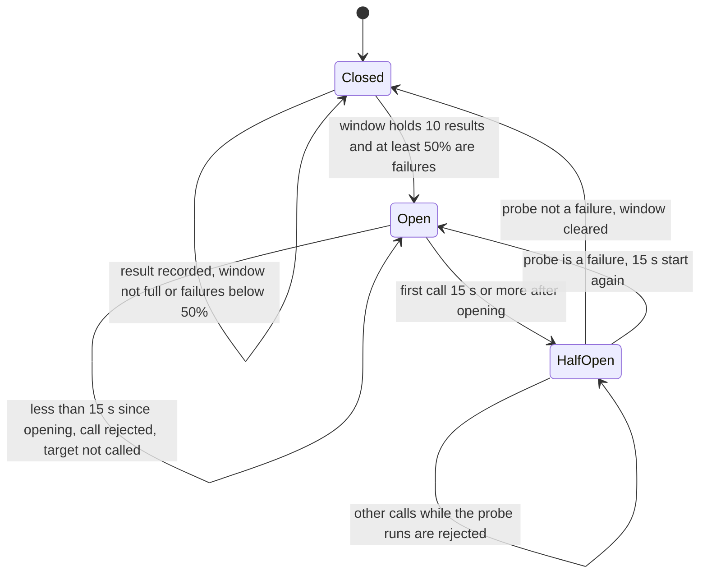
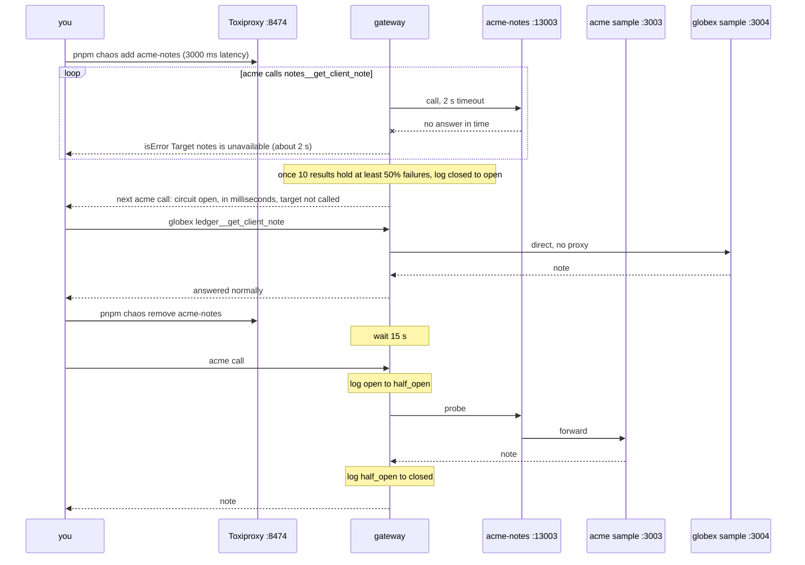

# 05 · Failure containment

> **Status**
> - **BUILT**:
>   - timeouts: 2 s provider, 2 s tenant targets, 5 s platform targets, 2 s DNS, 2 s token exchange and JWKS;
>   - circuit breaker per `tenant_id|target_id`;
>   - failure classification;
>   - Toxiproxy chaos (`pnpm chaos`).
> - **DESIGN ONLY** (RFC "Third party failure containment"): retries with backoff and jitter, deadline propagation, bulkhead, rate limiting, degradation, breaker state shared through DynamoDB, separate SLO accounting for target failures.

Acronyms used here:
- **RPC**: Remote Procedure Call.
- **SLO**: Service Level Objective.
- **MCP**: Model Context Protocol.

## 1. Timeouts first

**Analogy.** If the restaurant doesn't answer the phone in 10 seconds, you hang up and try another. You don't stand there holding the phone for an hour.

**Technical.** Every outbound call has an explicit limit:

| Call | Limit | Where |
| --- | --- | --- |
| Chain RPC | 2000 ms, `retryCount: 0` | `ViemBalanceReader` |
| Tenant target | 2000 ms | `TENANT_TARGET_TIMEOUT_MS` → `McpTargetClient` |
| Platform target | 5000 ms, above the target's own 2 s so its clear error arrives first | `TARGET_TIMEOUT_MS` |
| DNS, token exchange, JWKS | 2000 ms each | `NodeDnsResolver`, `OAuthTokenExchanger`, `JoseJwtVerifier.remoteKeys` |

`McpTargetClient` sets two timeouts: the MCP request timeout rejects the pending call, and an `AbortSignal` closes the socket, so a hung target can't hold connections. A slow target is worse than a dead one: it holds capacity.

**In AWS this is…** the same code, plus Lambda's own function timeout as an outer limit.

## 2. The circuit breaker

**Analogy.** A fuse box. When an appliance keeps shorting, the fuse trips, so the rest of the house keeps working. After a while you flip it back once to test it. If it shorts again, it trips again.

**Technical.** `CircuitBreaker` (`src/core/resilience/circuit-breaker.ts`) has one instance per `tenant_id|target_id`, created by `CircuitBreakers` and held in the gateway's memory. Every `listTools` and `callTool` to a target runs inside `breakers.run(...)`.



**Each transition:**
- **Closed → Open.** Only a full window of 10 counts, so one early failure isn't "100%". At 50% failures the target is clearly unhealthy. From now on the agent gets a fast, clear error (`Target notes is temporarily unavailable (circuit open)`) instead of waiting 2 s, and the target gets room to recover.
- **Open → HalfOpen.** There are no timers. The first call after 15 s moves the state, and that call becomes the probe.
- **HalfOpen → Closed.** One success is enough proof. The window starts clean.
- **HalfOpen → Open.** The target is still broken. Only that one call paid for finding out, and the cooldown starts again.

**What counts as a failure** (`isTargetFailure` in `src/core/errors.ts`):

| Counted | Not counted (the target answered) |
| --- | --- |
| `timeout` (request or socket) | `http_4xx` (including 401/403 wrong key) |
| `connection` (refused, reset, host not found) | `protocol` (JSON-RPC errors) |
| `http_5xx` | a tool's own `isError` result |

Calls that never reach the target (egress refusal, missing credential, missing scope) aren't recorded at all.

**Isolation.** The key is tenant **and** target. acme's broken `notes` doesn't change globex's `ledger`, nor acme's own `chain`. Platform targets also get one breaker per tenant, so one tenant's traffic can't open the platform breaker for everyone.

**Every transition is logged** with the request's `trace_id`:
```json
{"level":"warn","msg":"circuit breaker transition","trace_id":"…","tenant_id":"acme","target_id":"notes","from":"closed","to":"open","failures":10,"calls":10}
```

**In AWS this is…** the same class inside the gateway, or AgentCore's native behaviour if it has any (verify in AWS docs). On Lambda, each instance has its own breaker. The RFC proposes writing transitions to DynamoDB so new instances start informed. That isn't built.

## 3. The chaos demo

The full commands are in `docs/verify.md`, step 7k. Here's what you should see and why.



Expected log lines, in order:
1. `"from":"closed","to":"open"`. It happens after 5 to 10 failures, depending on how many earlier successes are still in the window.
2. `"from":"open","to":"half_open"` on the first call after 15 s.
3. `"from":"half_open","to":"closed"` when the probe succeeds. Or `"from":"half_open","to":"open"` if you left the toxic in place.

## 4. What the RFC adds (design only)

| Mechanism | RFC setting | Why | Trade-off |
| --- | --- | --- | --- |
| **Retries** | Max 2, exponential backoff with full jitter, idempotent reads only, honour `Retry-After` on 429 | Absorb blips | Retrying writes duplicates side effects; synchronized retries cause storms, which jitter spreads out |
| **Deadline** | Timeout capped by the caller's remaining time | Don't work on answers nobody waits for | Needs the deadline propagated across hops |
| **Bulkhead** | Max concurrent calls per tenant | One tenant's slow target can't use up all concurrency | Picking limits; rejecting work early |
| **Rate limiting** | Token bucket per tenant and agent client (DynamoDB counters with TTL if AgentCore has nothing native) | Fair use, 429 to that tenant only | Extra store reads; open question in the RFC |
| **Degradation** | `get_balance` returns the last known value with `stale_as_of` | A useful, honest answer instead of nothing | Needs a store of last values |
| **Breaker** | Last **20** calls, **30 s** cooldown, **3** probes, state shared via DynamoDB on transitions | Fail fast, recover safely | The built version is a minimal 10 / 15 s / 1 probe, in memory |
| **SLO split** | Target failures measured apart from gateway failures | A tenant's broken server doesn't burn the platform's error budget | Needs metrics (not built) |

**Analogy for the bulkhead:** watertight compartments, so one flooded room doesn't sink the ship. **For rate limiting:** a turnstile that lets a fixed number of people through per minute. **For degradation:** a shop showing "price as of this morning" when the live feed is down.

## Code vs. RFC
- **Breaker parameters.** 10 / 50% / 15 s / 1 probe, versus the RFC's 20 / 30 s / 3 probes. Proposed as a "What changed" line, not yet approved.
- **Breaker state.** In memory only, with no DynamoDB transitions.
- **Tenant timeout.** Tenant targets get 2 s and platform targets 5 s. The RFC's single "2 s capped by deadline" has no deadline in the code.
- **Work before the breaker check.** It runs after the cached registry read, the scope check, DNS and the secret read, so an open breaker saves the target call, not that local work.
- **Probe.** The registration health probe bypasses the breaker and uses the 5 s default.
