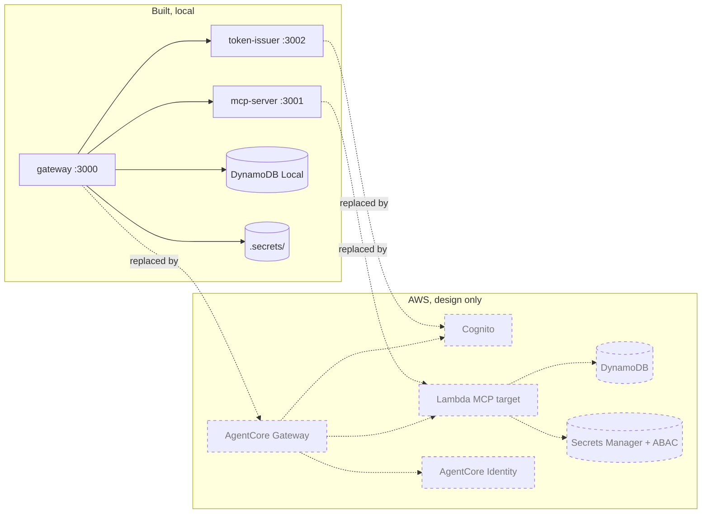

# 06 · AWS and AgentCore

> **Status: DESIGN ONLY.** Nothing in this repository is deployed to AWS. The RFC planned one tool behind AgentCore Gateway with Cognito, timeboxed to a few hours (Sunday early afternoon); that step hasn't been done. What follows describes the AWS services as the RFC uses them. Statements about AWS behaviour that this repo can't test are marked **verify in AWS docs**.

Acronyms used here:
- **MCP**: Model Context Protocol.
- **IAM**: Identity and Access Management.
- **STS**: Security Token Service.
- **SigV4**: AWS Signature Version 4.
- **JWT**: JSON Web Token.
- **M2M**: machine to machine.
- **ABAC**: Attribute Based Access Control.
- **FIS**: Fault Injection Service.

## 1. AgentCore Gateway, simply

**Analogy.** A universal adapter plate: you screw your existing appliances (APIs, Lambda functions, MCP servers) onto it, and agents see one standard socket (MCP) with every appliance's buttons on it.

**Technical.** Amazon Bedrock AgentCore Gateway is a managed MCP endpoint. It turns registered **targets** into MCP tools, presents one merged tool catalog to agents, authenticates inbound requests, and attaches the right credentials to outbound calls (RFC "What AgentCore Gateway does").

**In this repo it's** `src/apps/gateway`: inbound JWT verification (`BearerAuthenticator`), the merged and filtered catalog (`DefaultGatewayService.listTools`), routing by `<target>__<tool>`, and outbound credentials (token exchange or tenant API key).

### Targets and target types
A target is a backend the gateway exposes as tools. As stated in the RFC, AgentCore supports **Lambda functions, OpenAPI specifications and existing MCP servers** as targets. The RFC's open question asks to confirm the exact target types, semantic tool search and rate limiting options. **Verify in AWS docs.**

| Target kind | In this repo |
| --- | --- |
| Existing MCP server | Built: `chain` (platform) and tenant targets, called with the MCP SDK client |
| Lambda function | Design only: the MCP server is written so its handlers could run in Lambda |
| OpenAPI spec | Not built (chapter 09) |

## 2. Inbound auth

**Analogy.** A doorman who reads the badge's seal, checks it was issued for this building and hasn't expired.

**Technical.** AgentCore Gateway's inbound authorizer validates agent JWTs: issuer, audience or allowed clients, and expiry. The RFC's "What changed" section notes that **Cognito M2M access tokens carry `client_id`, not `aud`**, so in AWS the check would use allowed clients. **Verify in AWS docs** which fields the authorizer can check and whether it can enforce scopes per tool.

**Locally:** `JoseJwtVerifier` checks signature (ES256 only), `iss`, `aud`, `exp`, `typ` and required claims. The scope check is per tool in `DefaultGatewayService`.

## 3. Outbound auth and AgentCore Identity

**Analogy.** A key cabinet at the concierge desk: for each outside service, the right key (an OAuth token, an API key) is kept and handed out only for the matching job.

**Technical.** AgentCore Identity provides outbound **credential providers** (OAuth and API keys) that AgentCore Gateway uses to call targets (RFC). Which identity hops it handles natively, and which need custom code, is an open RFC question. **Verify in AWS docs.**

**Locally:**
- platform target → `OAuthTokenExchanger` (RFC 8693), cached;
- tenant target → `FileCredentialProvider` → `X-Api-Key`.

The RFC's "What changed" section notes that **Cognito lacks RFC 8693 token exchange**. In AWS, the gateway-to-target hop would use AgentCore outbound auth, and the caller's identity would have to travel separately as signed context. Verify in AWS docs.

**AWS backends** (design only): a target calling DynamoDB or Secrets Manager signs requests with **SigV4**, using credentials from an **STS** role session tagged with `tenant_id`, and IAM policies with tag conditions (**ABAC**) limit it to that tenant's resources.

## 4. Local version → real AWS service

| Local piece (file) | AWS service | What changes when you swap |
| --- | --- | --- |
| `src/apps/gateway` | Amazon Bedrock AgentCore Gateway | Targets are registered in AgentCore instead of `STATIC_TARGETS` and DynamoDB; inbound auth becomes the managed authorizer; catalog merging is managed |
| Outbound credentials in the gateway | AgentCore Identity credential providers | Tokens and keys come from managed providers; token exchange likely replaced (verify in AWS docs) |
| `src/apps/token-issuer` | Amazon Cognito (user pool, app clients, resource server) | Scopes prefixed by the resource server; `aud` absent in M2M tokens; `tenant_id` via a pre-token-generation trigger (all verify in AWS docs) |
| `src/apps/mcp-server` run with `node` | AWS Lambda | Same handler classes; composition root at module top level; no Express |
| DynamoDB Local | Amazon DynamoDB | Drop the local endpoint and dummy credentials; same adapter; optional IAM `dynamodb:LeadingKeys` |
| `FileCredentialProvider` (`.secrets/`) | AWS Secrets Manager + IAM ABAC via STS session tags | Tenant check enforced by IAM, not code |
| `NodeDnsResolver` + egress checks | same code in Lambda | Network-level egress controls not designed (verify in AWS docs) |
| Toxiproxy | AWS FIS for experiments; real failures in production | — |
| Anvil | A node provider (Alchemy, Infura, QuickNode…) | Tenant's own provider key from Secrets Manager (RFC) |
| PostgreSQL in Docker | Amazon Aurora Serverless v2 PostgreSQL + Data API | Lambda talks HTTPS, no VPC or NAT (RFC; verify pricing in AWS docs) |
| Jaeger + OTLP | AWS X-Ray / CloudWatch via the AWS Distro for OpenTelemetry | Needs OTel instrumentation first (not built) |
| JSON logs on stdout | Amazon CloudWatch Logs | No code change |
| Scripts / `setInterval` | Amazon EventBridge Scheduler | Design only |
| SQS emulator + polling loop | Amazon SQS + Lambda event source + DLQ | Design only |
| `ws` relay | Amazon API Gateway WebSocket API | Design only |
| `docker compose` | Terraform (the RFC's choice) | Not written |

## 5. What the local version cannot prove
- **IAM enforcement.** The tenant check on secrets is code (`FileCredentialProvider.pathFor`). Nothing proves an IAM policy with tag conditions would allow exactly the right reads (RFC "Local first strategy": emulators accept requests AWS would reject).
- **SigV4.** DynamoDB Local accepts any credentials (`local`/`local`). Signing and permission errors only show up in AWS.
- **AgentCore behaviour.** Target types, authorizer settings, tool catalog merging, rate limiting, semantic search, error formats. All verify in AWS docs.
- **Cognito tokens.** Claim names, scope format, custom claims, token exchange support.
- **Managed scaling and limits.** Lambda concurrency and cold starts, API Gateway connection limits, DynamoDB throttling.
- **Network egress in AWS.** VPC rules, metadata endpoints.

## 6. Cost controls (from the RFC, not yet applied)
MFA on root, no root access keys, a separate admin user, an AWS Budgets alert, no NAT gateways or always-on instances, and `terraform destroy` after the interview.
