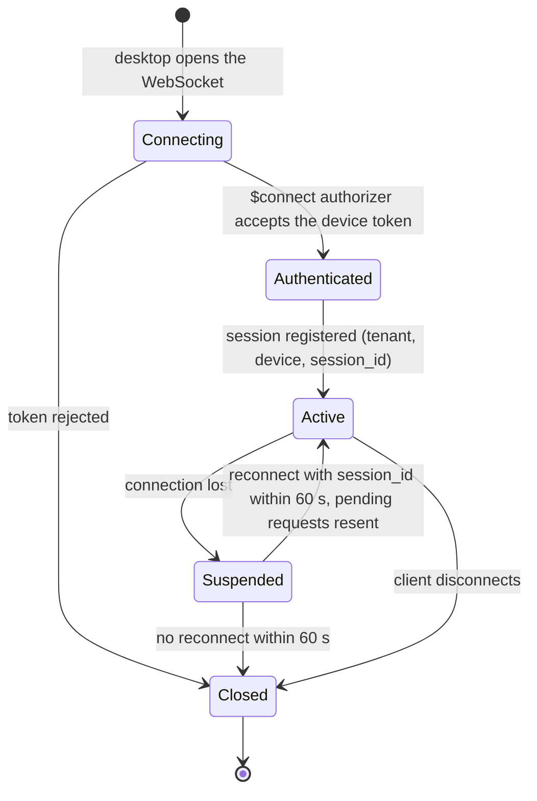
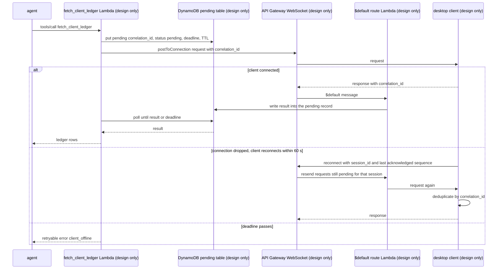

# 07 · The on-premise relay

> **Status: DESIGN ONLY.** There is no relay code in this repository. Everything here comes from the RFC section "On premise relay". The `fetch_client_ledger` tool, the desktop client and the WebSocket service don't exist. The RFC listed a local `ws` relay with a Node client reading a CSV ledger as a "could have" item; it wasn't built.

Acronyms used here:
- **API**: Application Programming Interface.
- **TTL**: Time To Live (automatic expiry).
- **DLQ**: Dead-Letter Queue.

## 1. Why the desktop client dials out

**Analogy.** Instead of asking every client to unlock their front door for our courier, we give them a walkie-talkie. They switch it on from inside, and we talk through it.

**Technical.** The client's ledger lives in a desktop application inside the audit firm's client's network. Accepting inbound connections there would mean opening firewall ports and exposing that machine. So the desktop opens an **outbound** WebSocket to the cloud and keeps it open. Requests travel down that connection, and responses come back up it. Nothing on premise accepts inbound traffic.

**In AWS this is** an Amazon API Gateway WebSocket API with `$connect`, `$default` and `$disconnect` routes. A `$connect` authorizer validates a device token bound to `tenant_id` and `device_id`, and a DynamoDB table maps tenant and device to `connection_id`, `session_id` and `last_seen` (RFC).

## 2. Session lifecycle

**Analogy.** A phone call: dialling, saying who you are, talking, a dropped line you can call back within a minute without starting over, then hanging up.

All states are design only. The 60 s resume window comes from the RFC.

## 3. Request correlation and the pending record

**Analogy.** A coat-check ticket. The waiter writes the ticket number in the book before taking your coat away. Whoever brings the coat back matches it by the number, even if it's a different waiter.

**Technical.** The Lambda that sends a request isn't necessarily the one that receives the answer, because responses arrive through the `$default` route, possibly on another instance. So every request carries a `correlation_id`, and a **pending record** in DynamoDB is where the answer lands.

**Trade-off (RFC).** Polling DynamoDB from Lambda costs time and requests. A stateful service on ECS (Elastic Container Service) with an in-memory map of pending requests is simpler at scale, but no longer serverless.

## 4. Reconnection, in-flight requests, backpressure, degradation

| Topic | Design (RFC) | Why |
| --- | --- | --- |
| Heartbeats and reconnect | Client sends heartbeats, reconnects with exponential backoff and jitter, presenting `session_id` and its last acknowledged sequence number | Avoid a thundering herd of reconnects; resume without losing work |
| In-flight requests | Server resends requests still pending for that session; the desktop deduplicates by `correlation_id` | A resent request mustn't be executed twice |
| Expired requests | Fail with a retryable `client_offline` error | The agent can decide to retry later |
| **Backpressure** | At most **10 requests in flight per session**; beyond that the tool answers **429** at once | Don't pile work onto a slow desktop |
| **Degradation** | Reconciliation that depends on the ledger waits in a **blocked** status while the client is offline, and resumes when it reconnects | A useful state instead of a failure |

**Analogy for backpressure:** a restaurant that says "we're full, come back in 10 minutes" instead of seating people it can't serve.

## 5. Why reconnection is the normal path

As stated in the RFC, API Gateway closes **idle** WebSocket connections after **10 minutes** and **any** connection after **2 hours**. A long-running desktop client will therefore be disconnected regularly, even when everything is healthy. Reconnect with resume is the everyday case, not an error case. **Verify in AWS docs** for the current limits.

## What a local version would look like (not built)
The RFC's local plan: the `ws` library imitating the connect, default and disconnect routes, and a Node client reading a CSV ledger. This repo has none of it. The relay would follow the same rules as the rest of the code: tenant from the device token, and a timeout on every wait.
