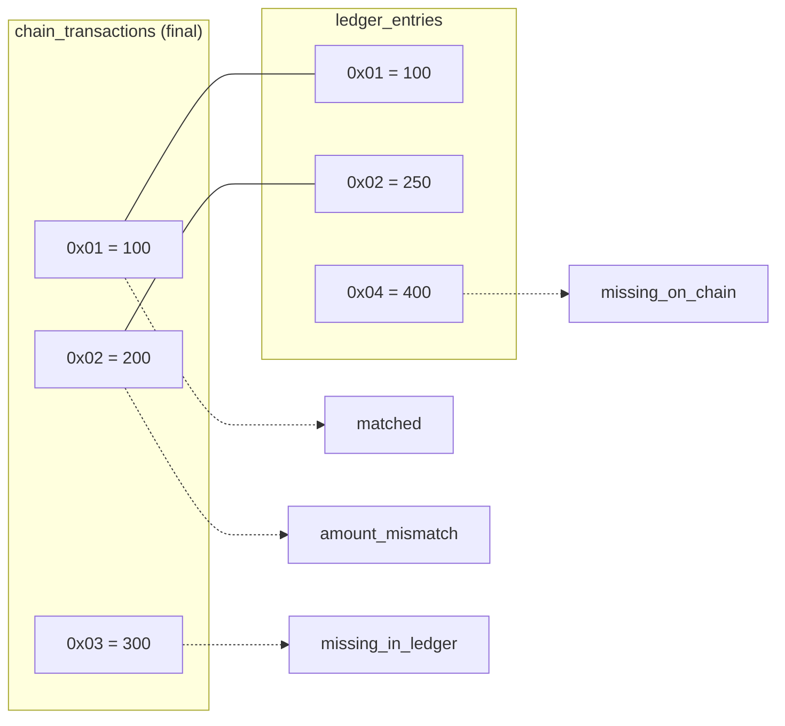
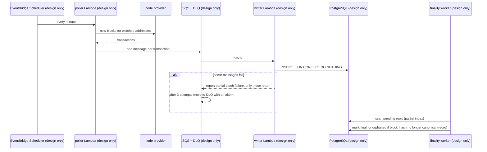
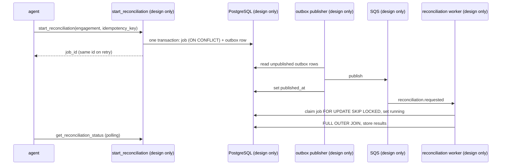

# 08 · Data and async flows

> **Status**
>
> - **BUILT**: DynamoDB for the gateway's registry (chapter 04).
> - **RUN BY HAND**: the SQL lab in `docs/sql-lab.sql`, against the local PostgreSQL in DBeaver, in an isolated `lab` schema. No application code connects to PostgreSQL.
> - **DESIGN ONLY**: ingestion (EventBridge → poller → SQS → writer → finality worker), `start_reconciliation`, the outbox publisher, the reconciliation worker, `get_reconciliation_status`, Aurora.

Acronyms used here:

- **SQL**: Structured Query Language.
- **SQS**: Simple Queue Service.
- **DLQ**: Dead-Letter Queue.
- **CTE**: Common Table Expression (a `WITH` clause).
- **EVM**: Ethereum Virtual Machine.

## 1. Two stores, two jobs

**Analogy.** A key-cabinet at reception (grab one key by its number, instantly) and the accounting department's ledger (cross-check many entries against each other).

| | DynamoDB | PostgreSQL |
| --- | --- | --- |
| Used for | Gateway hot path: tenant settings, targets (built); idempotency records (design) | Domain data: engagements, chain transactions, ledger entries, jobs, outbox (design) |
| Access | Single-key lookups and one-partition Queries | Joins, unique constraints, multi-row transactions |
| Why | Fast, no connection pool limits from Lambda | Reconciliation *is* a join; auditors need constraints |
| **In AWS this is** | Amazon DynamoDB | Amazon Aurora Serverless v2 PostgreSQL with the Data API (verify capacity and pricing in AWS docs) |

## 2. The SQL lab, exercise by exercise

The lab creates the RFC schema (section 0):

- `engagements`;
- `chain_transactions`: `UNIQUE (engagement_id, chain_id, tx_hash, log_index)`, a status check, and indexes `idx_tx_recent` and `idx_tx_pending`;
- `ledger_entries`;
- `reconciliation_jobs`: `UNIQUE (engagement_id, idempotency_key)`;
- `outbox`.

### Exercise 1: deduplication with `ON CONFLICT`

**Analogy.** A guest list where the door, not the guest, decides whether you're already inside.
**Technical.**

- The same insert run twice gives `INSERT 0 1` and then `INSERT 0 0`, with no error. Without `ON CONFLICT` the second insert fails with a unique violation.
- The unique constraint decides what a duplicate is, so it's safe under concurrency.
- "SELECT, then INSERT if not found" is wrong because two writers can both see "not found" and both insert.

**In AWS this is…** the ingestion writer Lambda's insert (design only). SQS delivers at least once, so duplicates are normal.

### Exercise 2: idempotent job creation plus outbox

**Analogy.** Ordering at a counter with a ticket number. Showing the same ticket again gets you the same order, not a second one, and the kitchen slip is printed in the same motion as the order.
**Technical.**

- One statement uses CTEs: `INSERT … ON CONFLICT DO NOTHING RETURNING id`, then the outbox insert *from* that CTE, then either `created` or the existing row (`existing`).
- Run three times, it returns the same id and the outbox has exactly one row.
- The edge case the lab notes: two concurrent first requests with the same key. The second waits, does nothing, and its snapshot may not see the first's row, so the application must re-read in a new statement.
- **Code vs. RFC:** the RFC writes this as `BEGIN; INSERT … ON CONFLICT … RETURNING; INSERT INTO outbox …; COMMIT;`, while the lab uses a single CTE statement. Both are atomic.

### Exercise 3: atomicity, all or nothing

**Analogy.** A bank transfer: either both the debit and the credit happen, or neither.
**Technical.** Inside `BEGIN`, the job insert succeeds and the outbox insert fails (`NULL` payload). After an error PostgreSQL refuses every statement until the transaction ends, so `COMMIT` becomes `ROLLBACK`. The job is never persisted without its event. That's the outbox guarantee.

### Exercise 4: workers claiming jobs with `SKIP LOCKED`

**Analogy.** Workers taking tickets from a board. Each takes the next ticket nobody is holding, without waiting for a colleague who is still reading one.
**Technical.**

- Session A locks one job with `FOR UPDATE SKIP LOCKED`, and session B immediately gets a *different* job.
- Without `SKIP LOCKED`, B waits until A ends.
- The real claim is a single `UPDATE … WHERE id IN (SELECT … FOR UPDATE SKIP LOCKED) RETURNING`, which claims and marks the job `running` atomically.

**In AWS this is…** the reconciliation worker Lambda (design only).

### Exercise 5: reconciliation joins

The data is built to produce every outcome: `0x01` matched, `0x02` amount mismatch, `0x03` missing in ledger, `0x04` missing on chain.

| Join | Rows | What it keeps | Lab |
| --- | --- | --- | --- |
| **INNER** | 2 (`0x01`, `0x02`) | Only matching pairs; unmatched rows vanish | 5a |
| **LEFT** | 3 (`+0x03` with a NULL ledger side) | Every chain row; ledger-only rows (`0x04`) still missing | 5b |
| **RIGHT** | 3 (`0x01`, `0x02`, `0x04`) | Every ledger row; chain-only rows missing. The mirror of LEFT | Not in the lab (explained only) |
| **FULL OUTER** | 4, one per outcome | Unmatched rows from both sides, which are exactly an auditor's findings | 5c (the RFC query) |

**The WHERE filter bug (5d).** The same FULL OUTER JOIN with the engagement filter moved to `WHERE` returns 3 rows: `0x04` disappears. For that row the chain side is NULL, and `c.engagement_id = …` isn't true, so `WHERE` removes it. The outer join silently became a LEFT JOIN. The fix, as in the RFC, is to filter **inside** the subqueries, before the join.

### Exercise 6: composite and partial indexes

**Analogy.** A phone book sorted by last name, then first name: great for "all the Smiths, alphabetically", useless for "everyone named John".
**Technical.** After loading 1,000 engagements and 200,000 transactions:

- **6a:** "latest 20 for one engagement" uses `idx_tx_recent (engagement_id, block_number DESC)`, an Index Scan with no Sort node.
- **6b:** drop it, and PostgreSQL still finds the rows through the UNIQUE index (also led by `engagement_id`), but a **Sort** node appears. Column order decides what an index can do.
- **6d:** the finality worker's query uses the **partial** index `idx_tx_pending … WHERE status = 'pending'`.
- **6e:** that partial index is a small fraction of the full one, because only about 1% of rows are pending.

## 3. Ingestion (design only)

Rows are marked `orphaned`, never deleted, so the audit trail survives a reorg.

## 4. Reconciliation with an outbox (design only)

**Why an outbox.** Writing to the database and then publishing to SQS from the handler is a **dual write**: if the process dies in between, the job exists but nobody processes it. The outbox makes the event part of the same commit.

**Delivery guarantee.** SQS delivers **at least once**, so every consumer is idempotent: unique constraints for inserts, status checks before state changes. Exactly-once delivery is never assumed.

**Tenant isolation in SQL.** Every query filters by engagement, which belongs to one tenant. Row Level Security on `tenant_id` is the stronger option, which the RFC lists for discussion, not to build.

**Detailed flows with names:** [`docs/diagrams/03-end-to-end-flows.md`](../diagrams/03-end-to-end-flows.md): flow 16 (Northwind's reconciliation, design only).
