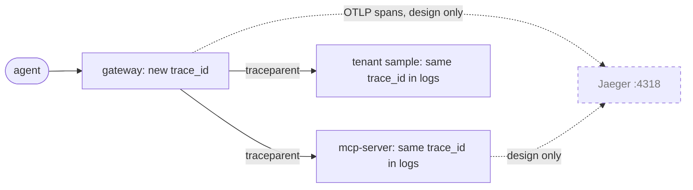

# 09 · Contracts and observability

> **Status**
> - **BUILT**: MCP tool names, schemas and namespacing; W3C `traceparent` propagation from the gateway to platform and tenant targets; `trace_id` in every JSON log line; Jaeger running.
> - **DESIGN ONLY**: OpenAPI specs and versioning (there are no spec files in the repo), the CI breaking-change check, OpenTelemetry spans, metrics, SLO measurement and burn-rate alerts.

Acronyms used here:
- **API**: Application Programming Interface.
- **CI**: Continuous Integration.
- **OTel**: OpenTelemetry.
- **OTLP**: OpenTelemetry Protocol.
- **SLO**: Service Level Objective.
- **W3C**: World Wide Web Consortium.

## 1. Contracts

**Analogy.** A restaurant menu. You can add dishes any time, but you don't silently change what "dish 12" is. If you must, it gets a new number, and the old one stays on the menu for a while.

### OpenAPI (design only)
The RFC rules:
- one spec per target, with the version in the path (`/v1`);
- only additive changes inside a version (new optional fields, new endpoints);
- a breaking change ships as `/v2`, while `/v1` keeps working with `Deprecation` and `Sunset` headers;
- a GitHub Actions job diffs each spec against `main` and fails on breaking changes.

None of this exists in the repo. The built targets speak MCP, not REST.

### MCP tools (applied today)
The RFC rules: tool names are stable, new input parameters are optional, and a breaking change becomes a new tool name.

In the code:
- tools declare an input schema (zod) and, for `get_balance` and `get_client_note`, an output schema, so `structuredContent` is validated by the SDK;
- the gateway exposes tools as `<target>__<tool>` and passes the upstream schemas through unchanged;
- amounts are decimal strings, never JSON numbers, because a float64 can't hold wei values exactly.

**In AWS this is…** AgentCore Gateway building tools from OpenAPI targets (verify in AWS docs), and the same versioning discipline.

## 2. Tracing today

**Analogy.** A tracking number on a parcel, written on the label at the first depot and copied onto every handover slip, but with no website yet to look the journey up.

**Technical** (built):
- The **gateway** starts every trace. It ignores an incoming `traceparent`, so callers can't inject or collide with trace ids. It creates `trace_id` and sends `traceparent: 00-<trace_id>-<span_id>-01` on every call to a target (`src/apps/shared/mcp-http-handler.ts`, `trace.ts`, `McpTargetClient`).
- The **MCP server** and the **tenant sample server** continue the trace from that header.
- **Every log line** of a request carries `trace_id` (and `tenant_id`, `sub` and `act` once known).
- **No spans are created or exported.** Jaeger (:16686, OTLP on :4318) runs but receives nothing.

To follow one call today: take `trace_id` from the gateway's `"msg":"mcp request"` line and search the other terminals for it (`docs/verify.md`, step 7a).

**Design (RFC).** The OpenTelemetry context starts at the gateway and travels through Lambda, SQS message attributes and relay messages. Logs carry `trace_id`, `tenant_id`, `target_id` and `correlation_id`. `correlation_id` doesn't exist in the code yet, and `target_id` appears only on the gateway's target-related lines.

**In AWS this is** AWS X-Ray and CloudWatch, fed by the AWS Distro for OpenTelemetry, plus CloudWatch Logs for the JSON lines.

## 3. SLOs

**Analogy.** A bus company promising "99.5% of buses on time this month". The 0.5% it may miss is its **error budget**. If it burns through that budget in a week, alarms ring. One late bus doesn't.

All four SLOs are design only, because nothing measures them yet. They're over 28 days, per tenant.

| SLO | Target | Status | What exists today |
| --- | --- | --- | --- |
| Tool calls answered without a gateway-caused error | 99.5% | Design only | Errors are typed and logged (`isError` texts, breaker transitions); no metrics |
| Sync tool latency p95, excluding provider time | under 800 ms | Design only | `duration_ms` on the `mcp request` log line |
| Relay round trip p95 | under 3 s | Design only | No relay |
| Final transactions visible after finality | 99% within 2 min | Design only | No ingestion |

**Alerting (RFC).** Alerts fire on error-budget **burn rate**, not single failures. **Target failures are measured separately** from gateway failures, so a tenant's broken server doesn't burn the platform's budget. The breaker's `failure` classification (chapter 05) is the starting point for that split.
