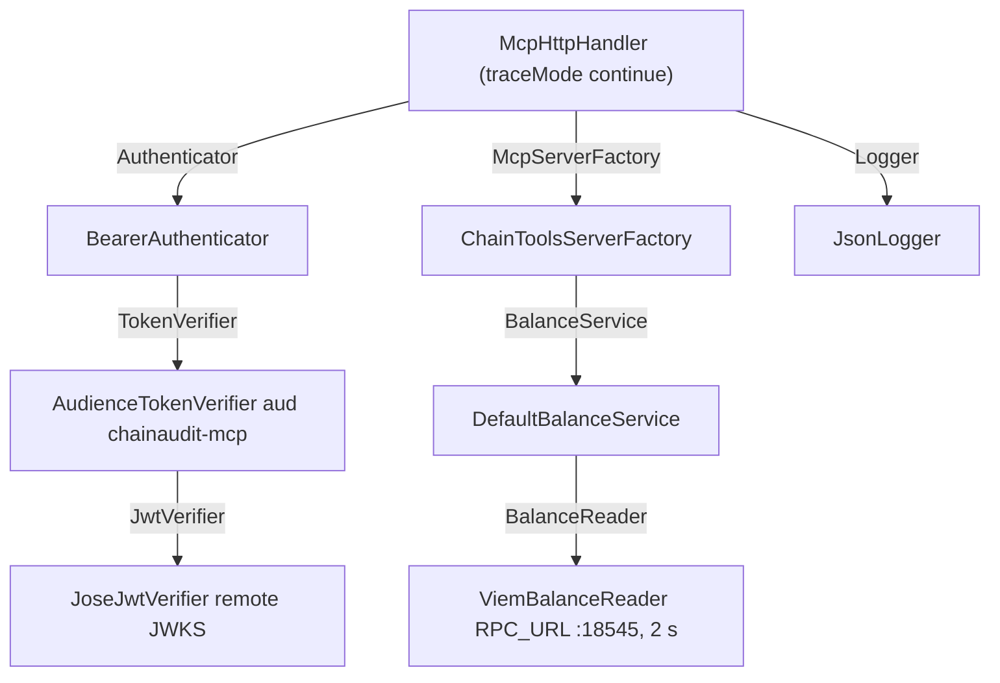
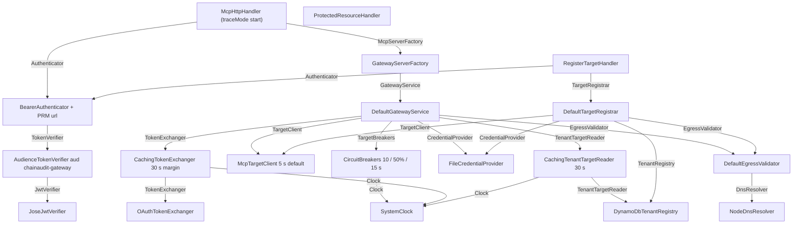
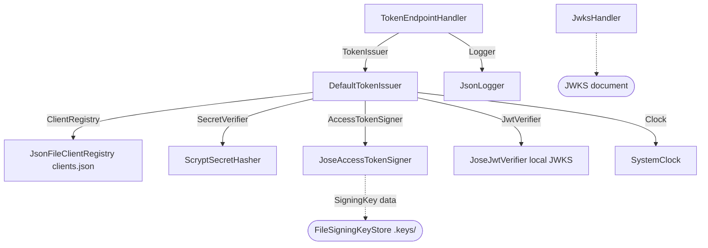

# 10 · Code tour

> **Status:** BUILT. Everything in this chapter exists under `src/`, `scripts/` and `infra/`. Adapters marked "design only" in the AWS column don't exist yet.

## Folder layout

```
src/
  core/                 domain logic and port interfaces (no AWS SDK, no HTTP framework, no DB driver)
    ports/              interfaces core needs from the outside world
    auth/               AudienceTokenVerifier, CachingTokenExchanger
    balance/            BalanceService (+ test)
    egress/             SSRF / DNS rebinding validation, IP ranges (+ test)
    gateway/            routing and policy: catalog, GatewayService (+ test), TargetConfig
    issuer/             OAuth grants: TokenIssuer (+ test)
    registry/           tenant target registration, registry cache, secret refs (+ test)
    resilience/         CircuitBreaker, CircuitBreakers (+ test)
    errors.ts, units.ts
  adapters/
    local/              implementations for local development (and some that are environment-neutral)
    aws/                AWS SDK implementations (today: DynamoDbTenantRegistry)
  apps/                 runnable entry points, one composition root (main.ts) each
    gateway/  mcp-server/  token-issuer/  tenant-sample-server/
    shared/             code more than one app uses: bearer auth, MCP HTTP handler, trace ids
scripts/                seed-anvil, setup-dynamodb, hash-secret, chaos, verify.sh
infra/                  docker-compose.yml, toxiproxy/toxiproxy.json
docs/                   rfc-001.md (design), verify.md (runbook), sql-lab.sql, diagrams/, guide/
```

The folder `src/apps/workers/` from the CLAUDE.md layout doesn't exist yet: the workers are design only.

## Ports and adapters

> **Analogy:** a wall socket. The appliance (core logic) only knows the socket's shape; any plug that fits (a local file, DynamoDB, AWS Secrets Manager) can be swapped in without rewiring the appliance.

**Technical.** `src/core` declares *ports*, which are interfaces for what it needs (time, tokens, a registry, DNS, a way to call a target). *Adapters* implement them with real technology. Core never imports an adapter, which `grep -rn "adapters/" src/core` confirms. Only a `main.ts` decides which adapter fills which port.

**In AWS this is…** the same code with different adapters: a Secrets Manager credential provider instead of files, DynamoDB without a local endpoint, Cognito's JWKS instead of the local issuer's. Switching is configuration and wiring, not changes in `src/core`.

### Every port

| Port (`src/core/ports/`) | What core needs | Local adapter | AWS adapter |
| --- | --- | --- | --- |
| `TokenVerifier` | Verify a token for this service's own audience | `AudienceTokenVerifier` (core) over a `JwtVerifier` | same, over Cognito's JWKS (design only) |
| `JwtVerifier` | Verify a JWT for an audience chosen per call | `JoseJwtVerifier` (`remoteKeys` or `localKeys`) | same class, Cognito JWKS URL (design only) |
| `TokenExchanger` | Get a token for a target on behalf of the caller | `OAuthTokenExchanger` (RFC 8693), wrapped by `CachingTokenExchanger` | AgentCore Identity outbound auth; verify in AWS docs (design only) |
| `AccessTokenSigner` | Sign a JWT access token | `JoseAccessTokenSigner` | Cognito issues tokens itself (no adapter needed) |
| `SecretVerifier` | Check a client secret, constant work for unknown clients | `ScryptSecretHasher` | Cognito (no adapter needed) |
| `ClientRegistry` | Find an OAuth client | `JsonFileClientRegistry` (`clients.json`) | Cognito app clients |
| `BalanceReader` | Read a wallet balance from a chain | `ViemBalanceReader` (RPC URL, 2 s, 0 retries) | same class, pointed at a node provider |
| `TargetClient` | List and call tools on a target | `McpTargetClient` (MCP SDK client, pinned undici agent) | same class (environment-neutral) |
| `TenantTargetReader` / `TenantRegistry` | Read and write tenant targets and settings | `CachingTenantTargetReader` (core decorator) over `DynamoDbTenantRegistry` | `DynamoDbTenantRegistry` without an endpoint (it already lives in `adapters/aws`) |
| `CredentialProvider` | Get or put a tenant secret, tenant-checked | `FileCredentialProvider` (`.secrets/`) | Secrets Manager + IAM ABAC (design only) |
| `DnsResolver` | Resolve a hostname to all its IPs | `NodeDnsResolver` (`dns.lookup`, 2 s) | same class |
| `Clock` | Current time in seconds | `SystemClock` | same class |
| `Logger` | Structured logs with fields | `JsonLogger` (JSON lines on stdout) | same, collected by CloudWatch Logs |

Two driving-side interfaces live in `src/apps/shared/`: `Authenticator` (filled by `BearerAuthenticator`) and `McpServerFactory` (filled by `ChainToolsServerFactory` and `GatewayServerFactory`). The core services also have interfaces that apps depend on: `BalanceService`, `GatewayService`, `TokenIssuer`, `TargetRegistrar`, `EgressValidator`, `TargetBreakers`.

## Composition roots

> **Analogy:** a kitchen's mise en place. Every ingredient is prepared and laid out in one spot, in the order the recipe needs, before cooking starts.

**Technical.** Each app has exactly one `main.ts` that:
1. parses configuration once with zod (`parseConfig(process.env)`);
2. builds adapters;
3. builds core services;
4. builds handlers;
5. registers HTTP routes.

Nothing else reads `process.env`, and nothing else calls `new` on a dependency. Per-request objects (MCP servers, transports) come from injected factories.

**In AWS this is…** the Lambda handler module's top level: it runs once per cold start and wires the same graph.

### mcp-server (`src/apps/mcp-server/main.ts`)


### gateway (`src/apps/gateway/main.ts`)


### token-issuer (`src/apps/token-issuer/main.ts`)


### tenant-sample-server (`src/apps/tenant-sample-server/main.ts`)
`NotesHttpHandler(KeyGuard → ApiKeyGuard, NotesServerFactory → ClientNotesServerFactory, Logger → JsonLogger)`. It plays a third party, so it has no token verification, only an API key check.

## Shared app code
- `bearer-auth.ts`: `BearerAuthenticator` turns `Authorization: Bearer …` into a `Principal`, or into a 401/503 with the right `WWW-Authenticate` header.
- `mcp-http-handler.ts`: the stateless MCP request pipeline. It sets the trace id, authenticates, creates a per-request server and transport, and logs one `mcp request` line per call.
- `trace.ts`: `traceIdFrom`, `newTraceId`, `traceparentFor`.

## Tests

> **Analogy:** a flight simulator. The pilot (core logic) flies real procedures against simulated instruments (fakes), so failures can be practiced safely and on cue.

Six test files run with `pnpm test` (vitest). There are no mocking libraries, no network and no Docker: every port is replaced by a small hand-written fake class.

| File | What it proves |
| --- | --- |
| `core/balance/balance-service.test.ts` | Wei and ether as exact strings; provider errors pass through |
| `core/issuer/token-issuer.test.ts` | Expiry with a fixed clock; `invalid_scope` signs nothing; the exchanged `exp` is capped at the subject's |
| `core/gateway/gateway-service.test.ts` | Default deny; no target call without scope; exactly one scope exchanged; tenant isolation; API key not token; pinning; rebinding stopped; breaker isolation |
| `core/registry/target-registrar.test.ts` | Secret under the tenant path; idempotent re-register; conflict; quota; egress refusal writes nothing; pending with a reason |
| `core/egress/egress-validator.test.ts` | Every blocked case, including mixed public and private answers and local mode limits |
| `core/resilience/circuit-breaker.test.ts` | Window rule, open, one probe, reopen, 4xx not counted |

## How to add a new tool
1. **The tool.** On a platform server (e.g. the MCP server), register it in that server's factory, e.g. `ChainToolsServerFactory.create` with `server.registerTool(name, { inputSchema, outputSchema }, callback)`.
   - The callback must never throw: it maps errors to `isError`.
   - It checks its own scope (as `TOOL_SCOPES` does).
2. **A port, if needed.** If the tool needs new data, add a port in `src/core/ports`, a core service that uses it, and an adapter, then wire them in that app's `main.ts`.
3. **Expose it through the gateway.** Add the tool to the target's `toolScopes` in `src/apps/gateway/targets.ts`. Without that entry the gateway hides and refuses it (default deny).
4. **Tests.** Add a core test with fakes, and a check in `scripts/verify.sh`.

## How to add a new target type
Today there are two: platform targets (`TargetConfig`, token exchange) and tenant targets (`TenantTarget`, API key). A new kind would need:
1. **Its credential.** A new `TargetCredential` variant in `ports/target-client.ts` (e.g. `oauth_client_credentials`), and `credentialHeader` support in `McpTargetClient`.
2. **Where it's stored and how it's obtained.** The `TenantTarget.authType` union, the registration body schema (`register-target-handler.ts`), and a resolver in `DefaultGatewayService` (next to `tenantCredential` / `platformCredential`).
3. **A non-MCP protocol** (e.g. a plain REST/OpenAPI target, which AgentCore supports; verify in AWS docs). This means a new `TargetClient` adapter, plus a way to describe its tools (from the OpenAPI spec).
4. **The same protections.** Egress validation, breaker keys `tenant|target`, and tests for isolation.
