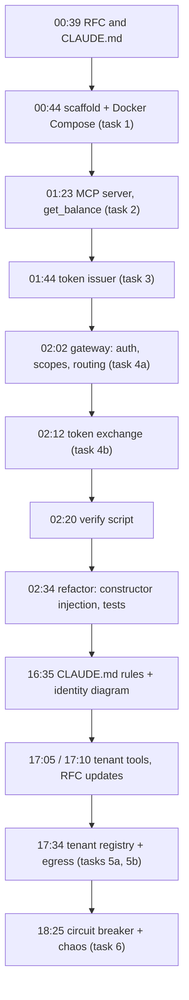

# 11 · How it was built with AI

> **Status:** factual record, based on what the repository contains:
> - the commit history;
> - `CLAUDE.md`;
> - the RFC and its "What changed after building" section;
> - the pins in `package.json`;
> - the `// LEARN:` comments;
> - `docs/verify.md`, `scripts/verify.sh` and `docs/diagrams/`.
>
> Where a point comes from the working sessions and not from a file, it says so.

Acronyms used here:
- **RFC**: Request for Comments, used here as the project's design document.
- **AI**: Artificial Intelligence.

## 1. Design first, then code

**Analogy.** An architect's drawing before the builders arrive. Builders may find the ground is different from the drawing, but they write that down rather than quietly moving walls.

`docs/rfc-001.md` was committed **before any code** (commit `de520fa`, together with `CLAUDE.md`). It sets:
- the goals and non-goals;
- a build plan with hard cut lines per day;
- the alternatives considered;
- a closing section, "What changed after building", for every assumption that proved wrong.

`CLAUDE.md` names it "the source of truth".

## 2. `CLAUDE.md` as the agent's rules

`CLAUDE.md` is the instruction file the coding agent reads at the start of every session. Its "How we work" rules:

| Rule | What it caused in practice |
| --- | --- |
| One task at a time from the RFC build plan; start in plan mode and wait for approval | Every task began with a written plan, approved before any file changed |
| If the RFC and reality disagree, stop, tell, and propose a "What changed" line | Six lines in the RFC's "What changed" section (Cognito `aud`, prefixed scopes, `tenant_id` trigger, quota transaction, API keys for tenant targets, partial quotas) |
| The human runs and verifies everything; no Docker, servers or test suites started by the agent | Every task ended with exact commands and expected output, which led to `docs/verify.md` and `pnpm verify` |
| No dependency without name, exact version and reason; pinned; at least two weeks old | `package.json` uses exact versions; `jose` is pinned to 6.2.12 with a `pnpm.overrides` entry (6.2.13 was too new); `vite` 8.3.4 is pinned explicitly as vitest's peer for the same reason |
| Small changes, a suggested commit message | One commit per task in `git log` |
| No code for tasks that aren't the current one | Later features appear only as `TODO(task …)` until their task |
| (added later) Report affected RFC sections and wait for approval before editing the RFC; never edit `docs/diagrams/` | RFC edits only after approval; diagrams kept as snapshots (`01-…`, `02-…`) |

It also holds the architecture rules (ports and adapters, `tenant_id` only from tokens, timeouts on every outbound call, no token forwarding, …) and the **Comments** rule: `// LEARN:` comments explain *why*, not *what*. The code has 69 of them.

## 3. The human verifies

The agent didn't start servers or run the test suite in your environment. Within the sessions (this isn't recorded in files), it type-checked on a separate copy of the repo and ran a few throwaway checks in a scratch directory, for example confirming that the pinned undici connection keeps the `Host` header. Running the system was always the human's step.

The runbook grew from that rule:
- `docs/verify.md`: from-scratch steps, manual commands, manual checks;
- `scripts/verify.sh` (`pnpm verify`): about 90 automated PASS/FAIL checks (93 in the last full run).

Real failures found this way, and fixed:
- **A paste problem, not a bug:** a pasted command broke because a long header wrapped while being pasted, and DynamoDB Local answered "Line Folding not supported".
- **A zsh bug in the verify commands** (from the sessions): helper functions used `${2:+…}`, which zsh doesn't split. The manual commands were rewritten.
- **Stale expectations in the verify script:** it expected the old default scopes after `tenant:tools` was added. Found by running `pnpm verify`, then fixed. A HINT was also added for stale DynamoDB data (a 409 on `notes`).

## 4. Deviations reported, not hidden

Examples visible in the repository:
- **The RFC's "What changed" section** records where Cognito and the design differ from reality, and where the build chose differently.
- **The diagram documents** (`docs/diagrams/*.md`) end with a "Code vs. RFC" list. They're drawn from the code, not from the RFC.
- **`TODO(task 5b)`** marked the missing URL validation in task 5a until 5b removed it.

From the sessions (not in files):
- **The two-week rule could only be enforced on direct dependencies.** Some packages pulled in by them (e.g. `@aws-sdk/*`, `@smithy/*`, `body-parser`) resolved to versions under two weeks old. A pnpm `minimumReleaseAge` setting was proposed and is **not applied**.
- **Task 6 differed from the RFC.** Its breaker parameters (10 calls, 15 s, 1 probe) differ from the RFC's (20, 30 s, 3), and a "What changed" line was proposed for it; it's still awaiting approval.

## 5. Plan mode before every task

Each task started with a plan covering the context, the design (state machine, key design, flows), files, dependencies, the RFC impact, and the verification commands. It was approved before any code was written. When something in a plan was a real choice, the agent asked:
- the scope for tenant tools → `tenant:tools`;
- local-mode HTTP and IP-literal decisions.

## 6. Timeline (from `git log`)

All 14 commits are dated 2026-10-25. Commit messages were written by the human. The agent only suggested them.

## 7. What this means for the interview
- **How output is verified:** the human runs every check, with expected outputs written down before the run.
- **Guardrails:** the rules live in a file the agent must follow (`CLAUDE.md`), plus the dependency-age and pinning rules and plan approval.
- **Honesty:** the RFC's "What changed" section, the diagrams' difference lists, and this guide's "Known gaps" chapter (12).
- **Mentoring:** the LEARN comments and this guide are meant to be read by someone learning the codebase.
