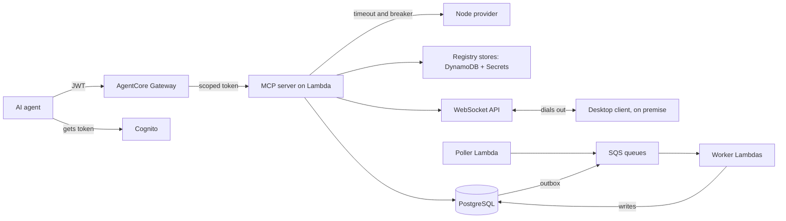

# RFC: ChainAudit Agent Gateway (practice project)

October 2026 · Cris

## Context and goals

This project builds a small but real version of Caseware's agent integration layer in two and a half days, so every design decision can be defended from hands on experience in a 90 minute technical interview.

**Business scenario.** Audit firms (the tenants) audit clients that hold digital assets on EVM chains. The firms' AI agents need MCP tools to fetch on chain transactions and balances and to reconcile them against the client's ledger. That ledger lives in an on premise desktop application, not in the cloud.

The domain is chosen on purpose: node providers (RPC endpoints) fail and throttle in real life, so they are a genuine untrusted third party. Chain reorganizations force real deduplication. The on premise ledger justifies the relay.

**Success by Monday:**

- An agent calls a tool through a gateway built locally, with a valid token, and gets data; a token without the right scope is rejected. One tool is also deployed behind AgentCore Gateway to compare it with the local one.
- A failing node provider opens the circuit breaker for one tenant only, while other tenants keep working.
- Reconciliation runs as an async job, using SQL joins over PostgreSQL with idempotent job creation.
- Every decision in this RFC can be explained out loud in English, together with the alternative it beat.

## Scope and non goals

The scope covers every Department Specific Responsibility in the job description at a working minimum, plus the SQL layer that past interviews keep asking about.

**In scope:** MCP server on Lambda, AgentCore Gateway with inbound auth and scopes, tenant registry with credentials and egress control, circuit breaker per tenant and target, event driven ingestion, async reconciliation over PostgreSQL, WebSocket relay to a local desktop client, tracing with tenant ID, versioned OpenAPI contracts.

**Non goals:** production hardening, a user interface, multiple regions, real customer data. Agent to agent targets and model routing are covered as one paragraph of design, not code. Infrastructure is Terraform, not CDK, because speed matters more than tool novelty this weekend.

## Local first strategy

Every component runs locally first, so the concepts are mastered before a managed service hides them; AWS comes last and only for the small piece that cannot be emulated.

**Ports and adapters.** Business logic depends on interfaces (TokenVerifier, TenantRegistry, CredentialProvider, TransactionRepository, EventPublisher), never on an AWS SDK directly. Each interface has a local adapter and an AWS adapter, and switching between them is configuration, not code. This is dependency inversion in practice, a good example for the SOLID question.

| Component                | Local                                                               | AWS                              |
| ------------------------ | ------------------------------------------------------------------- | -------------------------------- |
| Lambda handlers          | Plain functions behind a Node HTTP server                           | Lambda                           |
| Token issuer             | Own issuer with the jose library and a public keys endpoint (JWKS)  | Cognito                          |
| Gateway                  | Own gateway: validates token, checks scopes, routes to targets      | AgentCore Gateway, one tool only |
| Registry and idempotency | DynamoDB Local (official AWS image)                                 | DynamoDB                         |
| Secrets                  | Emulator, or a file adapter                                         | Secrets Manager                  |
| Domain database          | PostgreSQL in Docker                                                | Aurora Serverless v2, optional   |
| Queues                   | SQS emulator plus an own polling loop                               | SQS with Lambda event source     |
| Scheduler                | setInterval                                                         | EventBridge Scheduler            |
| Relay                    | ws library imitating connect, default and disconnect routes         | API Gateway WebSocket            |
| Node provider            | Anvil from Foundry, behind Toxiproxy to inject latency and failures | Public RPC provider              |
| Tracing                  | OpenTelemetry with Jaeger in Docker                                 | CloudWatch and X-Ray             |

**Emulator choice.** Since March 23, 2026 LocalStack requires a free auth token for non commercial use. Floci is an MIT licensed alternative with no account; not yet tested here.

**What local cannot prove.** IAM policies with tag conditions, SigV4 signing and AgentCore behavior. Emulators support IAM only partially and may accept requests AWS would reject, so nothing about permissions counts as validated until it runs in AWS.

## What AgentCore Gateway does

AgentCore Gateway is a managed MCP front door: it turns existing APIs, Lambda functions and MCP servers into tools that agents discover and call, and it enforces authentication on the way in and credentials on the way out.

| AgentCore concept | Local equivalent built here |
| --- | --- |
| Inbound authorizer that validates agent JWTs | Gateway middleware using jose |
| Targets: Lambda, OpenAPI specs, existing MCP servers | Route table in the tenant registry |
| Outbound credential providers in AgentCore Identity (OAuth, API keys) | CredentialProvider adapter reading tenant secrets |
| One merged tool catalog across targets | Gateway answering tools/list by aggregating its targets |
| Built in observability | OpenTelemetry and Jaeger |

Open question: confirm the exact target types, the semantic tool search feature and the rate limiting options in the current AgentCore docs.

**Interview stance.** "I understand AgentCore conceptually, I built the equivalent pieces myself to learn them, and I deployed one tool behind it in a practice account. I haven't run it in production."

## Domain model

Eight entities split across two stores: DynamoDB for what the gateway reads on every request, PostgreSQL for domain data that needs joins and constraints.

| Entity | Owned by | Natural key | Store |
| --- | --- | --- | --- |
| Tenant (audit firm) | Platform | tenant_id | DynamoDB |
| Target registration | Tenant | tenant_id + target_id | DynamoDB |
| Idempotency record | Caller | tenant_id + idempotency_key | DynamoDB |
| Engagement (client under audit) | Tenant | engagement_id | PostgreSQL |
| Watched address | Engagement | chain_id + address | PostgreSQL |
| Chain transaction | Engagement | chain_id + tx_hash + log_index | PostgreSQL |
| Ledger entry | Client, synced through the relay | engagement_id + entry_ref | PostgreSQL |
| Reconciliation job | Engagement | engagement_id + idempotency_key | PostgreSQL |

The same on chain transaction can matter to two engagements of different tenants, so it is stored once per engagement, never shared across tenants.

## Architecture overview

Twelve components in three rows: the synchronous request path on top, state in the middle, async work and the on premise client at the bottom.



External agents only enter through the gateway, and desktop clients only connect through a WebSocket they open themselves, so nothing on premise accepts inbound traffic.

## MCP server and AgentCore Gateway

One stateless MCP server on Lambda exposes five tools behind AgentCore Gateway, and every tool requires its own scope.

| Tool | Scope | Flow | Notes |
| --- | --- | --- | --- |
| get_transactions | chain:read | Sync | Paginated by block number |
| get_balance | chain:read | Sync | Falls back to last known value when the provider is down |
| start_reconciliation | recon:write | Async | Requires an idempotency key, returns job_id |
| get_reconciliation_status | recon:read | Sync | Polled by the agent |
| fetch_client_ledger | ledger:read | Relay | Reaches the on premise desktop client |

**Transport.** Streamable HTTP in stateless mode: every request carries everything it needs, so any Lambda instance can serve it. Stateful MCP sessions would force sticky routing, which Lambda cannot give.

**Inbound auth.** Agents get a JWT from Cognito with the client credentials flow. The gateway's inbound authorizer validates issuer, audience and expiry. The server checks the scope again per tool, as defense in depth.

**Rate limiting.** A token bucket per tenant and per agent client. Open question: check what AgentCore Gateway enforces natively before building it; if nothing, store counters in DynamoDB with a short TTL (time to live, automatic expiry).

**Errors.** Business failures return an MCP tool result with isError true and a clear message, so the agent can reason about them. Protocol or auth failures return JSON-RPC or HTTP errors.

## Tenant registry and isolation

Isolation rests on one rule: the tenant comes from the verified token, never from the request body, and every resource the code touches is scoped by that value.

**Registering a target:**

1. Tenant admin submits name, base URL, auth type and credential.
2. URL validation: HTTPS only, domain on the tenant's approved allowlist, DNS resolved and every resulting IP checked against private, loopback and link local ranges, including 169.254.169.254 (the instance metadata endpoint).
3. The credential goes to Secrets Manager at /tenants/{tenant_id}/targets/{target_id}, tagged with tenant_id. DynamoDB stores only the secret's ARN.
4. Target starts in a pending state and becomes active after a health probe succeeds.

**Egress control at call time.** Resolve DNS again and connect to the checked IP, so a domain cannot pass validation and later resolve to an internal address (DNS rebinding).

**Credential isolation.** The shared Lambda assumes a role through STS with a session tag tenant_id. The role's policy only allows reading secrets whose tag matches that session tag (ABAC, attribute based access control). A bug that passes the wrong tenant ID still cannot read another tenant's secret.

**Quotas per tenant:** maximum registered targets, requests per minute and concurrent in flight calls. Exceeding them returns 429 to that tenant only.

## Identity and scope propagation

No token ever travels past the hop it was issued for: each hop validates what it received and gets a new, narrower credential for the next one.

| Hop | Credential presented | What the receiver checks |
| --- | --- | --- |
| Agent to gateway | Cognito JWT, audience = gateway | Signature, issuer, audience, expiry, scopes |
| Gateway to MCP target | Short lived token minted for that target (OAuth token exchange, RFC 8693), carrying sub, tenant_id and narrowed scopes | Audience = this target, scope for the tool |
| Target to AWS backend | SigV4 signature from an STS role session tagged with tenant_id | IAM policy with tag conditions |
| Target to node provider | The tenant's own API key from Secrets Manager | Provider side |
| Cloud to desktop client | Relay session bound to tenant_id and device_id at connect time | Desktop verifies the request's tenant matches its session |

**Rules:**

- Scopes only shrink along the chain, never grow.
- Every hop logs trace_id, tenant_id, sub and the acting service, so any backend action traces back to the original agent and user.
- Token passthrough is forbidden by the MCP authorization spec: it skips audience checks and turns the gateway into a confused deputy, a service tricked into using its own privileges for someone else.

Open question: confirm which of these hops AgentCore Identity handles natively (outbound OAuth and API key credential providers) and which ones need custom code.

## Third party failure containment

A misbehaving target must cost its own tenant a fast, clear error and cost every other tenant nothing.

| Mechanism | Setting | Why |
| --- | --- | --- |
| Timeout | 2 s per provider call, capped by the caller's remaining deadline | A slow target is worse than a dead one: it holds capacity |
| Retries | Max 2, exponential backoff with full jitter, idempotent reads only; 429 honors Retry-After | Retrying writes duplicates side effects; jitter avoids synchronized retry storms |
| Circuit breaker | Key tenant_id + target_id; opens at 50% failures over the last 20 calls; 30 s cooldown; 3 probes in half open | Fail fast and give the target room to recover |
| Bulkhead | Max concurrent calls per tenant | One tenant's slow target cannot use up all Lambda concurrency |
| Degradation | get_balance returns the last known value with a stale_as_of field | The agent gets a useful, honest answer instead of nothing |

**Breaker states.** Closed: calls pass and failures are counted. Open: calls fail immediately without touching the target. Half open: after the cooldown, a few probes go through; success closes the breaker, failure opens it again.

**Where breaker state lives.** Each Lambda instance keeps its own breaker in memory, and writes to DynamoDB only on state transitions so new instances start informed. Fully shared state on every call would add a write per request; per instance only state reacts slower. This trade off is a likely follow up question.

**SLO impact.** Target failures are measured apart from gateway failures, so a tenant's broken server does not burn the platform's error budget.

## Data layer

DynamoDB serves the gateway's hot path with single key lookups; PostgreSQL holds the domain, where reconciliation needs joins, unique constraints and multi row transactions.

**Hosting.** Aurora Serverless v2 PostgreSQL with the Data API, so Lambda talks to it over HTTPS without a VPC or NAT gateway. Verify current minimum capacity and auto pause pricing before creating it; fallback is a free external Postgres or Docker locally.

**Schema:**

```sql
CREATE TABLE engagements (
  id          uuid PRIMARY KEY,
  tenant_id   text NOT NULL,
  client_name text NOT NULL,
  created_at  timestamptz NOT NULL DEFAULT now()
);
CREATE INDEX idx_engagements_tenant ON engagements (tenant_id);

CREATE TABLE chain_transactions (
  id            bigserial PRIMARY KEY,
  engagement_id uuid NOT NULL REFERENCES engagements(id),
  chain_id      int NOT NULL,
  tx_hash       text NOT NULL,
  log_index     int NOT NULL,
  block_number  bigint NOT NULL,
  block_hash    text NOT NULL,
  amount        numeric(78,0) NOT NULL,
  status        text NOT NULL DEFAULT 'pending'
                CHECK (status IN ('pending','final','orphaned')),
  UNIQUE (engagement_id, chain_id, tx_hash, log_index)
);
CREATE INDEX idx_tx_recent  ON chain_transactions (engagement_id, block_number DESC);
CREATE INDEX idx_tx_pending ON chain_transactions (chain_id, block_number)
  WHERE status = 'pending';

CREATE TABLE ledger_entries (
  id            bigserial PRIMARY KEY,
  engagement_id uuid NOT NULL REFERENCES engagements(id),
  entry_ref     text NOT NULL,
  tx_hash       text,
  amount        numeric(78,0) NOT NULL,
  UNIQUE (engagement_id, entry_ref)
);
CREATE INDEX idx_ledger_tx ON ledger_entries (engagement_id, tx_hash);

CREATE TABLE reconciliation_jobs (
  id              uuid PRIMARY KEY,
  engagement_id   uuid NOT NULL REFERENCES engagements(id),
  idempotency_key text NOT NULL,
  status          text NOT NULL DEFAULT 'queued',
  created_at      timestamptz NOT NULL DEFAULT now(),
  UNIQUE (engagement_id, idempotency_key)
);
CREATE INDEX idx_jobs_open ON reconciliation_jobs (created_at)
  WHERE status IN ('queued','running');

CREATE TABLE outbox (
  id           bigserial PRIMARY KEY,
  event_type   text NOT NULL,
  payload      jsonb NOT NULL,
  created_at   timestamptz NOT NULL DEFAULT now(),
  published_at timestamptz
);
CREATE INDEX idx_outbox_unpublished ON outbox (id) WHERE published_at IS NULL;
```

**Index choices to defend.** Composite indexes follow the query's equality columns first, then the range or sort column. Partial indexes cover only the rows a worker scans (pending transactions, open jobs, unpublished events), so they stay small. Every UNIQUE constraint is also an index.

**Deduplication.** Ingestion uses INSERT ... ON CONFLICT DO NOTHING on the unique key. Never check then insert: two concurrent writers can both pass the check. A reorg marks rows orphaned when their block_hash no longer matches the canonical chain, instead of deleting them, so the audit trail survives.

**Atomic, idempotent job creation:**

```sql
BEGIN;
INSERT INTO reconciliation_jobs (id, engagement_id, idempotency_key)
VALUES ($1, $2, $3)
ON CONFLICT (engagement_id, idempotency_key) DO NOTHING
RETURNING id;
-- no row returned: SELECT the existing job, return it, skip the outbox
INSERT INTO outbox (event_type, payload)
VALUES ('reconciliation.requested', jsonb_build_object('job_id', $1));
COMMIT;
```

The job and its event commit together or not at all. A retried request with the same key returns the original job.

**Workers claim jobs safely:**

```sql
SELECT id FROM reconciliation_jobs
WHERE status = 'queued'
ORDER BY created_at
LIMIT 10
FOR UPDATE SKIP LOCKED;
```

Concurrent workers skip rows another worker already locked, so no job runs twice and nobody waits.

**Reconciliation join:**

```sql
SELECT
  COALESCE(c.tx_hash, l.tx_hash) AS tx_hash,
  c.amount AS chain_amount,
  l.amount AS ledger_amount,
  CASE
    WHEN l.id IS NULL THEN 'missing_in_ledger'
    WHEN c.id IS NULL THEN 'missing_on_chain'
    WHEN c.amount <> l.amount THEN 'amount_mismatch'
    ELSE 'matched'
  END AS result
FROM (SELECT * FROM chain_transactions
      WHERE engagement_id = $1 AND status = 'final') c
FULL OUTER JOIN (SELECT * FROM ledger_entries
                 WHERE engagement_id = $1) l
  ON l.tx_hash = c.tx_hash;
```

A FULL OUTER JOIN keeps unmatched rows from both sides, which are exactly the findings an auditor cares about. Filtering inside the subqueries keeps the engagement filter from turning the outer join into an inner join.

**Tenant isolation in SQL.** Every query filters by engagement, which belongs to one tenant. Row Level Security on tenant_id is the stronger option to discuss, not to build this weekend.

## Sync and async flows

A tool stays synchronous only if it finishes in a few seconds and the agent needs the answer to continue; anything long, retriable or dependent on the on premise client becomes a job.

**Ingestion (event driven):**

1. EventBridge Scheduler triggers a poller Lambda every minute.
2. The poller reads new blocks for watched addresses and sends one SQS message per transaction.
3. A writer Lambda consumes batches and inserts with ON CONFLICT DO NOTHING. It reports partial batch failures, so only failed messages return to the queue.
4. After 3 failed attempts a message moves to a dead letter queue (DLQ) with an alarm.
5. A finality worker scans pending rows and marks them final or orphaned once enough blocks have passed.

**Reconciliation (async request and reply):**

1. start_reconciliation writes the job and an outbox row in one transaction and returns job_id immediately.
2. An outbox publisher sends unpublished rows to SQS and sets published_at.
3. A worker claims the job with FOR UPDATE SKIP LOCKED, sets it to running inside that same transaction, runs the join and stores the results.
4. The agent polls get_reconciliation_status.

**Why an outbox.** Writing to the database and then publishing to SQS in the handler is a dual write: if the process dies between the two, the job exists but nobody processes it. The outbox makes the event part of the same commit.

**Delivery guarantee.** SQS delivers at least once, so every consumer is idempotent: unique constraints for inserts and status checks before state changes. Exactly once delivery is not assumed anywhere.

## On premise relay

The desktop client always dials out over a WebSocket, so customers open no inbound firewall ports, and every request crossing the relay is matched to its response by a correlation ID.

**Components.** API Gateway WebSocket API owns the connections. A $connect authorizer validates a device token bound to tenant_id and device_id. A DynamoDB connections table maps tenant and device to connection_id, session_id and last_seen.

**Request path:**

1. fetch_client_ledger writes a pending record (correlation_id, status pending, deadline, TTL) to DynamoDB.
2. It sends the request to the desktop with postToConnection.
3. The desktop replies; the $default route Lambda writes the result into the pending record.
4. The original Lambda waits on that record until the result arrives or the deadline passes.

The response can arrive at a different Lambda than the one waiting, which is why the pending record exists. The trade off: polling from Lambda costs time and requests; a stateful service on ECS with an in memory map of pending requests is simpler at scale but no longer serverless.

**Session lifecycle:** connecting, authenticated, active, suspended (disconnected but inside a 60 s resume window) and closed.

**Recovery.** API Gateway closes idle WebSocket connections after 10 minutes and any connection after 2 hours, so reconnection is a normal path, not an edge case. The client sends heartbeats and reconnects with backoff and jitter, presenting session_id and the last sequence number it acknowledged. The server resends requests still pending for that session, and the desktop deduplicates by correlation_id. Requests whose deadline passed fail with a retryable client_offline error.

**Backpressure.** Each session allows at most 10 requests in flight. Beyond that the tool answers 429 immediately instead of piling work onto a slow desktop.

**Degradation.** If the client stays offline, ledger dependent reconciliation waits in a blocked status instead of failing, and resumes when the client reconnects.

## Contracts, observability and SLOs

Contracts change only by addition inside a version, and every request carries one trace ID from agent to backend.

**OpenAPI contracts.** One spec per target in the repo, version in the path (/v1). Inside a version only additive changes are allowed: new optional fields, new endpoints. A breaking change ships as /v2 while /v1 keeps working with a Deprecation and Sunset header. A GitHub Actions job diffs each spec against main and fails the build on a breaking change.

**MCP tool contracts.** Tool names are stable; new input parameters are optional; a breaking change becomes a new tool name, and the old one is kept until usage drops.

**Tracing.** OpenTelemetry context starts at the gateway and travels through Lambda, SQS message attributes and relay messages. Structured logs always include trace_id, tenant_id, target_id and correlation_id.

**SLOs (Service Level Objectives), over 28 days, per tenant:**

| SLO | Target |
| --- | --- |
| Tool calls answered without a gateway caused error | 99.5% |
| Sync tool latency, 95th percentile, excluding provider time | Under 800 ms |
| Relay round trip, 95th percentile | Under 3 s |
| Final transactions visible after finality | 99% within 2 min |

Alerts fire on error budget burn rate, not on single failures, so a short blip does not page anyone but a fast burn does.

## Alternatives considered

Each choice below is the one to state first in the interview, followed by what it costs.

| Decision | Chosen | Rejected | Reason and cost |
| --- | --- | --- | --- |
| MCP server compute | Lambda | ECS Fargate | Matches the stack and scales to zero; costs cold starts and no long lived state |
| Relay host | API Gateway WebSocket | ECS service with in memory sessions | Managed connections; costs the pending record and polling for correlation |
| Domain database | PostgreSQL | DynamoDB only | Reconciliation needs joins and multi row transactions |
| Registry and idempotency | DynamoDB | PostgreSQL | Key lookups on the hot path, no connection pool limits from Lambda |
| Queue | SQS | EventBridge, Kinesis | Point to point with DLQ is enough; EventBridge later for fan out to several consumers |
| Event publication | Transactional outbox | Publish inside the handler | Avoids the dual write gap; costs a publisher and some latency |
| Breaker state | Per instance, shared on transitions | Shared on every call | One write per state change instead of per request; reacts a bit slower |
| Infrastructure as code | Terraform | CDK | Known tool, faster this weekend |

**Future targets, design only.** Agent to agent (A2A) targets plug into the registry as another target type with their own outbound auth. Model routing becomes a target that picks a Bedrock model by cost, latency or capability, behind the same quotas and breakers.

## Risks, cost controls and build plan

The biggest risk is spending the weekend on AWS setup and arriving without spoken design practice, so each day has a hard cut line.

**Risks:**

- AgentCore learning curve. Timebox: the AWS deployment gets Sunday early afternoon only; if one tool is not reachable through AgentCore by then, stop and document what blocked it.
- Aurora setup or cost surprises. Fallback: Postgres in Docker for the SQL work.
- Scope creep. Anything not in the Saturday or Sunday lists below is design only.

**Cost controls before deploying anything:**

- [ ] MFA on the root user; no access keys for root
- [ ] Separate admin user for daily work
- [ ] AWS Budgets alert at a low amount
- [ ] No NAT gateways, no always on instances
- [ ] terraform destroy after the interview

**Saturday, local (must have):**

- [ ] Docker Compose with DynamoDB Local, PostgreSQL, Anvil, Toxiproxy and Jaeger
- [ ] MCP server with get_balance and get_transactions against Anvil, tested with MCP Inspector
- [ ] Local token issuer with jose; own gateway validating token and scopes and routing to the server
- [ ] Tenant registry in DynamoDB Local
- [ ] Timeouts, retries and circuit breaker, with Toxiproxy injecting failures

**Sunday morning, local (should have):**

- [ ] PostgreSQL schema; ingestion through the SQS emulator with ON CONFLICT
- [ ] start_reconciliation with outbox and the reconciliation join

**Sunday early afternoon, AWS (small and timeboxed):**

- [ ] Cost controls done first
- [ ] One tool on Lambda behind AgentCore Gateway with Cognito; note every difference from the local gateway

**Sunday late afternoon (could have):**

- [ ] Local WebSocket relay with a Node client reading a CSV ledger

**Sunday evening and Monday (not negotiable):**

- [ ] Two 45 minute design mocks out loud in English, recorded
- [ ] Five experience stories: situation, decision, rejected alternative, measurable result
- [ ] Answers on AI assisted development: how output is verified, team guardrails, mentoring others

## What changed after building

Every assumption in this RFC that turned out wrong while building goes here, with what was found instead. This section is the best interview material in the document.

- Cognito M2M access tokens carry client_id, not aud; the gateway checks allowed clients in AWS and aud locally.
- Cognito scopes are resource-server-prefixed (chainaudit/chain:read); scope checks must normalize or use the full name.
- tenant_id in Cognito M2M tokens needs a pre-token-generation trigger; check tier and cost.
- Target quota is enforced with a TransactWriteItems counter on the tenant CONFIG item; counting with a Query and then writing races.
- Tenant-owned targets are third parties: the gateway sends the tenant's API key (outbound credential), never a platform token; token exchange is only for platform targets.
- Of the per-tenant quotas, only maximum registered targets is enforced so far; requests per minute and concurrent in flight calls are still open.
